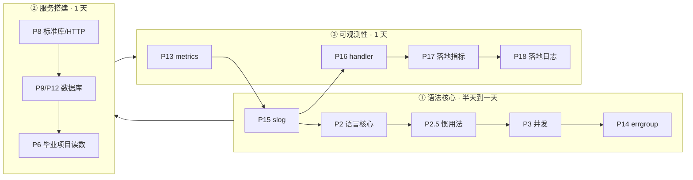

# golearn：Go for Backend 教程（以练代学）

> 面向「已经写过 Rust/Java/Kotlin 的后端」的 Go 速成课。
> 配方仿 `rs/rust-for-frontend`（类比表 + 可运行示例 + 练习驱动 + capstone），
> 交付形态是本地仓库：**每章 = 一份教程 notes + 一个练习包，`go test` 全绿 = 学会**。

## 读者路径（按阶段，不按编号）



| 阶段 | 章 | 回答一个问题 | 怎么读 |
|---|---|---|---|
| ① 语法核心 | P1.5 → P2 → P2.5 → P3 → P14 | Go 这门语言怎么写、怎么写得地道 | 必读，测试要真跑 |
| ② 服务搭建 | P8 → P9 或 P12 → P6 LESSON | 一个真实后端怎么搭 | 必读；有 PG17 直读 P12 |
| ③ 可观测性 | P13 → P15 → P16 → P17 → P18 | 上线后怎么看得见 | 整条弧连读，别拆散 |
| ④ 按需参考 | P1 进阶命令、P19 生态地图、P20 写 CLI 工具、P4/P5（精读法）、P10（gRPC）、P11（goose） | 用到才翻 | 不排进日程 |

- **快速路径（有 Rust/Java 底子）**：①②③ 一共 2-3 天。语法底子厚可把
  P1.5 当字典查（P2/P2.5 仍建议通读：惯用法不是语法能推出来的），跳过
  P4/P5，P12 替代 P9（若装着 PG17）。
- **P1 工具链是 cheat sheet**：open 过一遍知道有什么，之后遇事查表，不背。
- **P4/P5 教的是"怎么读别人的 Go 代码"**：方法会了，两个库本身不用重读。


## 每章怎么打开

```sh
cd /Users/akka/Dev/learning/go
```

1. **正文当讲义读**：从章头“这章学完你能干什么”读起，正文按 2-4 个问题
   组织（场景 → 例子 → 原因 → 失效边界），顺着读。
2. **卡壳才翻章末“参考”**：语法细节、API 清单、大表格都沉在章末，
   要查再翻，不预读。
3. **练习按类型做**：预测题先写下答案再跑测试对答案；观察题跑起来看
   输出；改造题动手改。练习包已全绿（参考实现在练习文件里），先对答案
   再动手。
4. **判过**：Take-away 能向别人复述 + 改坏代码能修回。两件事做到，
   这章就过了，去下一章。

## 课程表

| 章 | 主题 | 教程 | 练习 | 状态 |
|---|---|---|---|---|
| P1 | 工具链：cargo → go | [notes/p1-toolchain.md](notes/p1-toolchain.md) | `exercises/p1tool/` | ✅ 全绿 + 章末进阶 |
| P1.5 | 语法基础速通（12 节 Rust 对照） | [notes/p1_5-basics.md](notes/p1_5-basics.md) | `exercises/p1_5basics/` | ✅ 8 tests |
| P2 | 语言核心：用 Rust 经验写 Go 的四个换直觉问题 | [notes/p2-lang-core.md](notes/p2-lang-core.md) | `exercises/p2lang/` | ✅ 全绿 |
| P2.5 | 范式与惯用法 | [notes/p2_5-idiom.md](notes/p2_5-idiom.md) | `exercises/p2_5idiom/` | ✅ 6 tests |
| P3 | 并发：goroutine/channel/select/context | [notes/p3-concurrency.md](notes/p3-concurrency.md) | `exercises/p3conc/` | ✅ 全绿 -race |
| P4 | 项目精读 A：ejdb（存储引擎） | [notes/p4-ejdb.md](notes/p4-ejdb.md) | `exercises/p4ejdb/` | ✅ 全绿 |
| P5 | 项目精读 B：deepsearch（工程组织/DI） | [notes/p5-deepsearch.md](notes/p5-deepsearch.md) | `exercises/p5deep/` | ✅ 全绿 -race |
| P6 | capstone：go 版 dnsproxi | [notes/p6-capstone-dnsproxi.md](notes/p6-capstone-dnsproxi.md) | `dnsproxi-go/` | ✅ G1-G6 收官+压测 |
| P7 | labs 工程实验（GC/计数器/worker pool） | 无 | `labs/experiments/` | ✅ 六组实验 |
| P8 | 泛型/标准库/测试/HTTP | [notes/p8-fast-track.md](notes/p8-fast-track.md) | `exercises/p8fast/`（含 httpkv） | ✅ 8 tests + 冒烟 |
| P9 | 数据库 database/sql + pgx | [notes/p9-database.md](notes/p9-database.md) | `exercises/p9db/` | ✅ 5 tests + PG 冒烟 |
| P10 | gRPC 四种流 + 拦截器 | [notes/p10-grpc.md](notes/p10-grpc.md) | `exercises/p10grpc/` | ✅ 5 tests + 真机冒烟 |
| P11 | sqlc + goose 数据层 | [notes/p11-sqlc-goose.md](notes/p11-sqlc-goose.md) | `exercises/p11sqlm/` | ✅ 3 tests -race |
| P12 | sqlc + pgx/v5（PG 原生类型） | [notes/p12-sqlc-pgx.md](notes/p12-sqlc-pgx.md) | `exercises/p12pgx/` | ✅ 4 tests -race + PG17 实测 |
| P13 | metrics/observability（Prometheus） | [notes/p13-metrics.md](notes/p13-metrics.md) | `exercises/p8fast/httpkv/` | ✅ /metrics 上线 + 冒烟实拍 |
| P14 | errgroup + pipeline 并发组装 | [notes/p14-pipelines.md](notes/p14-pipelines.md) | `exercises/p14pipe/` | ✅ 8 tests -race（消融+泄漏检测） |
| P15 | slog 结构化日志：404 报障怎么查 | [notes/p15-slog.md](notes/p15-slog.md) | `exercises/p15slog/` + httpkv | ✅ 6 tests -race + req_id 中间件冒烟 |
| P16 | 自定义 slog handler（注入基础设施） | [notes/p16-slog-handler.md](notes/p16-slog-handler.md) | `exercises/p16slogh/` + httpkv | ✅ 7 tests -race + 调用点零 req_id 冒烟 |
| P17 | 毕业项目指标落地（dnsproxi RED） | [notes/p17-dnsproxi-metrics.md](notes/p17-dnsproxi-metrics.md) | `dnsproxi-go/` :9153 | ✅ 7=2+4+1 冒烟对账 + errors{reason} 双场景实测 |
| P18 | 毕业项目日志落地（dnsproxi slog） | [notes/p18-dnsproxi-slog.md](notes/p18-dnsproxi-slog.md) | `dnsproxi-go/logger.go` | ✅ 每查询 req_id 注入冒烟实拍 |
| P19 | 生态与常用库选型地图 | [notes/p19-ecosystem.md](notes/p19-ecosystem.md) | `exercises/p19eco/` | ✅ 4 tests |
| P20 | 写 CLI 工具（管道/flag/cobra/退出码/发布） | [notes/p20-cli-tool.md](notes/p20-cli-tool.md) | `exercises/p20cli/`（含 cmd/） | ✅ 6 tests + wcgo 退出码实证 |

## 网站版（VitePress，rust-for-frontend 同款体验）

```sh
pnpm docs:dev        # http://localhost:5173，改 docs/*.md 热更新
pnpm docs:build      # 产出 docs/.vitepress/dist/，纯静态可托管
pnpm docs:preview    # 本地预览 dist
```

内容源是 `docs/*.md`（notes 的站点镜像 + 首页三弧路径 + 课程表 + 毕业项目页）。
侧栏按"阶段"组织（① 语法核心 → ② 服务搭建 → ③ 可观测性 → ④ 按需查），
与上面"读者路径"一致。**改教程先改 notes/*.md，再同步 docs/ 镜像**
（或直接改 docs/ 再倒回 notes，单一事实源别两头漂）。

## 全仓验证（任何时候一键回归）

```sh
cd /Users/akka/Dev/learning/go && go vet ./... && go test -race -count=1 ./...
cd dnsproxi-go && go vet ./... && go test -race -count=1 ./...   # 独立 module
```

当前基线：18 包（golearn）+ 3 包（dnsproxi，含 /metrics + slog）全绿。

## 三条主线（贯穿全程）

1. **Go vs Rust 心智模型**：error vs Result、interface 隐式实现 vs trait、
   goroutine vs tokio task、GC vs 所有权、race detector vs Send/Sync。
   每章的"对照表"和"自检问题"服务这条线。
2. **工程即目录**：internal/ 编译器强制、包级可见性、interface 定义在使用方。
   P4/P5 两个真实项目精读服务这条线。
3. **写作纪律**（notes 和代码注释都适用，来源：antfu antislop + no-slop skill）：
   - 注释只写 why 不写 what；代码自解释，叙述性注释删掉
   - 不用破折号做戏剧性插入；用句号、逗号、冒号、括号
   - 不用"全景/全图/最值钱/收束"这类自夸词；事实自己说话
   - 一句一个意思；列表只在条目真正并列时用
   - 自查：`node ~/.agents/skills/no-slop/slop-lint.mjs notes/pXX-*.md`

## 载体（外部项目）

- `/Users/akka/oss/github.com/clarkqaq/ejdb`（P4 精读对象，嵌入式 JSON 库）
- `/Users/akka/oss/github.com/clarkqaq/deepsearch`（P5 精读对象，LLM 搜索服务）
- `/Users/akka/Dev/learning/rs/dnsproxi`（P6 对照体，你自己的 Rust DNS）
