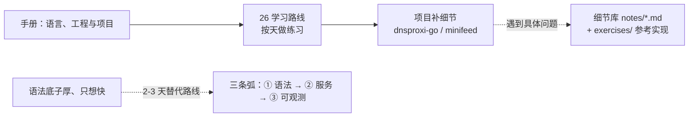

# 怎么学

> Go for Backend · 以练代学，面向已有其他语言经验的开发者。
> 测试能检查运行过的行为，但不能单独证明已经理解；还需要解释机制并独立修改代码。

这个仓库的文档分两层，别混着读：

| 层 | 位置 | 是什么 | 怎么读 |
|---|---|---|---|
| 第一层：手册 | [手册](/handbook/README) | 从语言机制到后端工程与项目 | 从 [26 学习路线](/handbook/26-route) 开始；运行标明可独立运行的例子，片段则按上下文补全 |
| 第二层：细节库 | notes/*.md（本站侧栏） | 各主题的深入讲解、练习和复盘记录 | 按手册的深入指引或[课程表](/table)查阅 |



## 判断你该从哪进

- 第一次系统学 Go：从手册及其学习路线开始，结合每节的判断题和练习。
- 有 Rust/Java 底子、只想快速能干活：走旧三条弧（① 语法核心 → ② 服务搭建 → ③ 可观测性，2 到 3 天），表在[课程表](/table)。
- 只查一个具体问题（GMP、泛型边界、熔断参数……）：细节库按编号查，或用本站搜索。

## 每章怎么打开

1. **正文当讲义读**：从章头「这章学完你能干什么」读起，正文按 2-4 个问题组织（场景 → 例子 → 原因 → 失效边界），顺着读。
2. **卡壳才翻章末「参考」**：语法细节、API 清单、大表格都沉在章末，要查再翻，不预读。
3. **练习按类型做**：预测题先写下答案再跑测试对答案；观察题跑起来看输出；改造题动手改。练习包已全绿（参考实现在练习文件里），先对答案再动手。
4. **判过**：Take-away 能向别人复述 + 改坏代码能修回。两件事做到，这章就过了，去下一章。

## 一键回归

怀疑哪章学漏了就跑：

```sh
go vet ./... && go test -race -count=1 ./...
cd dnsproxi-go && go vet ./... && go test -race -count=1 ./...   # 独立 module
```

测试结果依赖本机工具链与环境；以实际运行输出为准。
