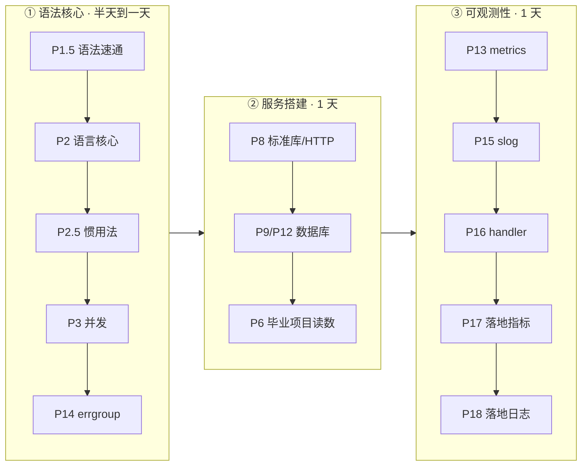

# 怎么学

> Go for Backend · 以练代学。面向已经写过 Rust/Java/Kotlin 的后端。
> 每章 = 一份教程 + 一个练习包，`go test` 全绿 = 学会。

## 三条弧（按阶段读，不按编号读）

编号是写作顺序，不是学习顺序。真正要走的路只有三条弧：



| 阶段 | 章 | 回答一个问题 | 判过标准 |
|---|---|---|---|
| ① 语法核心 | P1.5 → P2 → P2.5 → P3 → P14 | Go 这门语言怎么写、怎么写得地道 | 能向别人复述每章 Take-away |
| ② 服务搭建 | P8 → P9 或 P12 → P6 LESSON | 一个真实后端怎么搭 | 能画出 dnsproxi 的请求路径 |
| ③ 可观测性 | P13 → P15 → P16 → P17 → P18 | 上线后怎么看得见 | 能解释"为什么 req_id 不进 metrics label" |
| ④ 按需参考 | P1 进阶命令、P19 生态地图、P20 写 CLI 工具、P21 测试武器（synctest/fuzz）、P22 工具链深潜与文档工程、P23 Linux 运行时（进程/信号/fd/容器）、P24 网络协议栈（DNS 全链路）、P25 容器云原生（镜像/限额/健康检查）、P26 部署实战（compose 编排）、P30 方法与接口、P31 并发调度（GMP 与 channel/select）、P32 内存与 GC、P33 泛型的边界、P34 TCP 服务器与 DNS over TCP、P35 限流、熔断与容错、P36 用户、鉴权与分层测试（webook 主线）、P4/P5（精读法）、P10（gRPC）、P11（goose） | 用到才翻 | 不排进日程 |

- **快速路径（有 Rust/Java 底子）**：①②③ 一共 2-3 天。语法底子厚可把 P1.5 当字典查（P2/P2.5 仍建议通读：惯用法不是语法能推出来的），跳过 P4/P5，P12 替代 P9（若装着 PG17）。
- **P1 工具链是 cheat sheet**：过一遍知道有什么，之后遇事查表，不背。
- **P4/P5 教的是"怎么读别人的 Go 代码"**：方法会了，两个库本身不用重读。

## 每章怎么打开

```sh
cd /Users/akka/Dev/learning/go
```

1. **正文当讲义读**：从章头“这章学完你能干什么”读起，正文按 2-4 个问题组织（场景 → 例子 → 原因 → 失效边界），顺着读。
2. **卡壳才翻章末“参考”**：语法细节、API 清单、大表格都沉在章末，要查再翻，不预读。
3. **练习按类型做**：预测题先写下答案再跑测试对答案；观察题跑起来看输出；改造题动手改。练习包已全绿（参考实现在练习文件里），先对答案再动手。
4. **判过**：Take-away 能向别人复述 + 改坏代码能修回。两件事做到，这章就过了，去下一章。

## 一键回归

怀疑哪章学漏了就跑：

```sh
cd /Users/akka/Dev/learning/go && go vet ./... && go test -race -count=1 ./...
cd dnsproxi-go && go vet ./... && go test -race -count=1 ./...   # 独立 module
```

当前基线：18 包（golearn）+ 3 包（dnsproxi，含 /metrics + slog）全绿。
