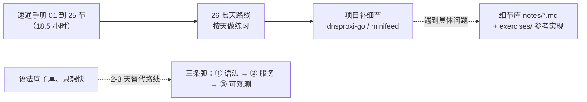

# 怎么学

> Go for Backend · 以练代学。面向已经写过 Rust/Java/Kotlin 的后端。
> 每章 = 一份教程 + 一个练习包，`go test` 全绿 = 学会。

这个仓库的文档分两层，别混着读：

| 层 | 位置 | 是什么 | 怎么读 |
|---|---|---|---|
| 第一层：速通手册 | [guide/handbook/](/handbook/README)，26 节 | 讲课体，18.5 小时建立体系。每节用具体现象开场，示例可直接跑 | 从 [26 七天路线](/handbook/26-route) 开始，看到 go 代码块先抄下来跑、猜输出，再对答案 |
| 第二层：细节库 | notes/*.md（27 章，本站侧栏 ① 到 ④） | 每个主题更长的讲解、完整练习和复盘记录 | 手册某节读到卡壳、或工程上真遇到那个问题时，按节末「想深入去哪查」的指引进来查 |



## 判断你该从哪进

- 第一次系统学 Go：读手册，26 节，七天。每节末尾的判断题和练习过关再走。
- 有 Rust/Java 底子、只想快速能干活：走旧三条弧（① 语法核心 → ② 服务搭建 → ③ 可观测性，2 到 3 天），表在[课程表](/table)。
- 只查一个具体问题（GMP、泛型边界、熔断参数……）：细节库按编号查，或用本站搜索。

## 每章怎么打开

1. **正文当讲义读**：从章头「这章学完你能干什么」读起，正文按 2-4 个问题组织（场景 → 例子 → 原因 → 失效边界），顺着读。
2. **卡壳才翻章末「参考」**：语法细节、API 清单、大表格都沉在章末，要查再翻，不预读。
3. **练习按类型做**：预测题先写下答案再跑测试对答案；观察题跑起来看输出；改造题动手改。练习包已全绿（参考实现在练习文件里），先对答案再动手。
4. **判过**：Take-away 能向别人复述 + 改坏代码能修回。两件事做到，这章就过了，去下一章。

## 一键回归

怀疑哪章学漏了就跑：

```sh
go vet ./... && go test -race -count=1 ./...
cd dnsproxi-go && go vet ./... && go test -race -count=1 ./...   # 独立 module
```

当前基线：29 包（golearn）+ 5 包（dnsproxi，含 /metrics + slog + guard）全绿。
