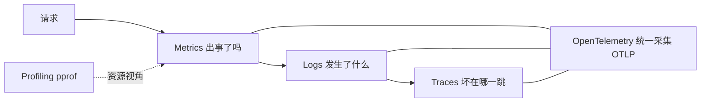

> 服务能跑（P8）之后是服务能看。这章回答四个问题：服务健康吗（RED 记分牌）、
> 中间件怎么拿到路由模板（r.Pattern 踩坑实录，本章最独有的内容）、label 基数
> 为什么是最常见的生产事故、从 metrics 往 logs/traces 怎么走（P15 的入口）。
> 概念辨析、方法论溯源、pull 模型细节在章末参考。
>
> 前置：P8（httpkv）。后续：P15 从 §13.8 的路线图起步，P17 把同一套方法论
> 搬进 DNS 代理。
>
> Rust 对照：`metrics` + `metrics-exporter-prometheus` crate；`tracing`
> 生态对应 Go 的 slog/OTel。概念一一对应，Go 的默认值更高。

## 13.0 这章学完你能干什么

上线后回答"现在健康吗"，不再靠登机器看进程：一条 curl 拿到全量指标。
冒烟实拍（2026-10-12，PUT 一次、GET 一次不存在的 key 后）：

```sh
go run ./exercises/p8fast/httpkv          # 起 httpkv（带 /metrics）
curl -s -X PUT localhost:8090/kv/foo -d '{"value":"1"}'
curl -s -o /dev/null localhost:8090/kv/ghost   # 造一个 404
curl -s localhost:8090/metrics | grep ^httpkv_
```

```
httpkv_requests_total{method="PUT",path="PUT /kv/{key}",status="201"} 1
httpkv_requests_total{method="GET",path="GET /kv/{key}",status="404"} 1
httpkv_in_flight_requests 0
httpkv_keys 1
httpkv_request_duration_seconds_count{method="PUT",path="PUT /kv/{key}"} 1
httpkv_request_duration_seconds_count{method="GET",path="GET /kv/{key}"} 1
```

（节选，直方图桶明细省略。）这个格式 Prometheus 服务器原样抓取，接
Grafana 只差一个 scrape 配置。四个问题依次展开：

1. 服务上线后第一个问题：现在健康吗？RED 是什么，怎么照着摆指标？
2. 中间件怎么拿到路由模板？r.Pattern 踩坑实录（本章最独有的内容）。
3. label 基数为什么是最常见的 Prometheus 生产事故？
4. 从 metrics 往 logs/traces 怎么走（§13.8，P15 从这里起步）？

练习在 13.9；监控 vs 可观测的辨析、方法论溯源表、pull 模型细节在章末参考。

## 13.1 问题 1：服务上线后第一个问题：现在健康吗？

场景：下午三点，用户群说"服务有点慢"。手里没有指标时，你能做的只有
登机器看进程、翻日志数行数，每查一次都是体力活。"现在健康吗"要拆成
三个小问题：多少流量、多少错误、多慢。

先立坐标：可观测性三根柱，各答一个问题：

| 信号 | 回答的问题 | Go 侧 | Rust 侧 |
|---|---|---|---|
| Metrics | 出事了吗（数值趋势） | Prometheus client（本章） | `metrics` crate |
| Logs | 发生了什么（离散事件） | `log/slog`（1.21+ 标准库） | `tracing` 事件 |
| Traces | 慢在哪一跳（请求跨服务旅程） | OpenTelemetry-go | `tracing` + OTel |

Elastic 还提出第四根柱 profiling，答"资源花在哪"，Go 的 `net/http/pprof`
就是这个，P8 已经挂在 :6060。你已经做了一半可观测性，这章补 metrics。

"健康吗"归 metrics 管。请求驱动型服务摆哪些指标，业界有现成答案：
RED（Tom Wilkie, Weaveworks, 2015）。RED 的本意是"每个服务都长同一张
记分牌"：on-call 能值任何服务的班，不用重学仪表盘。

| RED | 含义 | httpkv 对应 |
|---|---|---|
| Rate | 每秒请求数 | `httpkv_requests_total` 求 `rate()` |
| Errors | 错误率 | 同一条序列里 `status≥5xx` 的占比 |
| Duration | 耗时分布 | `httpkv_request_duration_seconds` |

httpkv 的序列正好照 RED 摆（`httpkv_in_flight_requests` 是饱和度代理，
顶满说明处理能力到头）。P8 写 httpkv 时没人提 RED，手上这套就是它，
只是之前没人点破。照着 RED 摆指标，就不会漏也不会乱。资源视角另有
USE（Brendan Gregg）：查 CPU、内存、磁盘时用占用/饱和/错误三件套。
服务用 RED，资源用 USE，两边互补；三个方法论的作者与脉络在章末参考。

RED 只对请求驱动型服务成立。批处理任务、纯资源瓶颈要用 USE 的思路
另摆一套，见章末参考。

## 13.2 问题 1 续：照着 RED 摆，类型和名字怎么定？

client_golang 四种指标类型，本章只用前三种（对照 Rust metrics crate）：

| 类型 | 语义 | Rust 对应 | 本章用法 |
|---|---|---|---|
| Counter | 只增不减 | `counter!`/`increment!` | `httpkv_requests_total` |
| Gauge | 可增可减（瞬时值） | `gauge!` + `set` | `httpkv_in_flight_requests`、`httpkv_keys` |
| Histogram | 观测值落桶（分布） | `histogram!`/`record` | `httpkv_request_duration_seconds` |
| Summary | 分位数直接算 | 无直接对应 | 不用：分位数不可跨实例聚合 |

Summary 和 Histogram 的取舍一句话说清：单机上 Summary 的 p99 算得准，
但三个副本的 p99 加不出全局 p99。Histogram 存桶，`histogram_quantile()`
在服务端聚合桶再算分位数。生产基本用 Histogram。

定义即注册（`promauto` 挂默认 registry，重复注册 panic，错误不会被吞）：

```go
RequestsTotal = promauto.NewCounterVec(prometheus.CounterOpts{
    Name: "httpkv_requests_total",   // 命名规范：namespace_subsystem_unit[_total]
    Help: "Total HTTP requests by method, path template and status code.",
}, []string{"method", "path", "status"})
```

命名三条约定（[OneUptime 实践文](https://oneuptime.com/blog/post/2026-01-30-go-prometheus-client/view)）：
带单位后缀（`_seconds`、`_bytes`）、Counter 带 `_total`、Help 必填。
名字是 API：改指标名等于废弃所有历史面板。

`*Vec` 是带维度的指标族，`WithLabelValues(...)` 取出（或隐式创建）一条
具体时间序列。Vec 本身不记数，子序列才记。

## 13.3 问题 2：中间件怎么拿到路由模板？

场景：记分牌的类型和名字定了，还差一个决定。`path` 这个 label 填什么？
填原始 URL（`/kv/user123`）就埋了基数地雷（13.7 展开）；填路由模板
（`PUT /kv/{key}`）才是有限集合。问题来了：中间件是包在所有路由外面的
函数，它从哪儿知道"这条请求匹配了哪个模板"？

`Instrument`（metrics.go）做三件事：InFlight +1/-1（Gauge）、
statusWriter 截状态码（Counter 维度）、计时进 Histogram：

```go
func Instrument(pattern string, next http.HandlerFunc) http.Handler {
    return http.HandlerFunc(func(w http.ResponseWriter, r *http.Request) {
        InFlight.Inc()
        defer InFlight.Dec()
        start := time.Now()
        sw := &statusWriter{ResponseWriter: w, status: http.StatusOK}
        next(sw, r)                      // ← 截获 WriteHeader
        RequestsTotal.WithLabelValues(r.Method, pattern, strconv.Itoa(sw.status)).Inc()
        Duration.WithLabelValues(r.Method, pattern).Observe(time.Since(start).Seconds())
    })
}
```

注意 pattern 是参数。为什么不直接读 `r.Pattern`？因为第一版就是这么
写的，冒烟当场翻车，见 13.4。

对照 tower-http 的 `TraceLayer`：同一件事，`Service` 包装。中间件没有
魔法，就是函数包装。statusWriter 是 Go 的惯用技巧：嵌入
`http.ResponseWriter` 转发未覆盖的方法，覆写 `WriteHeader` 记状态码。
HTTP handler 不显式调用 WriteHeader 时默认 200，所以结构体初始化为 200。

## 13.4 问题 2 踩坑实录：r.Pattern 在 mux 外恒空

第一版写法：全站包一层 `Handler: Instrument(mux)`，中间件里读
`r.Pattern` 拿路由模板。冒烟翻车，所有请求记成 `path="UNMATCHED"`：

```
httpkv_requests_total{method="PUT",path="UNMATCHED",status="201"} 3   ← 全错了
```

最小复现（这个坑在 metrics.go 的注释里也记了一笔）：

```go
h := http.HandlerFunc(func(w http.ResponseWriter, r *http.Request) {
    fmt.Fprintln(w, "pattern-outer:", r.Pattern)  // 恒空！
    mux.ServeHTTP(w, r)
})
```

原理：`r.Pattern` 是 ServeMux 匹配后写入请求的，只在 mux 内层（匹配到的
handler 及其里层）可见。Instrument 包在 mux 外，看到的是匹配前的请求。
修复：逐路由包在 mux 内层，pattern 作参数显式传：

```go
mux.Handle("GET /kv/{key}",
    Instrument("GET /kv/{key}", getHandler))
srv := &http.Server{Handler: mux}   // 外层不再包
```

修复后冒烟：`path="PUT /kv/{key}"`，模板出现，基数有限。和 13.0 的实拍
对一下：`status="201"`、`status="404"` 都落在模板维度上。

## 13.5 问题 2 的边界：中间件能看见什么由位置决定

这条坑的推广比坑本身更需要记住：中间件能拿到的上下文，由它在洋葱模型
里的位置决定。包在路由器外层，只能看到 request 原始信息（方法、URL、
header）；要看路由模板这类"匹配之后"的信息，必须在路由器内层。

同一规律在别的技术栈同样成立：gRPC 的 interceptor、tower 的
`map_request` 层，能看到的上下文一样由位置决定。迁移时别问"这个框架的
中间件能不能拿到 X"，先问"它在洋葱的哪一层"。

修完的位置还有一个小边界：逐路由包装意味着未注册路径不经过任何
Instrument。`curl localhost:8090/nope` 返回 404，/metrics 里却查不到
这条请求（2026-10-12 实测，见 13.9 观察验证）。全站级的 404 监控要在
外层再包一层只记总数的 Counter，两层各干各的。

## 13.6 白送的部分：Go runtime 指标

`promhttp.Handler()` 挂默认 registry，Go runtime 指标白送（2026-10-12
实拍：`go_goroutines 10`、`process_cpu_seconds_total 0.023`）：

```
go_goroutines / go_gc_duration_seconds / go_memstats_alloc_bytes / process_cpu_seconds_total ...
```

Rust 侧这些要 `metrics-process` 之类的 crate 手动挂。Go 的 runtime 自己
就是被观测对象，instrument 写在标准库 sidecar 里。

Prometheus 是 pull 模型：服务器定期来抓 /metrics，你的服务只管暴露。
模型的两个推论（Counter 重启归零 `rate()` 能处理；短生命周期任务抓不到，
要走 pushgateway）和 2025 年"原生客户端还是 OTel"的争论，见章末参考。

## 13.7 问题 3：label 基数为什么是最常见的生产事故？

13.4 修完后 label 是路由模板，"基数有限"这四个字为什么生死攸关？看
同一指标的两种 label 填法：

| label 值 | 后果 |
|---|---|
| `path="PUT /kv/{key}"`（模板） | 4 条序列，健康 |
| `path="/kv/user123"`（原始） | 每个不同的 key 一条序列，永不回收，Prometheus OOM |

基数 = 一条指标的时间序列总数。每个新 label 值都创建一条新序列：内存
涨、查询变慢、抓取超时，最常见的生产事故形态就是有人把 user id 或
原始 URL 塞进了 label。三条纪律：

1. label 值必须来自有限集合（路由模板、状态码、方法）；
2. user id、原始 path、trace id 一律不进 label。要查细节去日志/trace；
   trace id 进指标有专门机制叫 Exemplar（§13.8）；
3. 不确定的先算"一天最多多少种取值"，超过几百就得收。

Rust 的 metrics crate 同样如此，label 就是序列维度，同样会炸。
P15 会把这条纪律用到 req_id 上：每请求一个 id，只能进日志，不进指标。

## 13.8 问题 4：从 metrics 往 logs/traces 怎么走？

本章只做了 metrics 这根柱。往上走的标准路径，每步都有 Go 标准件：

1. **结构化日志**：`log/slog`（标准库，1.21+）JSON handler，每条日志带
   `request_id`，日志和指标就能对上号
   （[Dash0 slog 指南](https://www.dash0.com/guides/logging-in-go-with-slog)）。
   P15/P16 已落地：req_id 由中间件生成进 ctx，自定义 handler 自动注入。
2. **trace 关联**：OpenTelemetry-go 把 `trace_id` 注入 slog context
   （`slog.InfoContext(ctx, ...)`），中间件里起 span
   （[关联实操文](https://openobserve.ai/blog/logs-traces-metrics-correlation)）。
3. **Exemplar**：Histogram 桶上挂 trace_id，"p99 那 1% 的请求长这样"，
   点面板直接跳 trace。这是 metrics 和 traces 的官方接口，也是 13.7
   纪律第 2 条的出口。
4. **OTel Collector**：生产统一采集层，pull Prometheus 端点、收 OTLP，
   路由到任意后端。instrument once, export anywhere。

13.7 和 13.8 这两个小节号被外部引用（P15 引用基数纪律和路线图，P16
引用路线图，p15slog 练习包注释引用路线图），本章改版特意保号不改：
13.7 仍是 label 基数纪律，13.8 仍是路线图。

Rust 侧每步都有对应物：`tracing` 的 span/layer 是 2+3 的合体，且起步
更早。Go 胜在标准库自带（slog、pprof），Rust 胜在 tracing 的表达力。
两边都学，迁移的是概念不是 API。

## 13.9 动手：验收与练习（30 分钟）

```sh
# 单测（-race）
go test -race ./exercises/p8fast/...

# 手动冒烟
go run ./exercises/p8fast/httpkv
curl -s -X PUT localhost:8090/kv/foo -d '{"value":"1"}'
curl -s localhost:8090/metrics | grep ^httpkv_
```

**预测题**（跑之前写答案）：

1. 13.0 实拍的四类输出里，哪条是 R，哪条是 E，哪条是 D？（§13.1）
2. 把 Instrument 改回第一版（包在 mux 外层读 `r.Pattern`），metrics
   输出会变成什么样？（§13.4）
3. `curl localhost:8090/nope` 之后，`httpkv_requests_total` 会多出一条
   404 序列吗？（§13.5）

**观察验证**：

```sh
curl -s -o /dev/null localhost:8090/nope      # 未注册路径
curl -s localhost:8090/metrics | grep ^httpkv_requests_total
# 预期：404 有响应，requests_total 不增（逐路由包装的可见边界）
```

| 练习 | 对应小节 | 检验什么 |
|---|---|---|
| 冒烟看四类输出 | §13.1 | requests_total / in_flight / keys / duration_count |
| 用 RED 审计指标 | §13.1 | 说出 httpkv 的 R/E/D 各对应哪条序列；缺饱和度吗 |
| 算 p99 | §13.2 | `histogram_quantile(0.99, sum(rate(...)) by (le))` |
| 故意造 404 | §13.5 | 未注册路径不进指标：逐路由包装的可见边界 |
| 加业务指标 | §13.2 | `httpkv_puts_total`（Counter），put 里 +1 |

改造题：给 dnsproxi-go 加同款 Instrument，RED 照搬，qtype/rcode 做
label。这是毕业项目生产化的一步，P17 是它的完成形态。

## 13.10 Take-away

1. 三根柱各答一个问题：metrics 出事了吗，logs 发生了什么，traces 坏在
   哪一跳；pprof 是第四根柱（P8 已挂）。服务用 RED 摆记分牌，资源用 USE。
2. 四件套只用三件：Summary 的分位数不可跨实例聚合，生产用 Histogram。
   命名是 API，改指标名等于废弃历史面板。
3. 中间件能看见什么由洋葱位置决定：r.Pattern 只在 mux 内层可见（实测
   踩坑），要路由模板就逐路由包、把 pattern 显式传参。
4. label 基数纪律：label 值必须来自有限集合；user id、原始 path、
   trace id 不进 label，细节去日志/trace（Exemplar 是官方出口）。
5. 路线图：slog 结构化日志（P15/P16 已落地）→ OTel trace 关联 →
   Exemplar → Collector。当下务实解：指标用 Prometheus 原生，traces 走 OTel。

---

## 章末参考

### 监控 vs 可观测：两个词的分界

两个词的分界（IBM/Elastic/Cribl 的说法一致）：

- **Monitoring**（监控）：预定义的问题发生了就报警，例如"CPU 超 80%"。
- **Observability**（可观测）：能回答没预设过的新问题，例如"为什么只有
  用 IPv6 的用户慢"。

这章装的是 monitoring 的标准件（预定义指标加阈值），但 RED 记分牌摆好
后，一部分新问题（"为什么只有 PUT 慢"）也能靠直方图桶和 label 组合
回答。完全的可观测性要三柱合流，见 §13.8。

### 方法论溯源：RED、USE、Four Golden Signals

| 方法 | 作者 | 对象 | 内容 |
|---|---|---|---|
| RED | Tom Wilkie（Weaveworks, 2015） | 每个请求驱动型服务 | Rate、Errors、Duration |
| USE | Brendan Gregg | 每个资源（CPU/内存/磁盘） | Utilization、Saturation、Errors |
| Four Golden Signals | Google SRE | 服务（RED 的上游） | 流量、错误、延迟、饱和度 |

脉络：Google Four Golden Signals 在前，Wilkie 面向微服务简化出 RED；
Gregg 的 USE 更早，面向基础设施。两者互补（ClickHouse 工程博客的总结）：
只有 USE，你找到忙的 CPU 却说不出用户疼不疼；只有 RED，告警了却查不到
原因。所以服务用 RED，资源用 USE，两边都摆。

### pull 模型的两个推论与 2025 年那场争论

pull 模型：Prometheus 服务器定期来抓 /metrics，你的服务只管暴露。
两个推论：

1. 指标是当前状态快照。Counter 崩溃重启会归零，`rate()` 能处理。
2. 短生命周期任务（cron job）pull 抓不到，要走 pushgateway 或 OTel。
   这是 pull 模型著名的盲区，选型时要知道。

2025 年 Prometheus 核心维护者 Julius Volz 认为指标应该继续用原生客户端
（[PromLabs 文](https://promlabs.com/blog/2025/07/17/why-i-recommend-native-prometheus-instrumentation-over-opentelemetry)）：
OTel 的指标模型转成 Prometheus 格式会丢特性、对齐标签要额外处理。但
OTel 是 trace/log 的事实标准（§13.8）。务实的结论：指标原生、traces 走
OTel，别被"all in OTel"的宣传带跑。

### 三支柱与采集链路


