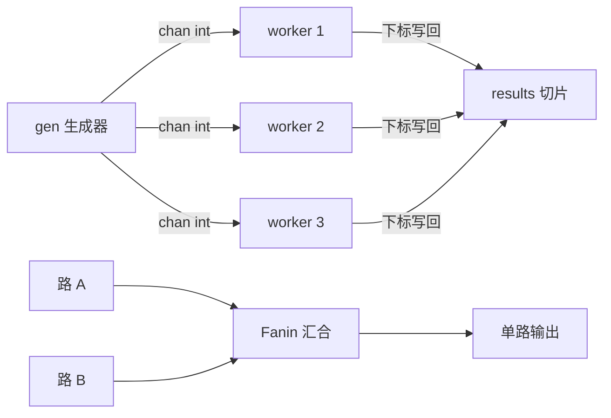

# 第 14 章 · errgroup + pipeline：并发的工程化组装


> P3 学了 goroutine/channel 的原语，这章学怎么把它们组装成生产形状：
> 生成器 → 扇出 → 汇合三板斧（Go blog 的经典模式），errgroup 管生命周期
> 和首错传播，SetLimit 控并发上限。
>
> 读者：读完 P3，写过 fan-out/fan-in 练习。前置：P3（goroutine、
> channel、select、ctx）。后续：P7 dnsproxi 的 worker pool 是这套
> 模式的真机版。Rust 对照（`futures::stream` 的 `buffer_unordered`、
> `JoinSet`）下沉到章末参考。

## 这章学完你能干什么

把一段"起 N 个 goroutine 抓数据"的草稿改造成生产形状：并发有上界、
首错会传播、下游取消上游会退、跑完没有泄漏，而且每一条都有测试
盯着。终点证据：

```sh
go test -race ./exercises/p14pipe/
```

8 个测试 -race 全绿，覆盖三板斧、并发上限消融（同时活的 worker
实测 ≤ SetLimit）、首错传播、goroutine 泄漏检测。这四件事凑齐了，
你就敢把这段模式抄进生产代码。四个问题依次是：

1. WaitGroup 缺什么，errgroup 补什么？
2. 三板斧（gen/fanout/fanin）怎么组装成流水线？
3. SetLimit 的并发上限怎么证明，而不是口说无凭？
4. 泄漏和首错怎么检测？

## 问题 1：WaitGroup 缺什么，errgroup 补什么？

P3 的 WaitGroup 只管"等全部结束"，工程上还缺三件事：

| 缺口 | 后果 | errgroup 的补法 |
|---|---|---|
| 不传错误 | 哪个 goroutine 失败了没人知道 | 首个非 nil 错误由 `Wait()` 返回 |
| 不联动取消 | 一个失败，其他还在白跑 | `WithContext` 派生 ctx，首错即 cancel |
| 不限并发 | `for ... go f()` 一次性起 N 个 | `SetLimit(n)` 闸门 |

`golang.org/x/sync/errgroup`，官方扩展库（不在标准库是因为 API 还在演化，
生产已普遍使用）。

```go
g, ctx := errgroup.WithContext(ctx)   // ctx 在任一任务返回错误时被 cancel
g.SetLimit(4)                          // 最多 4 个并发；Block 直到有空位
for i := range jobs {
    g.Go(func() error { ... })         // 任务签名带 error
}
err := g.Wait()                        // 等全部结束，返回首个错误
```

`SetLimit` 的一个非显然语义：**`g.Go` 在闸门满时会阻塞**。想在满员时不阻塞
而跳过/排队，用 `g.TryGo`（返回 bool）。这个差异决定了任务怎么排队，
写代码前想清楚。

## 问题 2：三板斧（gen/fanout/fanin）怎么组装成流水线？

Go blog "Go Concurrency Patterns: pipelines"（2012）的模式，至今是
Go 数据流处理的骨架：



**第一板斧 gen（生成器）**：切片变 channel。关键是 `select` 里挂上
`ctx.Done()`：下游不收了、上层取消了，goroutine 就退出，不泄漏：

```go
func gen(ctx context.Context, nums ...int) <-chan int {
    out := make(chan int)
    go func() {
        defer close(out)
        for _, n := range nums {
            select {
            case out <- n:
            case <-ctx.Done():
                return
            }
        }
    }()
    return out
}
```

**背压从这里来**：channel 满了（没人收）`out <- n` 就卡住，生产速度
自动被消费速度拉平。unbuffered channel 是最朴素的背压机制，
buffer 只在你知道容量上界时才加。

**第二板斧 fanout（扇出）**：N 个 worker 抢同一个输入 channel。
`errgroup.SetLimit` 限制同时跑的 worker 数：

```go
g, ctx := errgroup.WithContext(ctx)
g.SetLimit(consumers)
for range nums {
    g.Go(func() error {
        // 抢任务、处理、写回 results[i]
    })
}
return results, g.Wait()
```

**结果保序技巧**：worker 拿到下标 `i`，直接写 `results[i]`。切片各元素
独立，无锁安全（`-race` 验证过），不需要 channel 回传再排序。
对照 `buffer_unordered` 之后还要 `enumerate` 重排，这个更直接。

**第三板斧 fanin（汇合）**：多路 channel 合成一路。每路一个转发
goroutine，`sync.WaitGroup` 等全部结束后关总 channel：

```go
func Fanin(ctx context.Context, ins ...<-chan int) <-chan int {
    out := make(chan int)
    var wg sync.WaitGroup
    wg.Add(len(ins))
    for _, in := range ins {
        go func(c <-chan int) {
            defer wg.Done()
            for v := range c {
                select {
                case out <- v:
                case <-ctx.Done():
                    return
                }
            }
        }(in)
    }
    go func() { wg.Wait(); close(out) }()
    return out
}
```

注意 Go 1.22 前 for 循环变量复用的坑（每轮要 `c := in`），1.22+ 的
`for _, in := range ins` 直接传参即可。fanin 里是纯转发（无错误语义），
所以用 WaitGroup 而不是 errgroup。**按需选工具，errgroup 不是唯一解**。

## 问题 3：SetLimit 的并发上限怎么证明？

口说无凭，测试里放并发计数器（`TestFanoutLimit`）：

```go
var cur, max atomic.Int64
process := func(_ context.Context, n int) (string, error) {
    c := cur.Add(1)
    // CAS 循环更新 max（原子操作的常规写法）
    for { m := max.Load(); if c <= m || max.CompareAndSwap(m, c) { break } }
    time.Sleep(5 * time.Millisecond)   // 制造重叠窗口
    cur.Add(-1)
    return "ok", nil
}
// SetLimit(2) 跑 8 个任务，max.Load() 必须 ≤ 2
```

实测 max = 2。把 SetLimit 注释掉（消融），max = 8。这就是限闸的作用量。
**消融实验是验证并发参数的唯一可靠方法**，P7 的方法论在这里复用。

## 问题 4：泄漏和首错怎么检测？

**首错语义**（`TestFanoutFirstError`）：一个 worker 返回错误，`g.Wait()`
返回它，且 ctx 被 cancel，其他 worker 通过 `select ctx.Done()` 提前退出。
实测：5 个任务限 2 并发，第 3 号失败后剩余任务没跑完就被拉闸。

**泄漏检测**（`TestFanoutGoroutineLeak`/`TestGenCancel`）：跑完后
`runtime.NumGoroutine()` 回落到基线。channel 世界最常见的泄漏源就是
"发送端卡死在没人收的 channel 上"。`select ctx.Done()` 是唯一的药。
这两个测试是 pipeline 代码的体检仪，抄进任何类似代码都值。

## 动手：练习 p14pipe（30-45 分钟，纯标准库 + errgroup）

```sh
cd /Users/akka/Dev/learning/go
go test -race ./exercises/p14pipe/
```

**预测题**（跑之前写答案）：

1. `TestFanoutLimit` 里把 `g.SetLimit(2)` 那行删掉，max 计数器会
   变成多少？为什么不是 7 或 9 之类的随机数？（§问题 3）
2. `TestFanoutFirstError` 里 3 号 worker 返回错误后，4、5 号任务是
   "跑完了才退出"还是"中途退出"？它们靠哪个分支感知取消？（§问题 4）
3. `TestGenCancel` 把 gen 里的 `case <-ctx.Done(): return` 删掉，
   NumGoroutine 会回落吗？泄漏的 goroutine 卡在哪一行？（§问题 2、4）

**观察验证**：

```sh
go test -race -run TestFanoutLimit -v ./exercises/p14pipe/   # 看 max 实测值
go test -race -run TestFanoutGoroutineLeak -v ./exercises/p14pipe/   # 看 NumGoroutine 回落
```

| 练习 | 对应小节 | 检验什么 |
|---|---|---|
| TestPipeline | §问题 2 | 三板斧串起来结果保序 |
| TestFanoutConcurrent | §问题 3 | fanout 并发执行（不限死为串行） |
| TestFanoutResultOrder | §问题 2 | 下标写回，结果保序 |
| TestFanoutLimit | §问题 3 | 消融：SetLimit(2) 实测 max≤2 |
| TestFanoutFirstError | §问题 4 | 首错传播 + ctx 联动取消 |
| TestFanoutGoroutineLeak / TestGenCancel | §问题 4 | 泄漏检测（NumGoroutine 回落） |
| TestFanin | §问题 2 | 三路汇一路，元素不丢 |

**改造题**：给 Fanout 加 `stage` 中间站（fanout 后接一个 map 阶段再
fanin），验证背压：下游 sleep 100ms 时上游不会一次性算完所有数。
提示：在 gen 里放个计数器，观察"已生产"和"已消费"的差值。

## Take-away

1. errgroup 补齐 WaitGroup 三个缺口：错误传播、ctx 联动取消、
   SetLimit 闸门。`g.Go` 在闸门满时会阻塞，这是排队的姿势。
2. 三板斧 = Go 数据流的骨架：gen（背压源头）→ fanout（SetLimit
   限并发）→ 下标写回（保序无锁）/ fanin（WaitGroup 关闸）。
3. 每个发送 goroutine 都要 `select ctx.Done()`，否则下游一撤你就
   泄漏。
4. 并发参数要消融验证（计数器实测），goroutine 泄漏要检测
   （NumGoroutine 回落）。
5. 按需选工具：纯转发用 WaitGroup，有错误语义才上 errgroup。

---

## 章末参考

### 什么时候用哪把刀（P3 + P14 对照）

| 场景 | 用什么 | 理由 |
|---|---|---|
| 等一组任务结束，无错误语义 | `sync.WaitGroup` | 最轻 |
| 任务可能失败，要首错 + 取消 | `errgroup` | WaitGroup + error + ctx |
| 并发数有上界（DB 池/Rate limit） | `errgroup.SetLimit` | 闸门 |
| 每个结果都要收集且保序 | 下标写回 `results[i]` | 无锁，-race 验证 |
| 多路流合成一路 | fanin（WaitGroup 关闸） | 纯转发无错误 |
| 流式处理数据流 | pipeline 三板斧 | 背压自然形成 |

gRPC server、批量下载、ETL 抽取，底层都是这套组装。dnsproxi 的
worker pool（P7）就是这个模式的真机版。

### Rust 对照：futures::stream 与 JoinSet

`futures::stream` 的 `buffer_unordered(n)` = fanout+fanin 一体，
`JoinSet`/`select_all` 管集合；errgroup 对应 `JoinSet` 的首错语义。

`JoinSet` 也是"收全部结果"，但首错传播要自己写（遍历 join
结果找 Err）；`buffer_unordered(n)` 直接给"限并发 + 流式收集"，
比 Go 这套组装件更一步到位，但 Go 的部件看得见摸得着，学习价值更高。
