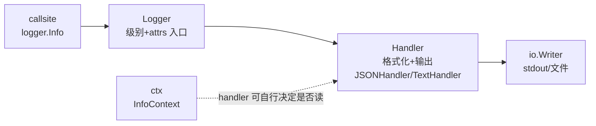

# 第 15 章 · slog 结构化日志：用户报了一个 404，怎样找到对应请求？


> 这章学完你能干什么：用户报障"GET /kv/ghost 返回 404，几点的我不知道"，服务多实例、日志几十万行。你能在响应头拿到 `X-Request-ID`，用它在 JSON 日志里一行 `jq` 捞出完整请求轨迹，并保证敏感字段不落盘。
> 前置：P8（net/http）、P13（label 基数纪律）。后续：P16 把 req_id 注入下沉到 handler。
>
> 动手方式：开一个空目录，`go mod init demo`，每个例子存成 `main.go`，用 `go run main.go` 运行。片段省略了 `package main` 和 `import`。为了让输出稳定，例子里用 `ReplaceAttr` 去掉了 `time` 字段，真实日志每行都有时间戳。

## 体系背景：日志是写进 fd 的字节流

Linux 和 macOS 的进程启动时自带三个文件描述符（fd，内核给每个打开的文件或管道编的整数）：0 是标准输入，1 是标准输出，2 是标准错误。

"打日志"在内核眼里只有一件事：往 fd 1 或 fd 2 写字节。至于这些字节去终端、去文件还是去另一个进程，由启动程序的 shell 决定。

```go
fmt.Fprintln(os.Stdout, "我是 stdout（fd 1）")
fmt.Fprintln(os.Stderr, "我是 stderr（fd 2）")
```

```sh
$ go build -o app main.go
$ ./app > out.log 2> err.log
$ cat out.log
我是 stdout（fd 1）
$ cat err.log
我是 stderr（fd 2）
```

`>` 把 fd 1 重定向到文件，`2>` 对 fd 2 做同样的事。用管道就能把日志直接喂给别的进程：

```sh
$ ./app 2>/dev/null | tr a-z A-Z
我是 STDOUT（FD 1）
$ ./app 2>&1 | wc -l
       2
```

这就是 12-factor 应用（一套云原生服务的写法约定）对日志的要求：程序只管把事件按行写到 stdout，不管文件轮转和传输，由容器运行时或日志采集器接走。P25 讲容器时会再用到这一点。

字节流有一个后果：下游拿到的只是一行行文本。想让下游能"查"，每一行就得有机器能解析的结构。

## 文本日志的极限

先看最朴素的写法：

```go
log.Printf("kv miss: key=%s status=%d", "ghost", 404)
log.Printf("kv miss: key=%s status=%d", "a b", 404)
```

```sh
$ go run main.go
kv miss: key=ghost status=404
kv miss: key=a b status=404
```

人能读，但第二行的 key 里有空格，`grep` 加 `awk` 切字段就错位了。想统计"过去一小时 ghost 的 miss 次数"，你得写一套正则，字段名或顺序一变就全崩。

## 结构化日志

结构化日志让每条日志是一个 JSON 对象，字段就是列。标准库的 `log/slog`（Go 1.21 起）一行配置就够：

```go
opts := &slog.HandlerOptions{Level: slog.LevelInfo, ReplaceAttr: noTime}
logger := slog.New(slog.NewJSONHandler(os.Stdout, opts))
logger.Warn("kv miss", "key", "ghost", "status", 404)
logger.Info("kv hit", "key", "a b", "status", 200)
```

```sh
$ go run main.go
{"level":"WARN","msg":"kv miss","key":"ghost","status":404}
{"level":"INFO","msg":"kv hit","key":"a b","status":200}
```

空格不再是问题，因为 JSON 有引号。字段名固定，`jq 'select(.msg=="kv miss")'` 就能过滤。`msg` 之后的参数是交替的键和值。

开发时想让人读，换成 `NewTextHandler`，格式是 `key=value`：

```sh
level=WARN msg="kv miss" key=ghost status=404
```

练习包 `exercises/p15slog/` 里的 `NewLogger` 就是上面那行配置的封装。`TestJSONFields` 断言输出是合法 JSON 且字段可查。

Rust 的 `tracing` 用 `info!(key = %k, "kv miss")`，是同一个事件加字段的模型，`NewJSONHandler` 对应 `tracing_subscriber::fmt().json()`。Java 的 SLF4J 加 Logback 的 JSON 编码器，JS 的 pino 默认就输出 JSON 行，思路一致。

## 级别

线上不想看 Debug。`HandlerOptions.Level` 设门槛，低于门槛的调用直接丢掉：

```go
logger.Debug("看不到我")
logger.Info("info 出得来")
logger.Error("error 也出得来")
```

```sh
$ go run main.go
{"level":"INFO","msg":"info 出得来"}
{"level":"ERROR","msg":"error 也出得来"}
```

四个级别从低到高是 `Debug`、`Info`、`Warn`、`Error`。`TestLevelFilter` 断言 Debug 被拦住。

## With 与 Group

同一个服务的每条日志都要带 `svc=httpkv`，没必要每次手写。`With` 返回一个预置了字段的新 logger，`WithGroup` 给后续字段加命名空间：

```go
logger := base.With("svc", "httpkv")
logger.Info("启动", "port", 8090)
logger.WithGroup("parser").Info("解析", "line", 3)
```

```sh
$ go run main.go
{"level":"INFO","msg":"启动","svc":"httpkv","port":8090}
{"level":"INFO","msg":"解析","svc":"httpkv","parser":{"line":3}}
```

内置 handler 在 `With` 时就把预置字段格式化一次，之后每条日志复用，所以高频的公共字段用 `With`，不要每次传。大系统里不同子系统的同名 key 用 `WithGroup` 隔开。

## 请求 ID

回到开头的报障。想从几十万行里捞出那一个请求，每个请求要有自己的 id，响应头和日志里都带上。

httpkv 的 `reqID` 中间件做三件事：生成 id、写进响应头、塞进 ctx。

```go
func reqID(next http.HandlerFunc) http.Handler {
	return http.HandlerFunc(func(w http.ResponseWriter, r *http.Request) {
		id := fmt.Sprintf("req-%d", time.Now().UnixNano())
		w.Header().Set("X-Request-ID", id)                              // 用户报障能贴
		next(w, r.WithContext(p15slog.WithRequestID(r.Context(), id)))  // 日志里取
	})
}
```

用户拿到响应头里的 id，运维拿它去日志里查。JS 读者可以类比 pino-http 给每个请求挂的 `req.id`。

## ctx 里的值不会自动出现

id 在 ctx 里了，下一步是把它打进日志。看看只递 ctx 会怎样：

```go
ctx := p15slog.WithRequestID(context.Background(), "req-42")
logger.WarnContext(ctx, "只递 ctx", "key", "ghost")
logger.WarnContext(ctx, "显式取出", "req_id", p15slog.RequestID(ctx), "key", "ghost")
```

```sh
$ go run main.go
{"level":"WARN","msg":"只递 ctx","key":"ghost"}
{"level":"WARN","msg":"显式取出","req_id":"req-42","key":"ghost"}
```

第一行没有 `req_id`。`WarnContext` 把 ctx 递给 handler，只是"给了它机会"。文档原话是 "Some handlers may wish to include information from the context"，`JSONHandler` 不在其中。

这是本章最大的认知坑：标准 slog handler 不自动从 ctx 提取值。参数在调用点求值，你没显式带，日志里就没有。

Java 读者对此会不习惯。SLF4J 的 MDC 靠线程局部变量，一次设置，之后每条日志自动带上。Go 没有线程局部变量，ctx 必须显式传，要自动注入就得自己写 handler，这是 P16 的内容。Rust 的 tracing 靠 span 自动传播，`#[instrument]` 一标字段就跟着走。

练习包用 `LogKV` 把显式取出封装好了，`TestCtxRequestID` 和 `TestLogKV` 断言它。

## 指标与日志的分层

req_id 每个请求一个，是高基数。P13 的基数纪律规定它绝不能进 metrics 的 label，否则时间序列会爆炸。

所以 httpkv 的中间件顺序是：`Instrument` 在外，只带 method、pattern、status 三个低基数 label。`reqID` 在内，高基数 id 只进日志。两边各守各的边界。

## 脱敏

日志里出现 token 是事故。靠每个调用点手工打码，迟早漏一个。`LogValuer` 接口把脱敏收敛到类型定义处：

```go
func (u User) LogValue() slog.Value {
	return slog.GroupValue(
		slog.Int64("id", u.ID),
		slog.String("email", redactEmail(u.Email)),
	)
}
```

调用点零感知：

```go
u := p15slog.User{ID: 7, Email: "alice@example.com", Token: "sekrit"}
logger.Info("login", "user", u)
```

```sh
$ go run main.go
{"level":"INFO","msg":"login","user":{"id":7,"email":"a***@example.com"}}
```

`Token` 字段从类型层面就不出现，`LogValue()` 在输出时才调用。`TestLogValuerRedact` 断言 "sekrit" 和明文邮箱都不在输出里。

Rust 的 tracing 靠给 field 包一个脱敏类型，思路一致：策略放在类型上，不放在调用点。

## 昂贵数据

slog 的性能合同是：参数总是先求值，级别不够时结果被丢掉，但计算已经发生。看这个计数：

```go
logger.Debug("dump", "state", expensive())          // 级别是 Info
fmt.Println("不加闸，expensive 被调用次数:", calls)

calls = 0
if logger.Enabled(context.Background(), slog.LevelDebug) {
	logger.Debug("dump", "state", expensive())
}
fmt.Println("加闸，expensive 被调用次数:", calls)
```

```sh
$ go run main.go
不加闸，expensive 被调用次数: 1
加闸，expensive 被调用次数: 0
```

日志一行都没出，函数却白跑了一次。昂贵数据要自己用 `Enabled` 加闸。`TestEnabledGuard` 验证级别不够时 expensive 根本没被调。tracing 用 `tracing::enabled!` 达到同样效果。

## 用 jq 查日志

现在把前面的东西串起来。编译真实的 httpkv，把 stdout 重定向进文件，打几个请求：

```sh
$ go build -o httpkv ./exercises/p8fast/httpkv/
$ ./httpkv > log.jsonl &
$ curl -s -i localhost:8090/kv/ghost
HTTP/1.1 404 Not Found
Content-Type: application/json
X-Request-Id: req-1791805890961874000
Date: Mon, 12 Oct 2026 11:51:30 GMT
Content-Length: 26

{"error":"key not found"}
```

httpkv 的日志写在 stdout，不是 stderr，所以 `>` 才能捞到。看日志文件开头两行：

```sh
$ head -2 log.jsonl
{"time":"2026-10-12T19:51:30.26841+08:00","level":"INFO","msg":"httpkv on :8090 (pprof on :6060/debug/pprof)"}
{"time":"2026-10-12T19:51:30.961884+08:00","level":"WARN","msg":"kv miss","key":"ghost","status":404,"req_id":"req-1791805890961874000"}
```

响应头的 `X-Request-Id` 和日志的 `req_id` 一致，报障的 id 直接对上。再多打几个请求，统计 miss 的 Top 10：

```sh
$ for k in ghost2 a ghost; do curl -s localhost:8090/kv/$k -o /dev/null; done
$ jq -r 'select(.msg=="kv miss") | .key' < log.jsonl | sort | uniq -c | sort -rn | head
   2 ghost
   1 ghost2
   1 a
```

用户报障时给的是响应头里的 id。把它存进变量，按 id 捞这一个请求的完整轨迹：

```sh
$ ID=$(curl -s -i localhost:8090/kv/ghost | grep -i x-request-id | awk '{print $2}' | tr -d '\r')
$ jq -c --arg id "$ID" 'select(.req_id==$id)' < log.jsonl
{"time":"2026-10-12T19:51:31.518931+08:00","level":"WARN","msg":"kv miss","key":"ghost","status":404,"req_id":"req-1791805891518900000"}
```

几十万行里一行命令就定位到这个请求，这就是第一节说的结构带来的好处。

## 小结

1. 日志是写进 fd 1 或 2 的字节流，去向由 shell 决定。
2. 结构化日志每条是一个 JSON 事件，字段即列，`grep` 加正则变成一行 `jq`。
3. req_id 链路是中间件生成（响应头加 ctx），handler 显式取出。标准 handler 不读 ctx。
4. 脱敏收敛在 `LogValuer`，昂贵数据先 `Enabled` 再算。
5. req_id 高基数只进日志，metrics label 保持三个低基数字段。

## 练习：p15slog 与 httpkv

先跑一遍看全绿：

```sh
$ go test -race ./exercises/p15slog/ ./exercises/p8fast/httpkv/
ok  	golearn/exercises/p15slog	1.232s
```

练习包的六个测试：

- `TestJSONFields`：JSON 事件字段可查。
- `TestLevelFilter`：Debug 被级别拦住。
- `TestEnabledGuard`：expensive 没白跑。
- `TestLogValuerRedact`：Token 不落盘。
- `TestCtxRequestID`：ctx 里塞 id 再取。
- `TestLogKV`：把 ctx 里的 id 和结构体字段一起带出来。

**预测**，先写答案再跑：

1. `curl -s -i localhost:8090/kv/ghost` 的响应头和日志里，两个 id 一致吗？
2. 把 handler 调用点的 `"req_id", requestID(r.Context())` 删掉再跑，日志里 req_id 还在吗？为什么？
3. `logger.Info("login", "user", User{...})` 输出里有 token 吗？为什么？

**观察**：

```sh
curl -s -i localhost:8090/kv/ghost     # 看 X-Request-Id 响应头
# 对照日志文件，req_id 与响应头一致
```

**改造**：写一个 `ctxHandler` 包装 `JSONHandler`，在 `Handle` 里从 ctx 自动取 req_id 注入，调用点不用每处显式带。实现 `slog.Handler` 接口，`WithAttrs` 和 `WithGroup` 要转发给内层。完整正解与两个必踩坑在 P16。

## 章末参考

### Logger、Handler、Record、Attr

slog 是一条过滤管道，定制行为时才需要全部细节：



- `Logger`：入口，带级别和预置字段。`slog.New(h)`，`.With("svc", "httpkv")`。
- `Handler`：格式化并写出。内置 `NewJSONHandler` 和 `NewTextHandler`，自定义要实现接口。
- `Record`：一次日志调用的载体，含时间、级别、消息、字段和调用位置。
- `Attr`：一个键值字段，`slog.String`、`slog.Int`、`slog.Group`。

`Enabled` 在 handler 处理前就判断。`Handle` 只在 `Enabled` 为真时被调。取消 ctx 不影响已开始的记录处理，因为日志可能正是用来排查取消的。

`LogAttrs` 比 `Log` 更高效：后者交替传键和值，每次调用要分配，前者直接传 `[]slog.Attr`，热路径上可以预分配复用。练习的 `LogKV` 用的就是 `LogAttrs`。

### 自定义 handler 的最小骨架

这是改造题的起点，实测输出如下：

```go
func (h ctxHandler) Handle(ctx context.Context, r slog.Record) error {
	if id := p15slog.RequestID(ctx); id != "" {
		r.AddAttrs(slog.String("req_id", id))
	}
	return h.inner.Handle(ctx, r)
}

func (h ctxHandler) WithAttrs(attrs []slog.Attr) slog.Handler {
	return ctxHandler{inner: h.inner.WithAttrs(attrs)}   // 必须转发并重新包装
}
```

```sh
$ go run main.go
{"level":"WARN","msg":"kv miss","svc":"httpkv","key":"ghost","status":404,"req_id":"req-42"}
```

调用点只写 `WarnContext(ctx, "kv miss", "key", "ghost", "status", 404)`，`req_id` 照样出现。`Enabled` 和 `WithGroup` 同样转发给内层。同名 attr 的覆盖方向是 P16 的实测点，别凭直觉猜。

### Rust tracing 对照

| Go slog | Rust tracing | 备注 |
|---|---|---|
| `logger.Info("kv miss", "key", k)` | `info!(key = %k, "kv miss")` | 事件加字段模型一致 |
| `slog.NewJSONHandler` | `tracing_subscriber::fmt().json()` | 格式化层 |
| `LogValuer` | 给 field 包脱敏类型 | 类型级脱敏 |
| `logger.Enabled(ctx, LevelDebug)` | `tracing::enabled!(Level::DEBUG)` | 昂贵数据守卫 |
| ctx 显式取值，标准 handler 不读 | span 上下文自动传播 | 最大差异，P16 的 handler 补齐 |
| 无，要自定义 | `#[instrument]` | 自动注入靠 handler |

### Java/Kotlin 与 TS/JS 类比

| 概念 | Java / Kotlin | TS / JS |
|---|---|---|
| JSON 日志 | Logback 的 JSON 编码器 | pino 默认输出 JSON 行 |
| 请求级字段自动注入 | SLF4J 的 MDC，线程局部变量 | `AsyncLocalStorage` 加 pino-http 的 `req.id` |
| 命名空间 | logger 名按包分层 | pino 的 `child` logger |
| 级别过滤 | Logger 配置的级别 | pino 的 `level` 选项 |
| 脱敏 | Logback 的转换器或 Jackson 注解 | pino 的 `redact` 选项 |

### 历史实拍与运行版本

下面是 2026-10-10 在 P15 教学阶段冒烟的实拍，调用点显式带 req_id：

```json
{ "time": "2026-10-10T17:20:01.593787+08:00", "level": "WARN", "msg": "kv miss", "req_id": "req-1791624001593759000", "key": "ghost", "status": 404 }
```

当前 httpkv 已演进到 P16 形态：`p16slogh.NewCtxLogger` 自动注入 req_id，调用点已无显式 `"req_id", ...` 参数。本章教学场景是 P15 形态，两者输出相同，调用点不同。

要复现 P15 形态，把 `main.go` 的 `p16slogh.NewCtxLogger` 换成 `slog.NewJSONHandler`，再在 handler 调用点手动带 req_id。

### 日志查询常用命令

```sh
jq 'select(.msg=="kv miss")' < log.jsonl                          # 按 msg 过滤
jq 'select(.level=="WARN" and .status==404)' < log.jsonl          # 按级别和状态码
jq 'select(.req_id=="req-1791624001593759000")' < log.jsonl       # 按报障 id 捞轨迹
jq -r 'select(.msg=="kv miss") | .key' < log.jsonl | sort | uniq -c | sort -rn | head
```

最后一条回答 P13 留下的问题：过去一小时 miss 的 Top 10。
