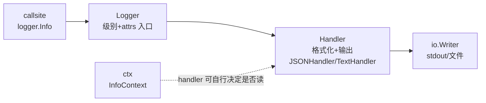

> P13 §13.8 路线图的第一步。metrics（P13）回答"多少"，这章回答
> "发生了什么"。前置：P8（net/http）、P13（label 基数纪律）。
> 后续：P16 把 req_id 注入下沉到 handler。

## 这章学完你能干什么

用户报障："GET /kv/ghost 返回 404，几点的我不知道。"你的服务在
多实例上跑着，日志几十万行。本章结束时你能：在响应头拿到
`X-Request-ID`，用它在 JSON 日志里一行 `jq` 捞出完整请求轨迹，
并顺手保证敏感字段（token）不落盘。httpkv 实拍（练习包现状）：

```json
{"time":"2026-10-10T17:20:01.593787+08:00","level":"WARN","msg":"kv miss","req_id":"req-1791624001593759000","key":"ghost","status":404}
```

`req_id` 与响应头一致，报障的 id 直接对上日志的 id。三个问题
依次展开：

1. 这条日志怎样变成可查询事件？
2. req_id 从哪里来，为什么 `InfoContext` 本身没有替你输出它？
3. 上线时怎样避免敏感字段和无效计算？

## 问题 1：这条日志怎样变成可查询事件？

先看反例。文本日志 `log.Printf("kv miss: key=%s", k)` 人能读，
机器不能查。想统计"过去一小时 ghost key miss 的 Top 10"，你得
grep + 正则 + awk 三件套，字段名一变就全崩。

结构化日志把一条日志变成一个 JSON 对象，字段即列：

| 文本日志 | 结构化日志 |
|---|---|
| `kv miss: key=ghost` | `{"msg":"kv miss","key":"ghost"}` |
| 统计靠 grep 正则 | `jq 'select(.msg=="kv miss")'` |
| 字段名各写各的 | 统一 schema，跨服务可聚合 |
| 级别埋在字符串里 | `"level":"WARN"` 可过滤可告警 |

落地只需一行配置（练习包 `p15slog.NewLogger` 就是它的封装）：

```go
logger := slog.New(slog.NewJSONHandler(os.Stdout, &slog.HandlerOptions{Level: slog.LevelInfo}))
logger.Warn("kv miss", "key", "ghost", "status", 404)
```

验证：跑 `go test -run TestJSONFields ./exercises/p15slog/`，
它断言输出是合法 JSON 且字段可查。Rust 对照：`tracing` 的
`info!(key = %k, "kv miss")` 是同一个事件+字段模型，JSONHandler
对应 `tracing_subscriber::fmt().json()`。你会用 tracing，这层
概念直接平移，差异在下一问。

## 问题 2：req_id 从哪里来，为什么 InfoContext 没有替你输出它？

这条 404 日志的 `req_id` 有自己的生命周期，三步：

1. **中间件生成**：httpkv 的 `reqID` 给每个请求分配 id，写进
   响应头（用户报障能贴）并塞进 ctx：

```go
func reqID(next http.HandlerFunc) http.Handler {
    return http.HandlerFunc(func(w http.ResponseWriter, r *http.Request) {
        id := fmt.Sprintf("req-%d", time.Now().UnixNano())
        w.Header().Set("X-Request-ID", id)                      // 响应头可回查
        next(w, r.WithContext(p15slog.WithRequestID(r.Context(), id)))  // ctx 传递
    })
}
```

2. **handler 显式取出**：日志调用点自己从 ctx 拿（练习 `TestCtxRequestID`
   的断言）：

```go
logger.WarnContext(r.Context(), "kv miss",
    "req_id", p15slog.RequestID(r.Context()), "key", k, "status", 404)
```

3. **`InfoContext` 只是递了 ctx，不读它**。这是本章最大的认知坑：
   **标准 slog handler 不自动从 ctx 提取值**。`WarnContext(ctx, ...)`
   把 ctx 交给 handler 只是"给了它机会"，文档原话是"Some handlers
   may wish to include information from the context"，JSONHandler
   不在其中。OTel 的 handler 才会从 ctx 提取 trace_id 自动注入。

所以参数求值发生在**调用点**，不在 handler。你没显式带 req_id，
日志里就没有。Rust tracing 的 span 模型把这一步自动化了
（`#[instrument]` 一标，字段自动传播），Go 标准库选择了显式。
P16 的正解是把提取逻辑下沉到自定义 handler，调用点瘦身成
`logger.WarnContext(ctx, "kv miss", "key", k, "status", 404)`，
req_id 照样出现在输出里，这是下一章的入口。

**与 metrics 的分层纪律**：req_id 是高基数（每请求一个），按 P13
§13.7 的基数纪律绝不进 metrics label。所以 httpkv 的中间件顺序是
`Instrument（metrics，低基数：method/pattern/status）在外，
reqID（高基数 id 只进日志）在内`。指标 label 三个字段，日志
带 req_id，两边各守各的边界。

## 问题 3：上线时怎样避免敏感字段和无效计算？

两个上线边界，都有现成测试盯着：

**脱敏收敛到 LogValuer**。敏感字段不该散落各处手工打码，纪律
靠人的方案必然漏。`LogValuer` 把脱敏收敛到类型定义处，日志调用点
零感知（练习 `TestLogValuerRedact` 断言 "sekrit" 和明文邮箱都不在
输出里）：

```go
type User struct {
    ID    int64
    Email string
    Token string
}

func (u User) LogValue() slog.Value {
    return slog.GroupValue(
        slog.Int64("id", u.ID),
        slog.String("email", redactEmail(u.Email)),
    )
}
```

`LogValue()` 在输出时才调用（延迟求值），Token 字段类型层面就
不出现。对照 Rust：tracing 的 field 里塞 `?redacted` 类型包装，
思路一致：把策略放在类型上，而不是每个调用点。

**昂贵数据先问 Enabled 再算**。slog 的性能合同：参数总是求值，
级别不够时结果被丢掉但计算已经发生。所以昂贵数据要自己加闸
（练习 `TestEnabledGuard` 验证"级别不够，expensive 函数根本没被调"）：

```go
if logger.Enabled(ctx, slog.LevelDebug) {
    logger.Debug("dump", "state", expensiveDump())
}
```

tracing 用 `enabled!()` + 延迟格式化达到同样效果。

## 动手：练习 p15slog + httpkv（45 分钟）

```sh
cd /Users/akka/Dev/learning/go
go test -race ./exercises/p15slog/ ./exercises/p8fast/httpkv/
go build -o /tmp/httpkv15 ./exercises/p8fast/httpkv/ && /tmp/httpkv15 &
```

**预测题**（跑之前写答案）：

1. `curl -s localhost:8090/kv/ghost` 的响应头和 stderr 日志里，
   两个 id 一致吗？（§问题 2）
2. 把 handler 里的 `"req_id", requestID(r.Context())` 删掉再跑，
   日志里 req_id 还在吗？为什么？（§问题 2，标准 handler 不读 ctx）
3. `logger.Info("login", "user", User{...})` 输出里有 token 吗？
   为什么？（§问题 3）

**观察验证**：

```sh
curl -s -i localhost:8090/kv/ghost        # X-Request-ID 响应头
# 对照 stderr 的 JSON 日志：req_id 与响应头一致
```

| 练习 | 考什么 | 在哪 |
|---|---|---|
| TestJSONFields | JSON 事件字段可查 | p15slog |
| TestLevelFilter | Debug 被级别拦住 | p15slog |
| TestEnabledGuard | expensive 没白跑 | p15slog |
| TestLogValuerRedact | Token 不落盘 | p15slog |
| TestCtxRequestID / TestLogKV | ctx 塞、显式取 | p15slog |
| httpkv 冒烟 | req_id == X-Request-ID | httpkv |

**改造题（P16 入口）**：写一个 `ctxHandler` 包装 JSONHandler，在
`Handle` 里从 ctx 自动取 req_id 注入，调用点不用每处显式带。
提示：实现 `slog.Handler` 接口，`WithAttrs`/`WithGroup` 记得转发
给内层。完整正解与两个必踩坑（转发丢失、同名 attr 覆盖方向）在
P16。

## Take-away

1. 结构化日志 = 每条日志一个 JSON 事件，字段即列；grep+正则统计
   变成一行 jq。
2. req_id 链路 = 中间件生成（响应头 + ctx）→ handler 显式取出；
   `InfoContext` 只是递 ctx，**标准 handler 不读 ctx**，这是 slog
   与 tracing/OTel 生态的关键差异。
3. 上线边界两条：脱敏收敛在 `LogValuer`（类型层面 Token 不出现）；
   昂贵数据先 `Enabled` 再算（参数总是求值，要自己加闸）。
4. 基数纪律跨柱生效：req_id 高基数只进日志，metrics label 保持
   method/pattern/status 三个低基数字段。

---

## 章末参考

### 四对象：Logger/Handler/Record/Attr

slog 架构是一层过滤管道，定制行为时才需要全部细节：



| 对象 | 职责 | 常用件 |
|---|---|---|
| `Logger` | 入口，带级别+预置 attrs | `slog.New(h)`, `.With("svc","httpkv")` |
| `Handler` | 格式化+写出 | `NewJSONHandler`/`NewTextHandler`，自定义可实现接口 |
| `Record` | 一次日志调用的载体（time/level/msg/attrs/pc） | 自定义 handler 时处理 |
| `Attr` | 一个键值字段 | `slog.String/Int/Group` |

`With("svc","httpkv")` 预置 attrs：内置 handler 在 With 时就格式化
一次，之后每条日志复用：高频公共字段用 With 而不是每次传。
`WithGroup("parser")` 给后续字段加命名空间，防止大系统里不同子系统
的重复 key 撞车。

### 级别与性能细节

四个级别 `Debug < Info < Warn < Error`，`HandlerOptions.Level` 设
门槛，`Enabled` 在 handler 处理前就判断（省掉参数处理的开销）。
Handler 合同里 `Handle` 只在 `Enabled` 为真时被调；ctx 取消不影响
已开始的记录处理（日志可能正是排查取消用的）。

`LogAttrs` vs `Log`：后者交替传 key/value（`"key", k, "status", 404`），
每次调用要分配；前者直接传 `[]slog.Attr`，热路径可预分配复用。
练习 `LogKV` 用的是 `LogAttrs`。

### 自定义 handler 的最小骨架

P15 改造题的起点（完整讲解和两个坑在 P16）：

```go
type ctxHandler struct {
    inner slog.Handler
}

func (h ctxHandler) Enabled(ctx context.Context, l slog.Level) bool {
    return h.inner.Enabled(ctx, l)
}

func (h ctxHandler) Handle(ctx context.Context, r slog.Record) error {
    if id := p15slog.RequestID(ctx); id != "" {
        r.AddAttrs(slog.String("req_id", id))
    }
    return h.inner.Handle(ctx, r)
}

func (h ctxHandler) WithAttrs(attrs []slog.Attr) slog.Handler {
    return ctxHandler{inner: h.inner.WithAttrs(attrs)}   // 坑 1：必须转发重包
}

func (h ctxHandler) WithGroup(name string) slog.Handler {
    return ctxHandler{inner: h.inner.WithGroup(name)}
}
```

同名 attr 的覆盖方向（先注入会被显式覆盖还是反过来）是 P16 的
实测点，别凭直觉猜。

### 与 Rust tracing 的对照表

| Go slog | Rust tracing | 备注 |
|---|---|---|
| `logger.Info("kv miss", "key", k)` | `info!(key = %k, "kv miss")` | 事件+字段模型一致 |
| `slog.NewJSONHandler` | `tracing_subscriber::fmt().json()` | 格式化层 |
| `LogValuer` | `?redacted` field 包装 | 类型级脱敏 |
| `logger.Enabled(ctx, LevelDebug)` | `enabled!( LevelDEBUG)` | 昂贵数据守卫 |
| ctx 显式取值（标准 handler 不读） | span 上下文自动传播 | **最大差异**；P16 的 handler 补齐 |
| 无（要自定义） | `#[instrument]` | 自动注入靠 handler 或 P16 |

### 历史实拍与运行版本说明

章首 JSON 是 2026-10-10 冒烟实拍（P15 教学阶段：调用点显式带
req_id）。当前 httpkv 代码已演进到 P16（`p16slogh.NewCtxLogger`
自动注入），冒烟时 `X-Request-ID` 与日志 `req_id` 依然一致，但
handler 调用点已无显式 `"req_id", ...` 参数。你读到的代码是
P16 形态，本章教学场景是 P15 形态，两者输出相同、调用点不同。
复现 P15 形态：把 `main.go` 的 `p16slogh.NewCtxLogger` 换成
`slog.NewJSONHandler`，再在 handler 调用点手动带 req_id。

### 日志查询常用命令

```sh
# 按 msg 过滤
jq 'select(.msg=="kv miss")' < log.jsonl
# 按级别和状态码
jq 'select(.level=="WARN" and .status==404)' < log.jsonl
# 按报障 id 捞完整请求
jq 'select(.req_id=="req-1791624001593759000")' < log.jsonl
# 过去一小时 miss Top 10（jq 时代答 P13 留下的问题）
jq -r 'select(.msg=="kv miss") | .key' < log.jsonl | sort | uniq -c | sort -rn | head
```
