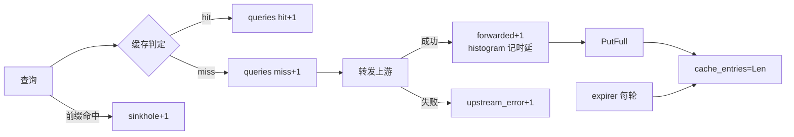

# 第 17 章 · 毕业项目指标落地：dnsproxi 的 RED


> 这章学完你能干什么：给 dnsproxi 这个 UDP 代理接上 `:9153/metrics`，跑一轮查询后，对着自己的输出做逐条对账。
> 你会回答四件事：DNS 代理的 RED 怎么定义，label 怎么保持低基数，gauge 在哪里更新，冒烟怎么对账。
> 前置：P13（RED/USE、基数纪律）、P15/P16（logs 柱已落地）。后续：P18 落地日志柱，与本章的指标柱汇合。
>
> 动手方式：这章不写新代码，跟着做。先编译 `dnsproxi-go/`，再用一个 20 行的 Python 假上游代替真 DNS 服务器，然后每次改一个开关，看 `/metrics` 怎么变。

## 体系背景：UDP 没有连接，指标口为什么走 TCP

DNS 代理收发的是 UDP 报文。UDP 没有握手，也没有连接状态：内核只给你一个绑定了端口的 socket，每个报文互相独立。

指标口是 HTTP，跑在 TCP 上。TCP 有 LISTEN 状态，每个抓取请求都是一条有状态的连接。把两个端口都打开，看内核怎么描述它们：

```sh
$ lsof -nP -a -p $PID -iUDP -iTCP
COMMAND   PID USER   FD   TYPE             DEVICE SIZE/OFF NODE NAME
dp17    91901 akka    3u  IPv6 0x90416d8a905d5f18      0t0  UDP *:15373
dp17    91901 akka    4u  IPv6 0x8caa364223eb8d3d      0t0  TCP *:9173 (LISTEN)
```

UDP 那一行后面没有状态，TCP 那一行有 `(LISTEN)`。netstat 里也一样：

```sh
$ netstat -an | grep -E "15373|9173"
tcp46      0      0  *.9173                 *.*                    LISTEN
tcp6       0      0  ::1.59209              ::1.9173               TIME_WAIT
udp46      0      0  *.15373                *.*
```

`TIME_WAIT` 是已经结束的抓取连接留下的尾巴。UDP 那行什么都没有，查询一来一回就结束了，内核不记得它。

这有两个后果。第一，"当前有多少连接"这类指标对 UDP 服务没有意义，要自己数在飞的查询。第二，业务端口和指标端口协议不同，天然应该分开：

```sh
$ curl -s -o /dev/null -w "%{http_code} %{content_type}\n" localhost:9173/metrics
200 text/plain; version=0.0.4; charset=utf-8; escaping=underscores
$ curl -s -o /dev/null -w "POST %{http_code}\n" -X POST localhost:9173/metrics
POST 405
```

Prometheus 用的是拉取模型：它定时 `GET /metrics`，进程只负责把当前读数摆出来。进程不需要知道谁在抓、多久抓一次。

Java 里同样的角色是 Spring Actuator 的 `/actuator/prometheus`，Node 里是 `prom-client` 的 `register.metrics()`。三者暴露的文本格式一样。

## 环境

先编译。`dnsproxi-go/` 是独立的 Go 模块，要在它自己的目录里编译：

```sh
$ cd dnsproxi-go
$ go build -o /tmp/dnsproxi .
```

再准备假上游。把下面存成 `upstream.py`。它对任何查询都回一条 `10.0.0.1` 的 A 记录，TTL 可以从命令行传：

```python
import socket, struct, sys

port = int(sys.argv[1])
ttl = int(sys.argv[2]) if len(sys.argv) > 2 else 60
s = socket.socket(socket.AF_INET, socket.SOCK_DGRAM)
s.bind(("127.0.0.1", port))
print(f"fake upstream on :{port}, ttl={ttl}", flush=True)
while True:
    data, addr = s.recvfrom(4096)
    off = 12
    while data[off] != 0:
        off += 1 + data[off]
    question = data[12:off + 5]
    flags = bytearray(data[2:4])
    flags[0] |= 0x80  # QR=1，标记这是应答
    resp = data[:2] + bytes(flags) + struct.pack("!HHHH", 1, 1, 0, 0) + question
    resp += b"\xc0\x0c" + struct.pack("!HHIH", 1, 1, ttl, 4) + bytes([10, 0, 0, 1])
    s.sendto(resp, addr)
```

```sh
$ python3 upstream.py 15330 60 &
fake upstream on :15330, ttl=60
```

## 跑起来

打开缓存和 sinkhole（匹配前缀的域名直接回 NXDOMAIN），指标口用默认的 `:9153`：

```sh
$ DNS_LISTEN=:15353 DNS_UPSTREAM=127.0.0.1:15330 DNS_CACHE=1 DNS_SINKHOLE=blocked. /tmp/dnsproxi &
```

还没发任何查询，先看一眼 `/metrics`：

```sh
$ curl -s localhost:9153/metrics | grep dnsproxi
# HELP dnsproxi_cache_entries Current number of cached responses.
# TYPE dnsproxi_cache_entries gauge
dnsproxi_cache_entries 0
# HELP dnsproxi_in_flight_queries Queries currently being handled.
# TYPE dnsproxi_in_flight_queries gauge
dnsproxi_in_flight_queries 0
# HELP dnsproxi_upstream_duration_seconds Upstream round-trip latency for forwarded queries.
# TYPE dnsproxi_upstream_duration_seconds histogram
dnsproxi_upstream_duration_seconds_bucket{le="0.0001"} 0
dnsproxi_upstream_duration_seconds_bucket{le="0.0005"} 0
dnsproxi_upstream_duration_seconds_bucket{le="0.001"} 0
...
dnsproxi_upstream_duration_seconds_bucket{le="+Inf"} 0
dnsproxi_upstream_duration_seconds_sum 0
dnsproxi_upstream_duration_seconds_count 0
```

只有两个 gauge 和一个空直方图。没有 `dnsproxi_queries_total`，因为带 label 的 counter 在第一次 `WithLabelValues` 之前一条序列都没有。

发第一条查询。为了让命令短，先定义一个小函数，`+noedns +noad` 是仓库 `run.sh` 里一直带着的选项：

```sh
$ q() { dig +noedns +noad +time=2 +tries=1 @127.0.0.1 -p 15353 "$1" ${2:-A} +noall +answer +comments | grep -E "status|IN"; }
$ q a.test
;; ->>HEADER<<- opcode: QUERY, status: NOERROR, id: 22330
a.test.			60	IN	A	10.0.0.1
$ curl -s localhost:9153/metrics | grep -E "^dnsproxi_(queries|cache|upstream_duration_seconds_count)"
dnsproxi_cache_entries 1
dnsproxi_queries_total{outcome="forwarded",qtype="A"} 1
dnsproxi_queries_total{outcome="miss",qtype="A"} 1
dnsproxi_upstream_duration_seconds_count 1
```

一次查询，两条计数增加：`miss`（缓存里没有）和 `forwarded`（真的发给了上游）。缓存条目 1 条，上游往返记了 1 个样本。

## 对账

接着上一节的实例，补发 6 条查询：`a.test` 再来两次，`b.test` 三次，`blocked.test` 一次。加上第一条，一共是固定的 7 条。

```sh
$ for n in a.test a.test b.test b.test b.test blocked.test; do q $n >/dev/null; done
$ curl -s localhost:9153/metrics | grep -E "^dnsproxi_(queries|cache|upstream_duration_seconds_count)"
dnsproxi_cache_entries 2
dnsproxi_queries_total{outcome="forwarded",qtype="A"} 2
dnsproxi_queries_total{outcome="hit",qtype="A"} 4
dnsproxi_queries_total{outcome="miss",qtype="A"} 2
dnsproxi_queries_total{outcome="sinkhole",qtype="A"} 1
dnsproxi_upstream_duration_seconds_count 2
```

逐条对账：

1. 7 次查询 = 2 个 `miss` + 4 个 `hit` + 1 个 `sinkhole`。
2. `forwarded` 是 2，等于 `miss` 的数，因为每个 miss 都真的发了上游。
3. 命中率 = 4/6。`sinkhole` 不走缓存路径，不进分母。
4. `cache_entries` 是 2，对着 `a.test` 和 `b.test` 两个 key。
5. 直方图样本数是 2，只有转发的两次有上游往返。

这笔账是正确性最硬的证据。日志里也有同样的故事：

```sh
{"level":"INFO","msg":"cache miss, forwarding","qname":"a.test","qtype":"A",...}
{"level":"INFO","msg":"cache hit","qname":"a.test","qtype":"A","ttl_left":60,...}
{"level":"INFO","msg":"cache hit","qname":"a.test","qtype":"A","ttl_left":60,...}
```

## RED 在 DNS 里长什么样

P13 的 RED 三问照搬，对象换掉：

| RED | httpkv（P13） | dnsproxi（P17） |
|---|---|---|
| Rate | 每路由请求数 | 每 qtype × outcome 的查询数 |
| Errors | 5xx | `upstream_error` 等 outcome |
| Duration | handler 耗时 | 上游往返，转发才有，命中没有 |

关键差异在 Rate：DNS 的 R 不是"每个 qname"。qname 是无限集，进 label 就是 P13 讲过的基数爆炸。要查"哪个域名慢"，那是日志的活，P18 的 `[miss]` 行已经在打了。

五个指标各回答一件事：

- `queries_total{qtype,outcome}` 是 Counter，回答量、错误率（`upstream_error` 除以总数）和命中率（`hit/(hit+miss)`）。
- `upstream_duration_seconds` 是 Histogram，回答上游慢不慢。
- `in_flight_queries` 是 Gauge，回答在飞积压。worker pool 模式顶到 N 就是背压点。
- `cache_entries` 是 Gauge，回答逼近 `CacheMax` 没。
- `/metrics` 独立端口 `:9153`，抓取口不掺业务端口。

`forwarded` 和 `miss` 要分清。`miss` 是缓存没有，`forwarded` 是真发上游了。缓存关着时只有 `forwarded`。两个数相减，就是"解析失败没发出去的"，告警规则用得上。

## 低基数：qtype 与 outcome

wire 里的 qtype 是 `uint16`，有 65536 种取值，直接进 label 等于裸奔。`qtypeLabel` 把它映射到 9 个实名加 `OTHER`：

```go
func qtypeLabel(t uint16) string {
    switch t {
    case 1: return "A"
    case 28: return "AAAA"
    ...
    default: return "OTHER"
    }
}
```

qtype 本身怎么从报文里取？它在 question 段 name 之后的两个字节，大端：

```go
t := uint16(query[next])<<8 | uint16(query[next+1])
```

名字畸形解析失败时归 `OTHER`。监控代码自己不能炸，炸了比没监控更糟。

改一处看变化：发几种不同的 qtype，包括两个冷门类型：

```sh
$ q c.test AAAA
$ q c.test MX
$ q d.test TYPE999
$ q e.test TYPE1234
$ curl -s localhost:9153/metrics | grep -E "^dnsproxi_queries_total"
dnsproxi_queries_total{outcome="forwarded",qtype="A"} 2
dnsproxi_queries_total{outcome="forwarded",qtype="AAAA"} 1
dnsproxi_queries_total{outcome="forwarded",qtype="MX"} 1
dnsproxi_queries_total{outcome="forwarded",qtype="OTHER"} 2
dnsproxi_queries_total{outcome="hit",qtype="A"} 4
dnsproxi_queries_total{outcome="miss",qtype="A"} 2
dnsproxi_queries_total{outcome="miss",qtype="AAAA"} 1
dnsproxi_queries_total{outcome="miss",qtype="MX"} 1
dnsproxi_queries_total{outcome="miss",qtype="OTHER"} 2
dnsproxi_queries_total{outcome="sinkhole",qtype="A"} 1
```

`TYPE999` 和 `TYPE1234` 落进同一条 `OTHER` 序列。无论线上来多少种怪类型，序列数不会涨。

这套设计能过 P13 的基数审计：qtype 取值 10 种，outcome 取值 6 种（`hit`、`miss`、`sinkhole`、`short`、`upstream_error`、`forwarded`），两者相乘最多 60 条序列，且不随流量增长。反面教材是 qname，每个新域名加一条序列，指标数据库跟着流量无限膨胀。

验收标准：label 必须能报出"一天最多多少种取值"这个数。qtype × outcome 是 60。

Java 的 Micrometer 叫 tag，Node 的 `prom-client` 叫 `labelNames`，规矩一样：别把用户 ID、URL 这类高基数值放进去。

## 时延：只量上游往返

直方图 `upstream_duration_seconds` 只记上游往返，不记整个 `handleQuery`。命中路径是微秒级的内存操作，混进同一个直方图会把 P99 稀释成无意义的数字。

桶的边界按被测对象的 SLA 定。UDP 转发是毫秒级，所以桶从 100µs 到 500ms：

```go
Buckets: []float64{0.0001, 0.0005, 0.001, 0.0025, 0.005, 0.01, 0.05, 0.1, 0.5},
```

## 压一轮

对账在小流量下成立，再压一轮看动态行为。`dnsproxi-go/dnsq/` 是仓库自带的压测器：

```sh
$ go run ./dnsq -target 127.0.0.1:15353 -dur 3s -conc 8 -names 50
sent=145622 recv=145622 lost=0 (0.00%)
elapsed=3.002s qps=48513
latency p50=132µs p90=309µs p99=660µs max=11.87ms n=145542
$ curl -s localhost:9153/metrics | grep -E "^dnsproxi_(queries_total|cache_entries)"
dnsproxi_cache_entries 52
dnsproxi_queries_total{outcome="forwarded",qtype="A"} 52
dnsproxi_queries_total{outcome="hit",qtype="A"} 145576
dnsproxi_queries_total{outcome="miss",qtype="A"} 52
```

先对账。压测前 A 的 `hit` 是 4、`miss` 是 2，所以这一轮新增了 145572 个 `hit` 和 50 个 `miss`，加起来正好是 `sent=145622`。50 个名字各 miss 一次，之后全部命中。

缓存条目是 52，是 `a.test`、`b.test` 加 50 个压测名。前面发的 AAAA、MX 和 `TYPE` 查询没进缓存，原因是缓存只收 answer 段里有匹配 qtype 的 IN 记录，而假上游对每种 qtype 都回 A 记录，所以重复问一遍 `c.test AAAA`，`miss` 照样加一。指标在这里替你发现了假上游的局限。

再看直方图。样本数只有 56 个，不是 14 万个：

```sh
$ curl -s localhost:9153/metrics | grep -E "upstream_duration_seconds_(count|bucket\{le=\"0.0005)"
dnsproxi_upstream_duration_seconds_bucket{le="0.0005"} 56
dnsproxi_upstream_duration_seconds_count 56
```

56 个转发样本全落在 0.5ms 内。压测器测到的 P99 是 660µs，那是客户端看到的整体往返，绝大多数请求走的是命中路径。两个数口径不同，别直接比。

## Gauge 的两个更新点

`cache_entries` 是 Gauge，双向走。它不只在 `PutFull` 后更新（涨），还在 expirer 每轮更新（落）。更新点画出来：



漏了后者会怎样？起一个 TTL 只有 2 秒的上游，先不开主动老化：

```sh
$ python3 upstream.py 15340 2 &
$ DNS_LISTEN=:15373 DNS_UPSTREAM=127.0.0.1:15340 DNS_CACHE=1 DNS_CACHE_ACTIVE_TTL=0 /tmp/dnsproxi &
$ for n in x1 x2 x3; do q $n.test >/dev/null; done
刚查完:   dnsproxi_cache_entries 3
过了 4 秒: dnsproxi_cache_entries 3
```

TTL 早过了，条目还赖在缓存里。读路径会把过期条目当 miss，但条目本身没人清。再换成 `DNS_CACHE_ACTIVE_TTL=1`，其余不变：

```sh
刚查完:   dnsproxi_cache_entries 3
过了 4 秒: dnsproxi_cache_entries 0
```

主动老化的 goroutine 每轮清理，并把 `cache_entries` 更新成真实长度。如果代码里漏掉这个 `Set`，指标会只涨不跌，主动老化看起来像没干活。

自查方法：对着流程图数一遍某个 Gauge 的涨落点，再 `grep` 代码里的 `Set(` 确认每个点都有对应调用。Counter 只涨无所谓，Gauge 双向走，漏一个方向指标就撒谎。

## 上游出错

出错路径有自己的计数器：`dnsproxi_upstream_errors_total{reason}`。`upstreamErrReason` 负责分类：`errors.As(net.Error)` 判超时，`errors.Is(syscall.ECONNREFUSED)` 判拒收，兜底归 `network`。分类器自己不能 panic，未知原因也要能数出来。

场景一：死上游，端口没人监听。发 3 个查询：

```sh
$ DNS_LISTEN=:15353 DNS_UPSTREAM=127.0.0.1:15399 /tmp/dnsproxi &
$ for i in 1 2 3; do dig +noedns +noad +time=3 +tries=1 @127.0.0.1 -p 15353 "d$i.test" A +noall +comments; done
;; connection timed out; no servers could be reached
;; connection timed out; no servers could be reached
;; connection timed out; no servers could be reached
$ curl -s localhost:9153/metrics | grep -E "^dnsproxi_(queries_total|upstream_errors_total|upstream_duration_seconds_count)"
dnsproxi_queries_total{outcome="upstream_error",qtype="A"} 3
dnsproxi_upstream_duration_seconds_count 0
dnsproxi_upstream_errors_total{reason="refused"} 3
```

代理出错时不回包，客户端靠自己的超时兜底。服务端的真相在日志和指标里：

```sh
{"level":"WARN","msg":"upstream read failed","err":"read udp 127.0.0.1:51302->127.0.0.1:15399: read: connection refused",...}
```

macOS 对 UDP 未监听的端口回 ICMP 端口不可达，`Read` 立刻浮出 `ECONNREFUSED`，不等 deadline。

场景二：黑洞上游，`10.255.255.1` 不回包。让 dig 一秒就放弃，再观察代理什么时候才记账：

```sh
$ DNS_LISTEN=:15353 DNS_UPSTREAM=10.255.255.1:53 /tmp/dnsproxi &
$ dig +noedns +noad +time=1 +tries=1 @127.0.0.1 -p 15353 hole.test A +noall +comments
;; connection timed out; no servers could be reached
-- 客户端放弃后 0.5 秒
dnsproxi_upstream_duration_seconds_count 0
-- 再等 1.5 秒
dnsproxi_queries_total{outcome="upstream_error",qtype="A"} 1
dnsproxi_upstream_duration_seconds_count 0
dnsproxi_upstream_errors_total{reason="timeout"} 1
```

客户端 1 秒放弃，指标要等代理自己的 2 秒 deadline 到了才出现。`reason="timeout"` 是 1，`upstream_duration_seconds_count` 仍是 0。

第二个场景藏着一个考点：错误样本不进时延直方图。混进去会把 P99 拉到 2 秒（deadline 上限），下游告警全部误报。"时延"只量成功路径。

这条纪律由测试守着。`TestMetricsDeadUpstream` 就是死上游场景的自动化版本，`TestMetricsSinkhole` 和 `TestMetricsForwardCounts` 守着另外两条对账关系：

```sh
$ go test -run Metrics -v .
--- PASS: TestMetricsDeadUpstream (0.85s)
--- PASS: TestMetricsSinkhole (0.15s)
--- PASS: TestMetricsForwardCounts (0.15s)
PASS
ok  	golearn/dnsproxi-go	1.437s
```

## 冒烟翻车：QR 位丢了

第一轮冒烟时 `hit` 一直是 0。把假上游改成有 bug 的版本，只改一行：置了 QR 位，但拼回包时用了没改过的原始 flags：

```python
flags[0] |= 0x80  # 置了位……
resp = data[:4] + struct.pack("!HHHH", 1, 1, 0, 0) + question   # 改的位被丢弃
```

假上游跑在 15331，代理指向它，监听 15363，指标口 9163。先别怀疑代理，直接问上游，再经代理问三次：

```sh
$ dig +noedns +noad @127.0.0.1 -p 15331 a.test A +noall +comments | grep flags
;; flags: rd; QUERY: 1, ANSWER: 1, AUTHORITY: 0, ADDITIONAL: 0
$ for i in 1 2 3; do dig +noedns +noad @127.0.0.1 -p 15363 a.test A +noall +comments | grep flags; done
;; flags: rd; QUERY: 1, ANSWER: 1, AUTHORITY: 0, ADDITIONAL: 0
;; flags: rd; QUERY: 1, ANSWER: 1, AUTHORITY: 0, ADDITIONAL: 0
;; flags: rd; QUERY: 1, ANSWER: 1, AUTHORITY: 0, ADDITIONAL: 0
$ curl -s localhost:9163/metrics | grep -E "^dnsproxi_(queries_total|cache_entries)"
dnsproxi_cache_entries 0
dnsproxi_queries_total{outcome="forwarded",qtype="A"} 3
dnsproxi_queries_total{outcome="miss",qtype="A"} 3
```

好的上游回的 flags 是 `qr rd`，这个回的只有 `rd`，应答没有 QR 位。代理只缓存 QR 位为 1 的应答（`cache/plan.go` 里的检查），所以三次全是 `miss`，`cache_entries` 是 0。

教训是冒烟二分法：直连被依赖方，把"代理坏"和"工具坏"切开。指标在这轮排查里的价值是，`miss 3、hit 0、cache_entries 0` 直接指出"回包没进缓存"，不用靠翻日志。

## 小结

1. UDP 无连接状态，指标口走独立的 TCP 端口 `:9153`，业务面不留 HTTP。
2. RED 照搬、对象换掉：量是查询数（qtype × outcome），错误是 outcome 枚举，时延只量上游往返。命中路径和错误样本都不进直方图。
3. qname 绝不进 label，qtype 先映射到有限集合。10 × 6 = 60 条序列封顶，能报数才算过基数审计。
4. Gauge 的涨落点都要喂：`PutFull` 涨、expirer 落，漏一边指标就撒谎。
5. 对账（7 = 2 + 4 + 1）是正确性最硬的证据。冒烟出问题先直连依赖方，切开"代理坏"和"工具坏"。

## 练习

没有独立练习包，毕业项目本身就是练习。

**预测**，先写答案再跑：

1. 把 `DNS_CACHE_MAX` 设成 2，依次查 `m1.test`、`m2.test`、`m3.test`、`m4.test`。`cache_entries` 是几？`forwarded` 是几？
2. 缓存关着（不设 `DNS_CACHE`），同一个域名查 5 次，`queries_total` 里会出现 `hit` 或 `miss` 吗？
3. 把假上游停掉，再查一个已经缓存的域名，结果是什么？指标变不变？

实测答案。第 1 题：`cache_entries` 是 2，`forwarded` 和 `miss` 都是 4。日志里有 2 条 `cache evict`，第一条是 `m1.test` 被 `m3.test` 挤掉，策略是 `full-lru`。第 2 题：只有 `forwarded` 是 5，没有 `hit` 和 `miss`。第 3 题：照常回 `10.0.0.1`，指标只多一个 `hit`，上游不再被问到。

**观察**：用 `dnsq` 压两轮，一轮 `-names 50`，一轮加 `-spread`（均匀随机大键空间，对缓存不友好）。比较两轮之后的命中率、`cache_entries` 和 `cache evict` 日志数量。观察点：

- `hit + miss` 要等于 A 查询总量。
- `cache_entries` 不超过 `CacheMax`。
- 上游往返的 P99（`histogram_quantile`）与 `dnsq` 的 P99 同量级，但口径不同。
- `in_flight` 峰值在 worker pool 模式下不超过 N。

**改造**：`upstream_errors_total{reason}` 已落地。试着再加一个 reason，比如上游返回 SERVFAIL 的情况，写出分类规则，并在 `metrics_test.go` 风格的测试里守住"错误样本不进直方图"。

## 章末参考

### Rust 对照

| 概念 | Rust | Go（本章） |
|---|---|---|
| 带 label 的计数器 | `prometheus` crate 的 `IntCounterVec` | `promauto.NewCounterVec` |
| 全局注册 | `lazy_static!` / `once_cell` 加 `register_*!` | `promauto` 在包初始化时注册 |
| 直方图 | `HistogramVec` | `promauto.NewHistogram` |
| UDP socket | `tokio::net::UdpSocket` | `net.ListenPacket("udp", ...)` |
| 指标 HTTP 口 | `axum` 或 `hyper` 路由 | `promhttp.Handler` 挂到独立 `http.Server` |
| 错误分类 | `match` 在 `io::ErrorKind` 上 | `errors.As` 加 `errors.Is` |

### Java/Kotlin 与 TS/JS 类比

| 概念 | Java / Kotlin | TS / JS |
|---|---|---|
| 指标库 | Micrometer 的 `Counter`、`Timer`、`Gauge` | `prom-client` 的 `Counter`、`Histogram`、`Gauge` |
| label | Micrometer 的 tag | `labelNames` |
| 抓取口 | Spring Actuator 的 `/actuator/prometheus` | `register.metrics()` 挂到 Express 路由 |
| UDP | `DatagramSocket`、`DatagramChannel` | Node 的 `dgram` |
| 推送式对照 | StatsD 客户端 | StatsD 客户端 |

### 五个指标速查

| 指标 | 类型 | 要回答的问题 |
|---|---|---|
| `queries_total{qtype,outcome}` | Counter | 量、错误率、命中率 |
| `upstream_errors_total{reason}` | Counter | 上游为什么错：`timeout`、`refused`、`network` |
| `upstream_duration_seconds` | Histogram | 上游慢不慢 |
| `in_flight_queries` | Gauge | 在飞积压 |
| `cache_entries` | Gauge | 容量逼近上限没 |

告警分通道：`timeout` 涨是上游过载或黑洞，`refused` 涨是上游端口没开。
