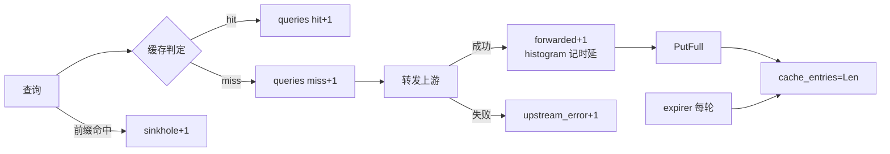

# 第 17 章 · 毕业项目指标落地：dnsproxi 的 RED


> P13 的方法论 + P16 的纪律搬进毕业项目。DNS 代理不是 HTTP，照搬
> Instrument 不行，要重新回答四个问题：量/错误/时延怎么定义、label 怎么
> 保持低基数、gauge 在哪里更新、冒烟怎么对账。
>
> 前置：P13（RED/USE、基数纪律）、P15/P16（logs 柱已落地）。后续：P18
> 落地日志柱，与本章的指标柱在 18.4 汇合。

## 17.0 这章学完你能干什么

dnsproxi 起服务自带 `:9153/metrics`，Prometheus 抓了就能画。真机冒烟
（fake upstream，7 个查询：cache on + sinkhole on）实测输出：

```
dnsproxi_queries_total{outcome="forwarded",qtype="A"} 2
dnsproxi_queries_total{outcome="hit",qtype="A"} 4
dnsproxi_queries_total{outcome="miss",qtype="A"} 2
dnsproxi_queries_total{outcome="sinkhole",qtype="A"} 1
dnsproxi_cache_entries 2
dnsproxi_upstream_duration_seconds_count 2
```

7 = 2 miss + 4 hit + 1 sinkhole，逐条对得上账。命中率 = 4/6（sinkhole
不算查询路径）一眼可算。这章结束时你能对着自己的 /metrics 输出做同样
的对账，并回答四个问题：

1. DNS 代理的 RED 怎么定义？量和错误、时延跟 HTTP 差在哪？（§17.1/§17.2）
2. qtype×outcome 为什么是正确的低基数设计？（§17.3）
3. gauge 有两个更新点，漏一个会怎样？（§17.4）
4. 冒烟对账怎么做？7=2+4+1 实测。（§17.5/§17.6）

## 17.1 问题 1：DNS 代理的 RED 是什么？

P13 的 RED 三问照搬，对象换掉：

| RED | httpkv（P13） | dnsproxi（P17） |
|---|---|---|
| Rate | 每路由请求数 | 每 qtype × outcome 的查询数 |
| Errors | 5xx | upstream_error / 超时（outcome 枚举里） |
| Duration | handler 耗时 | **上游往返**（转发才有，命中没有） |

关键差异：**DNS 的 R 不是"每 qname"**。qname 无限集，进 label 就是
P13 讲过的基数爆炸。所以 label 只有 `qtype`（映射到 9 个常见类型 + OTHER）
和 `outcome`（hit/miss/sinkhole/short/upstream_error/forwarded 六枚举）。
要查"哪个域名慢"，那是日志的活（P18 的 `[miss]` 行已经在打了）。

第二个差异在 D：时延直方图只记上游往返，不记整个 handleQuery。命中路径
是微秒级内存操作，混进同一个直方图会把 P99 稀释成无意义（对照 P13 分桶
原则：桶按被测对象的 SLA 定，UDP 转发毫秒级，桶 100µs~500ms）。

## 17.2 问题 1 续：五个指标各回答什么

| 指标 | 类型 | 回答什么 |
|---|---|---|
| `queries_total{qtype,outcome}` | Counter | 量 + 错误率（upstream_error/总）+ 命中率（hit/(hit+miss)） |
| `upstream_duration_seconds` | Histogram | 上游慢不慢（P99 延迟的源头） |
| `in_flight_queries` | Gauge | 在飞积压（worker pool 模式顶到 N 就是背压点） |
| `cache_entries` | Gauge | 逼近 CacheMax 没（容量规划） |
| `/metrics` 独立 :9153 | HTTP | 抓取口不掺业务端口 |

注意 `forwarded` 和 `miss` 的区别：miss 是"缓存没有"，forwarded 是
"真发上游了"。缓存关着时只有 forwarded。两个数相减就是
"解析失败没发出去的"，告警规则用得上。

## 17.3 问题 2：qtype×outcome 为什么是正确的低基数设计？

wire 里的 qtype 是 uint16（65536 种），直接进 label 等于裸奔。
`qtypeLabel` 映射到 9 个实名 + OTHER：

```go
func qtypeLabel(t uint16) string {
    switch t {
    case 1: return "A"
    case 28: return "AAAA"
    ...
    default: return "OTHER"
    }
}
```

位运算取 qtype（question 段 name 后两字节，大端）：

```go
t := uint16(query[next])<<8 | uint16(query[next+1])
```

解析失败（名字畸形）归 OTHER。监控代码自己不能炸，炸了比没监控更糟。

这套设计能过 P13 §13.7 的基数审计：qtype 取值 10 种，outcome 取值
6 种，两条序列乘起来最多 60 条，且都不随流量增长。对照反面教材：
qname 每个新域名加一条序列，指标数据库跟着流量无限膨胀。这也是 P13
改造题的验收标准：label 必须能报出"一天最多多少种取值"这个数
（qtype×outcome = 60，B 端也能算）。

## 17.4 问题 3：gauge 的两个更新点，漏一个会怎样？

`cache_entries` 不只在 PutFull 后更新（涨），还在 expirer 每轮更新（落）。
漏了后者，指标只涨不跌，主动老化看起来像没干活。更新点画出来：



自查方法：对着流程图数一遍某个 Gauge 的涨落点，再 grep 代码里的
`Set(` 确认每个点都有对应调用。Counter 只涨无所谓，Gauge 双向走，
漏一个方向指标就撒谎。

## 17.5 冒烟翻车记：QR 位丢了，先怀疑代理再自查工具

第一轮冒烟 `hit` 一直是 0。排查顺序：① 代理回包 `qr=0`？那是
upstream 回的原始包；② 直问 upstream 得到 `qr=0 ancount=1`，破案：
**fake upstream 自己的 bug**（`resp[2] |= 0x80` 后又用 `data[:6]`
重拼，改的位被丢弃）。

教训：冒烟二分法。直连被依赖方，把"代理坏"和"工具坏"切开。
指标在这轮排查里的价值：`miss 6 → hit 0` 直接指出"回包没进缓存"，
而不是靠翻日志。

## 17.6 问题 4：冒烟对账怎么做？

7=2+4+1 这笔账是正确性的最硬证据，做法三步：

1. **固定场景**：fake upstream + cache on + sinkhole on，查询数已知（7 个）；
2. **抓全量读数**：`curl -s localhost:9153/metrics | grep dnsproxi`；
3. **逐条对账**：outcome 各值加起来 == 请求总数（17.0 的
   7 = 2 miss + 4 hit + 1 sinkhole）；命中率手算（4/6）；`cache_entries`
   对着命中的 key 数。

压一轮看动态行为（dnsq/ 压测器）：

```sh
cd /Users/akka/Dev/learning/go/dnsproxi-go
DNS_LISTEN=:15353 DNS_CACHE=1 DNS_CACHE_MAX=100 go run . &
# 另一个终端用 dnsq/ 压一轮，再看：
curl -s localhost:9153/metrics | grep dnsproxi
```

| 观察点 | 期望 |
|---|---|
| hit + miss == queries 总量（A 查询） | 对账 |
| cache_entries ≤ CacheMax | 容量纪律 |
| upstream_duration P99（histogram_quantile） | 与 dnsq 的 P99 同量级 |
| in_flight 峰值 | worker pool 模式 ≤ N |

**改造题（P19 已完成）**：`dnsproxi_upstream_errors_total{reason}`
已落地，reason 分类 `upstreamErrReason`：`errors.As(net.Error)` 判超时、
`errors.Is(syscall.ECONNREFUSED)` 判拒收、兜底 network。真机双场景实测：

| 场景 | 指标读数 | 说明 |
|---|---|---|
| 死上游（端口没人听） | `upstream_errors_total{reason="refused"} 3`，`queries_total{outcome="upstream_error"} 3` | macOS 对 UDP 未监听端口回 ICMP，`Read` 立刻浮出 ECONNREFUSED，不等 deadline |
| 黑洞上游（10.255.255.1 不回包） | `reason="timeout" 1`，`upstream_duration_seconds_count 0` | 挂满 2s deadline；latency 直方图没数（没收到应答不算时延样本） |

第二行的隐藏考点：**错误样本不进时延直方图**。混进去会把 P99 拉到
2s（deadline 上限），下游告警全部误报。"时延"只量成功路径。

## 17.7 Take-away

1. RED 照搬对象换掉：量=查询数（qtype×outcome），错误=outcome 枚举，
   时延=只量上游往返（命中路径混进去会稀释 P99，错误样本同样不进）。
2. qname 高基数绝不进 label；qtype 也要映射到有限集合再进（10×6=60
   条序列封顶，能报数才算过基数审计）。
3. gauge 的涨落点都要喂：PutFull 涨、expirer 落，漏一边指标就撒谎。
4. 冒烟二分法：直连依赖方切开"代理坏/工具坏"；指标对账（7=2+4+1）
   是正确性的最硬证据。
5. 指标口独立端口（:9153），业务面不留 HTTP。
