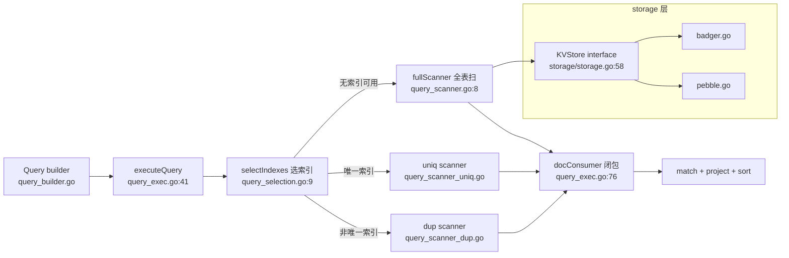

# P4 · 项目精读 A：ejdb，读别人的 Go 存储引擎从哪下手？


> 这章学完你能干什么：拿到一个没读过的 Go 存储引擎仓库，半小时内画出它的查询执行路径，说出接口抽象省了什么、丢了什么，并预言键编码的排序行为，包括负数会被排到哪里。
> 载体：`vendored/ejdb/`（快照自 https://forgejo.gulugulu.moe/clark/ejdb ，约 3200 行）。它是 C 版 EJDB2 的 Go 移植，Go 注释里到处是 `Ported from jbi_*.c`。
> 读者：读过 P2（接口与错误）和 P3（锁与原子操作）。前置：P3。后续：P5 用同一套方法读服务型项目。
>
> 动手方式：这章不改快照本体。先拷一份副本，所有实验在副本里做：`cp -r vendored/ejdb /tmp/ejdb-lab`。读码用 `grep` 和 `sed -n`，运行用 `go run`。

## 体系背景：嵌入式数据库是一个目录加一个库

MySQL 和 PG 是独立的服务进程，你通过网络连它。ejdb 不同，它是链接进你程序的库，数据就是磁盘上的一个目录。

这类库叫嵌入式数据库。Java 里的 H2、SQLite、RocksDB 的 JNI 绑定是同一类，Node 里的 `better-sqlite3` 和 LevelDB 也是。ejdb 底下的存储引擎是 Pebble（还可以换成 Badger），两者都是 LSM 树：先把写入追加到日志文件，再慢慢合并成有序的数据文件。

写几条数据、正常关闭，看目录里有什么：

```go
db, _ := ejdb.Open("data")
c, _ := db.CreateCollection("users")
for i := range 3 {
	c.Put([]byte(fmt.Sprintf(`{"n":%d}`, i)), 0)
}
db.Close()
```

```sh
$ ls -l data | awk 'NR>1{print $5, $9}'
251 000002.log
16 CURRENT
0 LOCK
52 MANIFEST-000001
1171 OPTIONS-000003
```

`000002.log` 是预写日志（WAL），新写入先落在这里。`MANIFEST` 记录有哪些数据文件，`LOCK` 保证同一时刻只有一个进程打开这个目录。

重开一次，数据都在。真实输出里还有一行 Pebble 回放 WAL 的日志，这里省略：

```sh
$ ./files.bin read
Get(3) = {"n":2}, err = <nil>
重开后 DocCount: 3
```

关键问题是：如果不调 `Close` 就退出呢？把写入后的 `db.Close()` 换成 `os.Exit(1)`，模拟进程崩溃：

```sh
$ rm -rf data && ./files.bin write crash
写入后 DocCount: 3
$ ls -l data/*.log | awk '{print $5, $9}'
0 data/000002.log
$ ./files.bin read
集合 users 不存在
```

日志文件是 0 字节，重开后连集合定义都没了。连续跑 3 次结果相同，在 `os.Exit` 前加 `time.Sleep(100 * time.Millisecond)` 再跑 2 次也一样。

原因在代码里能找到。`NewPebbleStore` 的选项里有 `SyncWrites`，但整个 `storage/pebble.go` 里它只出现在结构体定义的第 26 行。每次写入和删除都是 `pebble.NoSync`（:117、:145），意思是写返回时不等 fsync（把数据强制刷到磁盘）。上面的实测还说明，进程退出时数据连日志文件都没写进去。

嵌入式库的持久性，由你进程里的缓冲层说了算。`Close` 不是礼貌，是协议的一部分。这条要带着读后面的 `Put`。

## 环境

先确认载体在，版本对得上：

```sh
$ cd /tmp/ejdb-lab && git rev-parse --short HEAD
8be48bb
$ ls *.go | tr '\n' ' '
bench_test.go collection.go db.go ejdb_test.go index.go query_builder.go query_exec.go query_scanner_dup.go query_scanner_uniq.go query_scanner.go query_selection.go query_sorter.go
$ find . -name '*.go' ! -name '*_test.go' | xargs cat | wc -l
3888
```

非测试 Go 源共 3888 行，去掉空行和注释行后约 3200 行，开头说的"约 3200 行"指这个口径。

跑测试：

```sh
$ go test ./...
ok  	ejdb	0.774s
?   	ejdb/examples/crud	[no test files]
?   	ejdb/examples/index	[no test files]
?   	ejdb/examples/query	[no test files]
```

全绿再往下读。

仓库根的 `AGENTS.md` 说 Badger 是唯一实现，`DBOpts` 的注释也说默认 badger。实际 `Open` 写死的是 Pebble（`db.go:36-38` 的 `StorageType: "pebble"`）。文档和代码不一致时，信代码。

另外 `AGENTS.md` 和 `.gitignore` 都登记了 `c-code/` 目录，放 C 版参考源码，本机的 clone 没带下来。所以 C 版相关的说法只能靠注释推断。

## 跑起来

仓库自带三个 `main` 包，在 `examples/` 下，这是 Go 的惯例。先跑 `crud`：

```sh
$ go run ./examples/crud
created collection: users
inserted doc with id: 1
total documents: 3
get doc 1: name=Alice age=30 city=NY
updated doc 1: name=Alice age=31 city=SF
doc 1 deleted successfully
total documents after delete: 2
```

`Put(doc, 0)` 里的 0 表示自动分配 ID。再跑 `query`，它先建索引再查：

```sh
$ go run ./examples/query | head -15
=== Eq query: age == 30 ===
  Alice (age 30)
  Charlie (age 30)

=== Gt query: score > 90 ===
  Bob (score 92)
  Diana (score 95.5)

=== In query: city in (NY, SF) ===
  Alice (city NY)
  Diana (city NY)
  Eve (city SF)

=== And query: age == 30 AND city == LA ===
  Charlie (age 30, city LA)
```

跑通了，也有现成的 API 形状：`db.Query("users").Where(ejdb.Gt("score", 90.0)).All(ctx)`。接下来的问题是：这条链调下去，代码走过哪些文件？

## 包布局与查询路径

先画图再读码。ejdb 的查询执行路径一张图：



包布局，五个目录各管一层：

```
ejdb/          package ejdb      : DB/Collection/Index/Query
storage/       package storage   : KVStore 接口 + badger/pebble 双实现
jsondoc/       package jsondoc   : path 解析 + 索引键序列化
types/         package types     : 共享枚举（IndexMode/Op）
examples/                        : 三个 main 包
```

对照 deepsearch（P5 读）：它用 `internal/` 加 `pkg/`。ejdb 的包没有 internal 限制；包内小写标识符不能从外部访问，但小写包名本身并不阻止外部导入该包的导出标识符。

读陌生仓库的第一步，是用 `grep` 找到作者留下的线索。这个仓库是移植，线索就是 `Ported from`：

```sh
$ grep -rn "jbi_" . --include='*.go' | cut -c1-90
query_selection.go:8:// selectIndexes is the index selection algorithm, ported from jbi_se
query_selection.go:115:// Ported from _jbi_compute_index_rules() in jbi_selection.c:132.
query_selection.go:170:// Ported from _jbi_idx_cmp() in jbi_selection.c:371.
query_selection.go:212:// Ported from _jbi_idx_expr_op_weight() in jbi_selection.c:86.
query_scanner_dup.go:17:// dupScanner scans a non-unique (compound-key) index. Ported from
query_scanner.go:7:// fullScanner performs a full collection scan. Ported from jbi_full_sc
query_scanner_uniq.go:9:// uniqScanner scans a unique index. Ported from jbi_uniq_scanner.
```

四个移植点正好是图里的选索引和三个扫描器。Java 读者可以把它看成"找接口实现类"，TS 读者可以看成"从 `index.ts` 往下追 `export`"。

## 接口

最底下一层是 `storage/storage.go:58` 的 `KVStore`。数一下接口：

```sh
$ grep -n "interface" storage/storage.go
39:type Cursor interface {
50:type Txn interface {
58:type KVStore interface {
```

`KVStore` 有 10 个方法，加上 `Cursor`、`Txn` 两个小接口，整个存储层的抽象就这三个。接口是按"ejdb 需要什么"切的，不是按"Pebble 能给什么"，所以换后端不痛。

注意 `Txn` 事务接口用回调，不是返回句柄：

```go
View(fn func(txn Txn) error) error      // storage.go:72
```

回调表达了希望事务只在作用域内使用的意图。Java 读者会想到 Spring 的 `TransactionTemplate.execute(callback)`；不过这个签名本身不像 Rust 的借用检查那样强制生命周期。

但 Go 编译器并不强制"活不过回调"。把 `txn` 存进包级变量，回调结束后再用：

```go
var saved storage.Txn

st.View(func(txn storage.Txn) error {
	saved = txn
	v, err := txn.Get(100, &storage.Val{Data: []byte("k")})
	fmt.Printf("回调内 Get: %s %v\n", v.Data, err)
	return nil
})
fmt.Println("回调已结束，再用 saved.Get：")
v, err := saved.Get(100, &storage.Val{Data: []byte("k")})
```

```sh
$ go run ./demo/txn
回调内 Get: v <nil>
回调已结束，再用 saved.Get：
panic: pebble: closed
```

能编译，但运行时 panic。Pebble 的 `View` 用快照实现，回调返回后快照就关了（`pebble.go:355-359`）。Rust 的借用检查会在编译期拦下，Go 只能靠你记得。

接口还有一个细节，`storage.go:30` 的 `Val{Data []byte, Compound int64}`。复合键把 docID 放在 `Compound` 里，而不是拼新 slice，省一次拷贝。

接口的代价在 `Collection.Put`（`collection.go:39-74`）里看得最清楚：

```go
c.mu.Lock(); defer c.mu.Unlock()          // 集合级写锁
id = atomic.AddInt64(&c.idSeq, 1)          // ID 分配
store.Put(doc)                             // 先写主文档
removeIndexRecords(old)                    // 删旧索引
if err := addIndexRecords(new); err != nil {
    store.Del(doc)                         // 手工回滚
}
```

读点有三个：

- 文档和索引是两个 KV namespace，没有跨 DBID 事务。索引写失败，只能手工删掉刚写的文档（`collection.go:66`）。Badger 本身支持事务，但 `KVStore` 把 `Update` 收窄成回调，ejdb 没用。这是"抽象省了什么、丢了什么"的活教材。
- 写全程 `Lock`，读走 `RLock`，`db.go` 里的集合表另有一把 `RWMutex`。这是 P3 决策树的"复合临界区用 Mutex"档。
- `atomic.AddInt64(&c.idSeq, 1)` 分配 ID，单计数用原子，和 P3 的 `TestCounters` 同款。

再回头看体系背景：Pebble 后端的写入使用 `NoSync`，不能据此保证崩溃后持久化。手工回滚也不能替代原子事务：如果回滚本身失败或进程中途退出，文档和索引仍可能不一致。

## 键编码

LSM 引擎按字节序比较 key，所以"整数怎么变成字节"决定一切。先看主键编码（`db.go:279`）：

```go
func docIDToKey(id int64) []byte {
    buf := make([]byte, 8)
    binary.BigEndian.PutUint64(buf, uint64(id))
    return buf
}
```

为什么是大端？把几个 ID 分别用大端、小端和"符号位翻转"编码，再按字节序排：

```go
for _, v := range []int64{1, 2, 10, 256, -1} {
	fmt.Printf("%4d  大端 %x  小端 %x  翻转 %x\n", v, be(v), le(v), flip(v))
}
```

```sh
$ go run .
   1  大端 0000000000000001  小端 0100000000000000  翻转 8000000000000001
   2  大端 0000000000000002  小端 0200000000000000  翻转 8000000000000002
  10  大端 000000000000000a  小端 0a00000000000000  翻转 800000000000000a
 256  大端 0000000000000100  小端 0001000000000000  翻转 8000000000000100
  -1  大端 ffffffffffffffff  小端 ffffffffffffffff  翻转 7fffffffffffffff
大端 字节序排出: [1 2 10 256 -1]
小端 字节序排出: [256 1 2 10 -1]
翻转 字节序排出: [-1 1 2 10 256]
```

后三行的先后顺序每次可能不同，内容恒定。读出三件事：

- 大端把最高位字节放最前，对非负整数保持数值顺序；小端把低位放最前，256 排到了 1 前面。
- 有符号数不能直接按这个规则排序：`-1` 的补码最高位是 1，排到正数后面。本例自动分配的 ID 从 1 自增，但是否允许显式传入其他 ID 需看调用约束，不能只凭类型断言永远为正。
- 翻转符号位（`uint64(v) ^ (1 << 63)`）把 `-1` 救回正确位置。

Java 和 JS 读者注意，`ByteBuffer` 和 `DataView` 默认都是大端，Go 的 `encoding/binary` 要显式选。Java 里字节数组比较要用 `Arrays.compareUnsigned`，Go 的 `bytes.Compare` 天然是无符号比较。

[INFERENCE：C 原版 EJDB2 的文档主键走 iowow 的 VNUM64 变长数字键（`ejdb2.c:165` 的 `IWDB_VNUM64_KEYS`），天然有序。Go 移植改成定长 8 字节大端直排，负数坑由此引入。Go 版的 I64 索引用符号位翻转补回，见 `jsondoc/value.go:93`。]

索引键序列化在 `jsondoc/value.go` 的 `SerializeKey`，三种类型三种做法：

- I64：大端加符号位翻转，上面已经演示。
- Str：直接用原始字节，天然有序。
- F64：`strconv.FormatFloat(f, 'g', -1, 64)` 转成字符串。

第三种是个陷阱，下一节改它。

对照你的 Rust 学习线：这和 dnsproxi 的 D3/D4 用 HashMap 加稠密 slots 手工近似 LRU 淘汰序是同一类问题，语言或载体没有现成的有序结构，就到处手工算。ejdb 的答案是"把类型烧进编码"。

## 改一处，看变化

F64 用字符串当键，作者注释说是为了 lexicographic ordering（字典序）。字典序真等于数值序吗？写个小程序验证，8 个浮点数，先不建索引，再建索引，各查一次 `Gt(90)`：

```go
for _, v := range []string{"9.9", "50", "99.5", "100", "123.4", "1235.6", "990000", "1000000"} {
	c.Put([]byte(`{"v":`+v+`}`), 0)
}
r, _ := db.Query("t").Where(ejdb.Gt("v", 90.0)).All(ctx)
fmt.Println("无索引 Gt(90):", scores(r))
c.EnsureIndex("v", ejdb.IndexF64)
r, _ = db.Query("t").Where(ejdb.Gt("v", 90.0)).All(ctx)
fmt.Println("有索引 Gt(90):", scores(r))
```

```sh
$ go run ./demo/f64
无索引 Gt(90): [99.5 100 123.4 1235.6 990000 1e+06]
有索引 Gt(90): [99.5 990000]
```

同一个查询，没索引返回 6 条，有索引只返回 2 条。漏了 `100`、`123.4`、`1235.6` 和 `1e6`。

原因是字符串比较：`"100"` 的第一个字符 `'1'` 比 `"99.5"` 的 `'9'` 小，字典序上 100 在 90 前面。`"1e+06"` 同理。即使位数相同，负数、小数和科学记数法也可能破坏数值顺序。

这是移植引入的真实缺陷。现在改它：在副本的 `jsondoc/value.go` 里，把 F64 改成和 I64 同一思路的定长编码。浮点数的符号位翻转更复杂一点：正数翻符号位，负数整体取反。

```go
// SerializeKey 的 F64 分支
bits := math.Float64bits(f)
if bits>>63 == 1 {
	bits = ^bits
} else {
	bits |= 1 << 63
}
buf := make([]byte, 8)
binary.BigEndian.PutUint64(buf, bits)
return buf, nil

// DeserializeKey 的 F64 分支
bits := binary.BigEndian.Uint64(data)
if bits>>63 == 1 {
	bits &^= 1 << 63
} else {
	bits = ^bits
}
f := math.Float64frombits(bits)
return &types.Value{F64: &f}, nil
```

删掉不再使用的 `strconv` 导入，重跑：

```sh
$ go run ./demo/f64
无索引 Gt(90): [99.5 100 123.4 1235.6 990000 1e+06]
有索引 Gt(90): [99.5 100 123.4 1235.6 990000 1e+06]
```

两行一致了。负数也要验证。插入 `-1000.5`、`-5`、`-0.5`、`0`、`0.5`、`5`、`1000.5`，建索引后查 `Gt(-1)` 并按 `v` 升序：

```sh
# 改之前
$ go run ./demo/f64neg
0 0.5 1000.5 5
# 改之后
$ go run ./demo/f64neg
-0.5 0 0.5 5 1000.5
```

改之前不仅漏了 `-0.5`，连顺序都是错的。改之后对这组有限数值正确。这个实验并未覆盖 NaN、正负零或既有索引迁移；生产修复还须定义它们的排序语义并重建旧索引。

这个实验的意义不在修了一个 bug，而在体验"键编码决定一切"：Gt 的扫描起点是把 90 序列化成键后在 LSM 里 `CursorGE`，编码一错，整个范围扫描都错。

## 选索引

一条查询怎么选索引？答案在 `query_selection.go:9-112`，从 `jbi_selection.c` 移植：

- 正则（RE）条件不进索引（:49）。
- IN 数组超过 500 直接放弃（:58）。10 到 500 之间看"集合大小对数组长度"的比率（:61-64）。这几个魔数就是索引对全表扫的成本模型，作者注释 "empiric heuristic from EJDB2"。
- 候选按操作符权重排：EQ 最高，然后是 IN、GT、Prefix、LT，精确数字在章末参考。
- 没有谓词候选时，退而求其次用 ORDER BY 字段的索引（:74-93），并且置 `ctx.sorting = false`。索引天然有序，排序被省掉。

用 benchmark 感受一下索引的价值。作者自带的 `BenchmarkQueryEQ`：

```sh
$ go test -run xxx -bench 'QueryEQ' -benchtime=100x -benchmem .
BenchmarkQueryEQ/noindex-10         	     100	    907629 ns/op	 1009841 B/op	   32006 allocs/op
BenchmarkQueryEQ/withidx_n=100-10   	     100	      2284 ns/op	    2026 B/op	      59 allocs/op
```

本机这一次，无索引 907629 ns，有索引 2284 ns。审读时同机跑过一次是 816329 ns 对 2133 ns，数字会抖，量级一致。基准只有 100 次迭代，看量级，别看小数。

## 闭包与扫描器

选完索引，查询交给扫描器取候选，再交给 consumer 过滤、投影、排序。consumer 是闭包，不是接口（`docConsumer` 类型在 `query_exec.go:38`，`plainConsumer` 在 :76）：

```go
type docConsumer func(id int64, doc []byte) bool   // 返回 false = 停止
```

`plainConsumer` 里依次是：limit 短路（:91）、count-only 快路径（:96）、JSON 只解析一次给 match 和 projection 共用（:102-106）。skip 和 limit 的计数状态存在闭包变量里（:79-80）。

Rust 读者可以把它看成 `Iterator::take_while().skip().take()` 手写展开的版本。Java 读者对应 `Stream` 的 `skip`、`limit` 和 `takeWhile`，JS 读者对应 ES2025 的迭代器辅助方法 `drop` 和 `take`。区别是 Go 的闭包可变捕获没有借用检查，这里单线程执行才没问题。

扫描器按索引命中方式分三套：

- `query_scanner_uniq.go`：EQ 直接 `Get`，O(1) 点查。
- `query_scanner_dup.go`：非唯一索引的键是"值编码 加 docID 后缀"，扫描从 `CursorGE(值)` 开始，前缀失配就停。这是范围扫描加提前终止。
- 全表扫描 `fullScanner`（`query_scanner.go:8`）：用 `lastID` 去重（:30-33）。

[INFERENCE] `lastID` 只能去除连续出现的重复 ID；不能仅凭索引有序推断同一文档的不同索引键一定相邻，涉及多值字段时需要进一步验证。

读到这里，顺手验证 `query` 示例的最后一段，它的输出里有个值得怀疑的地方：

```sh
$ go run ./examples/query | grep -A1 '=== Count'
=== Count: age >= 25 ===
  count = 0
```

5 个用户里 `age >= 25` 的明明有 4 个。写个最小复现：

```go
n, _ := db.Query("users").Where(ejdb.Gte("age", 25)).Count(ctx)
fmt.Println("无索引 Count:", n)
r, _ := db.Query("users").Where(ejdb.Gte("age", 25)).All(ctx)
fmt.Println("无索引 All 条数:", len(r))
c.EnsureIndex("age", ejdb.IndexI64)
n, _ = db.Query("users").Where(ejdb.Gte("age", 25)).Count(ctx)
fmt.Println("有索引 Count:", n)
```

```sh
$ go run ./demo/cnt
无索引 Count: 0
无索引 All 条数: 4
有索引 Count: 0
```

线索在两处。`Count` 的实现是执行查询后返回 `len(results)`（`query_builder.go:211-219`）。而 count-only 模式下，带条件的 consumer 只做 `delivered++`，不往结果里追加（`query_exec.go:116`）。于是上面复现的两种情形里，`len(results)` 都是 0。

这是上游的一个真实缺陷，不在本章练习范围内，只记在这里当读码收获：读到"只算数不收集"的快路径，就去核对调用方到底从哪取这个数。

## 小结

1. 嵌入式库的数据是一个目录。不调 `Close` 就退出，实测日志 0 字节、集合丢失，持久性取决于缓冲层。
2. 库的 interface 按使用方需求切。回调式 `Txn` 想表达作用域，但 Go 编译器不强制。
3. 键编码决定一切：大端让整数序等于字节序，符号位翻转让负数有序，F64 用字符串当键会跨量级漏查。
4. 查询引擎等于选索引加扫描器加闭包流水线，排序能省靠索引天然有序。
5. 事务被接口收窄丢弃，只剩手工回滚。抽象的代价肉眼可见。

## 练习：p4ejdb

练习在 `exercises/p4ejdb/`，4 个测试。先跑一遍看全绿：

```sh
$ go test ./exercises/p4ejdb/ -v
=== RUN   TestKeyEncoding
--- PASS: TestKeyEncoding (0.00s)
=== RUN   TestKeyEncodingNegative
--- PASS: TestKeyEncodingNegative (0.00s)
=== RUN   TestI64IndexOrder
--- PASS: TestI64IndexOrder (0.00s)
=== RUN   TestConsumeClosure
--- PASS: TestConsumeClosure (0.00s)
PASS
```

练习地图：

- `TestKeyEncoding`：大端序让整数序等于字节序，只限正数域。
- `TestKeyEncodingNegative`：无符号字节序把 -1 排到 1 后面。
- `TestI64IndexOrder`：符号位翻转救回负数顺序。
- `TestConsumeClosure`：consumer 返回 false 就停止扫描。

**预测**，先写答案再跑：

1. `docIDToKey(-1)` 和 `docIDToKey(1)`，哪个的字节大？ejdb 主键为什么没踩这个坑，I64 索引却躲不开？
2. `takeFirstN(3, &sink)` 返回的 consumer 收到第 4 个文档时返回什么？scanner 拿到这个返回值会做什么？
3. 把 `View` 回调里拿到的 `txn` 存进包级变量，回调结束后再用它 `Get`：能编译吗？安全吗？

第 3 题的答案在"接口"一节的实验里：能编译，运行时 panic。

**观察**：

```sh
go test -run 'TestKeyEncodingNegative|TestI64IndexOrder' -v ./exercises/p4ejdb/
```

```sh
=== RUN   TestKeyEncodingNegative
--- PASS: TestKeyEncodingNegative (0.00s)
=== RUN   TestI64IndexOrder
--- PASS: TestI64IndexOrder (0.00s)
PASS
```

`TestKeyEncodingNegative` 的注释给出结论：-1 的 key 排在 1 后面。再进 ejdb 副本，跑作者的基准：

```sh
cd /tmp/ejdb-lab && go test -bench . -benchmem .
```

**改造**：

1. 读 ejdb 副本的 `bench_test.go`，找到作者的基准套路，把 Go 版数字和你的 Rust dnsproxi 压测数字同台记录。
2. 给 `exercises/p4ejdb/` 加 `skipFirstN(k, n, sink)`：先跳过 k 个再收 n 个，复刻 `plainConsumer` 的 skip 和 limit 闭包状态（`query_exec.go:79-80`）。验收是新增测试加 `go test ./exercises/p4ejdb/` 全绿。
3. 把本章 `Count` 缺陷修掉：让 count-only 模式把计数带回 `Count`。

检验你真读懂了：不翻源码，回答"ejdb 为什么用 BigEndian 而不是 LittleEndian"。答不出就回去重读"键编码"。

## 章末参考

### KVStore 接口全貌

10 个方法：OpenDB、CloseDB、Put、Get、Del、NewCursor、View、Update、Close、Sync（`storage/storage.go:58`）。多库靠 DBID namespace：每个集合和索引分一个 uint32 DBID，key 前缀 4 字节大端 DBID，用前缀迭代模拟多个库。DBID 1 是元数据，DBID 2 是文档计数，DBID 100 起是用户集合（见项目 `AGENTS.md`）。

### 选索引的精确权重与魔数

| 规则 | 值 | 位置 |
|---|---|---|
| IN 数组直接放弃 | 大于 500（maxINOpArraySize） | :58 |
| IN 看比率 | 10 到 500 之间：集合大小小于数组长度乘 200（maxINOpArrayRatio）则放弃 | :61-64 |
| 操作符权重 | EQ 10 / IN 9 / 支持 ORDER BY 8 / GT,GTE 7 / Prefix 6 / LT,LTE 5 | operatorWeight |
| 平局裁决 | 有范围端（expr2）优先，其次索引 Count 小，再次 path 短 | compareCandidates |

### 三种 scanner 的分派细节

- uniqScanner（`query_scanner_uniq.go`）：EQ 一次 `Get` 点查，IN 逐键点查，范围走 cursor 扫描。
- dupScanner（`query_scanner_dup.go`）：EQ、IN、范围三分派。扫描从 `CursorGE` 定位（:51、:105），`keyPrefixMatch` 前缀失配即停（:202）。
- fullScanner（`query_scanner.go:8`）：顺序 `Next`，`lastID` 去重防多值字段重复交付（:30-33）。

### Rust 对照

| Rust | Go（本章） | 差异 |
|---|---|---|
| `trait KvStore` 在提供方实现 | `KVStore` 由使用方切 | Go 不需要登记 `impl` |
| 借用作用域的 `&Txn` | 回调 `View(fn)` | Go 编译器不拦 txn 逃逸 |
| `u64::to_be_bytes` | `PutUint64` 配大端 | 同一个事，Go 要显式选字节序 |
| `Iterator::take_while().skip().take()` | `docConsumer` 闭包 | 状态在闭包变量里，无借用检查 |
| `rocksdb` crate（绑定 C++） | Pebble（纯 Go） | 无 CGO，交叉编译友好 |
| `BTreeMap` | LSM 加字节序键 | 有序性靠手工编码保证 |

### Java/Kotlin 与 TS/JS 类比

| 概念 | Java / Kotlin | TS / JS |
|---|---|---|
| 嵌入式数据库 | H2、SQLite、RocksDB（JNI） | `better-sqlite3`、LevelDB |
| 回调式事务 | `TransactionTemplate.execute` | `db.transaction(fn)` |
| 大端字节序 | `ByteBuffer` 默认大端 | `DataView` 默认大端 |
| 字节数组比较 | `Arrays.compareUnsigned` | 无内建，需手写 |
| consumer 闭包流水线 | `Stream` 的 `skip`、`limit`、`takeWhile` | 迭代器辅助方法 `drop`、`take` |
| 接口按使用方切 | 接口放在调用方包里 | TS 结构化类型天然支持 |
