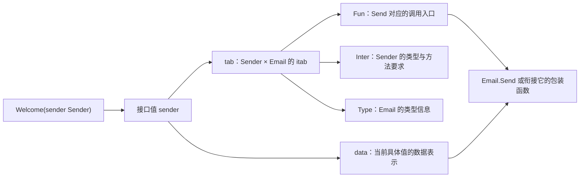
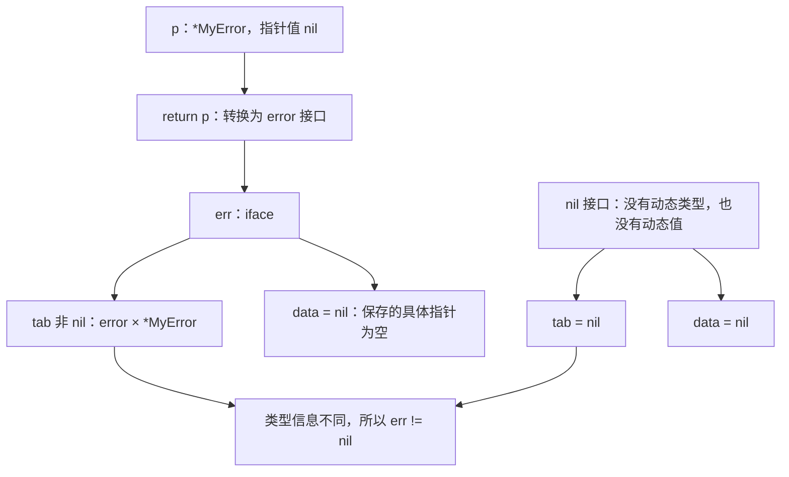
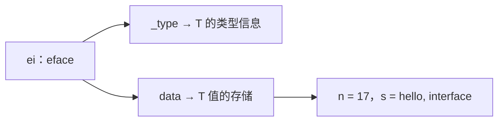
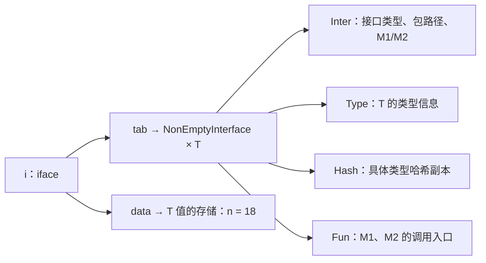
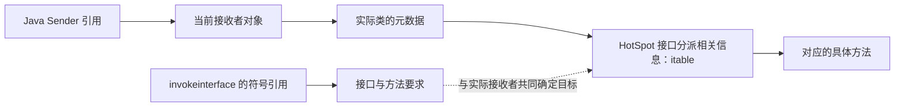

# 04 方法、接口与组合：从调用行为到运行机制

> 详细程度：深入 · 约 190 分钟
> 材料：TB24 到 TB30 · 旧长版：`notes/p2-lang-core.md`、`notes/p30-methods-interfaces.md`
> 前置：写过一种语言的函数、结构体或类，了解基本指针与接口概念

## 从类型的方法，走到可组合的能力

给用户发欢迎通知，最初可以直接调用邮件发送代码；需要短信时，我们希望保留欢迎流程，只替换发送方式。写出一段数据也有相似的需求：文件、网络连接和内存缓冲区不是同一种类型，但调用者可能只关心它能不能写入字节。本章用通知串起接口的使用，再用写入场景看清真实的接口边界。不是所有差异都该抽象成接口；这里要解决的是调用者确实需要在不同实现之间保持同一套调用方式的问题。

Go 没有 Java 那样的类声明和类继承树。它把数据放在类型里，把操作通过方法绑定到类型上，再用接口表达调用方需要的能力。结构体嵌入承担一部分纵向组合，接受接口参数的函数承担横向组合；这两者不等于继承。方法因此不只是面向对象语法的缩写，它也是组合设计在类型系统中的支点。〔TB24 p2〕

接下来的路径是连续的：先声明并调用方法，再让 Email 和 SMS 共同参与 Welcome 流程；随后把方法调用还原成参数传递，解释值、指针和方法集合；最后检查接口值与 nil、嵌入、包装器和中间件。方法承载的执行逻辑仍可按函数调用理解，不需要另造一套参数传递规则。反射在本章只用作观察方法的工具，完整反射与 trace 工具留在后续专题。

## 一、先给类型添加方法

### 读取一个值，与改变原来的值

发送通知之前，先用一个计数器观察方法的基本行为。它只有一个整数字段，读它和改它的区别不会被网络调用掩盖。这是一个可以独立运行的程序：

```go
package main

import "fmt"

type Counter struct {
    value int
}

func (c Counter) Value() int {
    return c.value
}

func (c *Counter) Add(n int) {
    c.value += n
}

func main() {
    var c Counter
    c.Add(3)
    fmt.Println(c.Value()) // 3
}
```

func 与方法名之间多出的括号是接收者段，其中的 c 是接收者参数，英文叫 receiver。Value 的接收者类型是 Counter，Add 的接收者类型是 *Counter。调用时，接收者写在点号左边：c.Value()、c.Add(3)。方法不是写在结构体声明内部的成员，而是在同一个包中单独声明，再通过接收者与类型关联。〔TB24 p2-3〕

Go 的参数按值传递，接收者也一样。调用 Value 时传入 Counter 的副本；调用 Add 时传入指针的副本，这个指针仍指向原计数器，所以 c.value += n 改的是原值。如果把 Add 的接收者改成 Counter，增加的就只是方法里的副本。这里的“副本”不是深拷贝：结构体中若含有 slice、map 或指针，复制这些字段后仍可能访问同一份底层数据。因此值接收者不等于不可变或线程安全。〔TB25 p2-4〕

调用也能写成 Counter.Value(c) 和 (*Counter).Add(&c, 3)。此时接收者显式排到第一个参数的位置。第三节会用这套写法分析 goroutine 接收到的究竟是值还是地址，现在先把它当作同一个调用的另一种表示。〔TB24 p6-8〕

### 一个方法声明里，哪些部分与函数相同

标准库 net/http 的 TLS 服务启动方法使用同样的结构。下面摘出声明签名，并非一个可单独编译的完整实现：

```go
func (s *Server) ListenAndServeTLS(certFile, keyFile string) error
```

普通函数的 func、名字、参数列表、返回值列表、函数体五个部分仍然存在，只在名字之前增加了接收者段，成为六个部分。除接收者之外，其他部分的形式与语义与函数一致：方法名以大写字母开头时可导出，参数列表可以有变长参数，返回值也可以具名。这里 receiver 参数 s 的类型是 *Server，因此这项声明使用的是指针接收者，不能据此说 Server 值的方法集合已经包含 ListenAndServeTLS。〔TB24 p2-3〕

接收者写成 T 或 *T 时，其中的 T 都叫接收者基类型。Counter.Value 的基类型是 Counter，(*Counter).Add 的基类型也仍是 Counter。一个方法只能声明一个接收者参数，而且它不能是变长参数；普通参数列表可以变长，不代表接收者段也可以。〔TB24 p3〕

### 基类型的限制，不是禁止指针接收者

接收者必须基于本包定义的类型 T，写成 T 或 *T；T 本身不能是指针类型或接口类型。这条限制检查的是基类型，而不是看到接收者段中有星号就拒绝。Counter 是结构体，所以*Counter 完全合法。下面两个类型定义各自合法，但接在后面的两项方法声明都有意违反接收者限制；放进 main 包核对错误时，需要导入 fmt 和 io。〔TB24 p4〕

```go
type MyInt *int

func (r MyInt) String() string { // 有意错误：基类型的底层类型是指针
    return fmt.Sprintf("%d", *(*int)(r))
}

type MyReader io.Reader

func (r MyReader) Read(p []byte) (int, error) { // 有意错误：基类型是接口类型
    return r.Read(p)
}
```

MyInt 不是“指向一个合法基类型的接收者”，而是自己定义成了指针类型；MyReader 则定义成接口类型。两者都不能绑定这样的新方法。go1.26.4 编译器先从接收者类型剥掉外围指针，再检查得到的基类型及其底层类型；对应错误包含 invalid receiver type 和 pointer or interface type。MyReader 的方法体也不是一个可用的转发包装器：它在这里根本无法通过接收者检查，不能靠重复调用同名方法实现接口委托。〔TB24 p4〕

### 只能在定义类型的包里添加方法

基类型和方法声明必须位于同一个包，不要求同一个文件。于是既不能直接给预声明的 int、float64 等类型加方法，也不能到自己的包中给 http.Server 加方法。map 等未命名类型也不能直接拿来作为接收者基类型。下面分别是有意不能编译的声明；第二个片段依赖 net/http 导入：〔TB24 p5〕

```go
func (i int) Foo() string { // 有意错误：int 不是本包定义的类型
    return fmt.Sprintf("%d", i)
}
```

```go
func (s http.Server) Foo() {} // 有意错误：Server 定义在 net/http 包
```

这两处错误的关键措辞是 cannot define new methods on non-local type。它约束方法的归属：第三方不能通过另一个包，悄悄给既有类型追加方法。需要扩展时，可以定义本包的新类型，或把现有值放进本包的包装结构体，再为这个新类型声明方法。比如下面的定义基于 int，却获得了本包自己的类型名：〔TB24 p5〕

```go
type Count int

func (c Count) IsZero() bool { return c == 0 }
```

这里必须区分类型定义与别名。type Count int 定义了新类型；type Count = int 只是为 int 起另一个名字，并不能绕过非本包类型的限制。新定义类型也不会自动继承来源类型的方法，第三节会给出验证。封闭的是可直接声明的方法归属；嵌入还能使既有方法被提升，但那是组合规则，不是跨包添加声明。

### 接收者名字与参数共享方法体作用域

接收者参数、普通参数和具名返回值变量的作用域都覆盖方法体。它们不是各占一个独立命名空间，因此非空白的名字不能在方法签名里重复。下面的 t 同时作为接收者名和普通参数名，有意不能编译：〔TB24 p3-4〕

```go
type T struct{}

func (t T) M(t string) {} // 有意错误：t 重复声明
```

把任意一处改成不同的名字就能消除冲突。旧课程把错误写作 duplicate argument t，当前编译器的诊断可能写作 t redeclared in this block，并指向另一个声明；需要理解的是同一签名里的名字冲突，而不是背某个版本的报错句子。具名返回值也不能再取同一个 t。

方法体完全不使用接收者时，可以只保留类型，省略参数名。以下是前一段声明的替代写法，不要与它同时声明同名 M：〔TB24 p4〕

```go
type T struct{}

func (T) M(t string) {}
```

省略名字不代表取消了接收者，也没有把方法变成普通函数；它仍属于 T，只是方法体不需要引用接收者的值。日常方法多数要访问实例状态，所以通常仍保留一个简短名字。对于同一个基类型，非空白方法名还必须唯一；结构体的非空白字段名与方法名也不能相同。这些命名限制与接收者参数是否省略是两回事。

### 同一个值方法，可以从值或指针调用

下面是独立的调用示例。M 使用值接收者，既可以从 T 变量调用，也可以从 *T 变量调用：〔TB24 p5-6〕

```go
package main

type T struct{}

func (t T) M(n int) {}

func main() {
    var t T
    t.M(1)
    p := &T{}
    p.M(2)
}
```

第二次调用不会把值接收者改成指针接收者。p 指向一个 T，调用 M 时取出该 T 的值，传入的仍是副本。后面会看到，*T 的方法集合本来就包含值接收者方法；而反方向调用指针方法，需要额外检查值是否可寻址。这使我们能先按方法是否需要修改实例来设计接收者，而不把“点号左边碰巧写了什么类型”当成方法归属的判断依据。

## 二、接口：让同一段欢迎逻辑使用不同的发送方式

注册成功后，我们要给用户发送一条欢迎消息。先只有邮件，可以直接让函数接收 Email。下面的 Send 只打印消息，帮助观察调用过程，不连接邮件服务器，也没有实现真实发送和发送失败处理。

```go
type Email struct{}

func (Email) Send(message string) {
    fmt.Println("发送邮件：", message)
}

func Welcome(sender Email) {
    sender.Send("欢迎注册")
}
```

这个片段需要导入 fmt。调用 Welcome(Email{})，会打印“发送邮件： 欢迎注册”。后来我们增加短信：

```go
type SMS struct{}

func (SMS) Send(message string) {
    fmt.Println("发送短信：", message)
}
```

SMS 同样提供 Send(string)，但此时写 Welcome(SMS{}) 仍然不能编译。Welcome 要求的是 Email，SMS 和 Email 是两个不同的具体类型；同名、同签名的方法不会把两个具体类型变成同一个类型。再写 WelcomeSMS 可以解决这一次调用，却复制了并未改变的欢迎逻辑，以后增加站内信还要继续复制。

观察 Welcome 的函数体：它不读取邮件地址，不连接邮件服务器，只调用一次 Send。它真正需要的不是“一个 Email”，而是“一个支持 Send(string) 的值”。把这个要求写成接口，就能让参数表达业务真正依赖的能力。

```go
type Sender interface {
    Send(message string)
}
```

Sender 是一个接口类型。声明里不写 func，也不写方法体，只写方法名、参数列表和返回值列表。这里约定的方法名为 Send，接收一个 string，没有返回值。接口描述怎样调用，不负责实现发送过程。〔TB28 p3〕将 Welcome 的参数改成 Sender，函数体保持不变。下面是这一阶段的完整程序：

```go
package main

import "fmt"

type Sender interface {
    Send(message string)
}

type Email struct{}

func (Email) Send(message string) {
    fmt.Println("发送邮件：", message)
}

type SMS struct{}

func (SMS) Send(message string) {
    fmt.Println("发送短信：", message)
}

func Welcome(sender Sender) {
    sender.Send("欢迎注册")
}

func main() {
    var sender Sender = Email{}
    Welcome(sender)

    sender = SMS{}
    Welcome(sender)
}
```

这段程序的预期输出是：

```text
发送邮件： 欢迎注册
发送短信： 欢迎注册
```

main 里只有一个 sender 变量，它声明时的类型一直是 Sender。第一次赋值保存 Email 值，第二次改为 SMS 值。两次都进入同一个 Welcome；执行 sender.Send 时，前一次调用 Email.Send，后一次调用 SMS.Send。Welcome 决定“发什么”，具体实现决定“怎么发”。这就是这里的多态：同一段业务代码通过接口使用不同实现。增加站内信时，只要新类型满足 Sender，Welcome 本身不必修改。

### 实现关系由方法集合决定，不靠 implements 声明

Email 和 SMS 都没有写“实现 Sender”，甚至可以先定义它们，再由使用方定义 Sender。Go 检查的是方法集合：对这里仅包含方法要求的普通接口，如果类型 T 的方法集合包含接口 I 要求的全部方法，也就是等于或大于这个方法集合，T 就实现了 I，T 的值可以赋给 I 的变量，也可以传给接收 I 的函数。这个关系称为隐式实现。〔TB28 p5,8〕T 和 *T 的方法集合可能不同，下一部分再具体求它们的集合；现在先把实现条件和调用语法分开。

“隐式”不等于“运行时试试看”。给 Sender 赋值或给 Welcome 传参时，编译器已经检查实现关系；不满足就不能编译。只匹配方法名还不够。例如保持 Sender 不变，把 Email.Send 改为下列版本，再传入 Email{} 就会失败：

```go
// 用来替换前面的 Email.Send；这是有意制造的签名不匹配。
func (Email) Send(message string) error {
    return nil
}
```

新方法的签名是 Send(string) error，接口要求的是 Send(string)。多出一个返回值，即使调用方愿意忽略它，也不算满足接口。反过来，Email 额外提供 Close() 不会妨碍它实现 Sender，因为接口要求的 Send 仍然存在；但 Welcome 中的 sender 静态类型是 Sender，不能仅因某次保存 Email 就直接调用 sender.Close()。调用方能直接使用的能力，以接口声明为准。

签名里的参数名只是给人看的。Send(message string)、Send(s string) 和 Send(string) 表达相同要求，具名返回值的名字也不参与匹配。将同一规则用于多个方法，可以写成下列声明；此片段需要导入 io：

```go
type MyInterface interface {
    M1(int) error
    M2(io.Writer, ...string)
}
```

M1(a int) error、M1(n int) error 都与 M1(int) error 相同；M2(w io.Writer, strs ...string)、M2(w io.Writer, args ...string) 都与 M2(io.Writer, ...string) 相同。参数和返回值的类型、顺序以及是否为可变参数才影响签名；参数名和返回值名不影响。一个类型必须满足这里的两个方法，才能作为 MyInterface 使用。〔TB28 p3〕

### 同名方法：显式重复与嵌入交集不是同一条规则

接口中的方法必须有名字。直接在同一接口中声明两个 M1，即使参数名不同，甚至想用不同参数类型来“重载”，也会触发 duplicate method。Go 不提供这种按参数列表区分同名方法的重载。下面是独立的、故意不能编译的声明：

```go
type Duplicate interface {
    M1(int) error
    M1(a int) error
}
```

接口还可以嵌入其他接口：裸写接口名，把它的方法要求合并进来。Go 1.14 起允许被嵌入接口的方法集合相交，但交集中的同名方法必须有相同签名。下面也是故意不能编译的例子：

```go
type Interface1 interface {
    M1()
}

type Interface2 interface {
    M1(string)
    M2()
}

type Interface3 interface {
    Interface1
    Interface2
    M3()
}
```

编译器对这组嵌入冲突报 duplicate method M1。冲突来自 Interface1.M1() 与 Interface2.M1(string)：名字相同，参数列表不同，触发报错的是同一个方法名下的两个不同签名；M3 与冲突无关。把 Interface2 中的方法改成 M1() 后，两份相同要求可以合并，Interface3 的方法集合是 M1、M2、M3；不是见到重复的名字就报错。这个放宽从 Go 1.14 开始，早于它的版本不允许这类嵌入交集。显式写两次 M1 仍然不合法，不要用嵌入规则解释直接重复声明。〔TB28 p3–4〕

### 接口也能包含非导出方法

Send 首字母大写，因此包外也能使用。接口中的方法不必全部导出。标准库 context 用下面这个接口描述能够被直接取消的 context；它的实现包括 *cancelCtx 和*timerCtx：

```go
// Go 1.26.4，src/context/context.go；这是源码片段，不是独立程序。
type canceler interface {
    cancel(removeFromParent bool, err, cause error)
    Done() <-chan struct{}
}
```

Done 是导出方法，cancel 是非导出方法，放在同一个接口中完全合法。标准库中这类带非导出方法的接口例子并不多，日常实际编码极少使用，了解即可。这样的接口通常连自身也不导出，服务于包内协作，而不是给包外实现者提供公共扩展点。非导出方法的身份包含所属包：另一个包自行声明一个同拼写的 cancel，并不等于 context 包的 cancel。这里的“通常包内使用”是使用惯例，不是“接口只要含小写方法就不能导出”的语法限制。〔TB28 p4–5〕

<details>
<summary>源码版本说明：cancel 为什么比旧资料多一个参数？</summary>

TB28 p4 展示的是 cancel(removeFromParent bool, err error)。Go 1.26.4 的 context/context.go:417–420 中加入了 cause，因此本章按现行签名展示。旧签名用于理解非导出方法仍然合适，但不能当作现行源码逐字复制。方法签名变化也再次说明：签名匹配看完整的参数与返回值，不只看名字。


</details>

### 没有方法要求时，任何类型都能放进去

再把方法集合的规则推到零个方法：

```go
type EmptyInterface interface{}
```

这个接口的方法集合是空集合，因此任何类型都满足它。不必专门声明 EmptyInterface，通常直接使用 interface{}。Go 1.18 起还可以使用 any，它是 interface{} 的预声明别名，不是另一种新接口类型，也不是关键字。〔TB28 p5–6,18〕下面的连续赋值都合法：

```go
// 放入 main 中即可观察；最后的 _ = i 只是让片段可以独立放进函数。
var i interface{} = 15
i = "hello, golang"

type T struct{}
var t T
i = t
i = &t
_ = i

var a any = i
_ = a
```

同一个 i 可以保存整数、字符串、结构体值和指针；变化的是它保存的具体值，不是 i 的静态类型。泛型语法加入之前，interface{} 常被用来保存通用数据结构里的不同类型元素，避免为每种元素复制一套容器代码。这个历史作用不等于现代泛型：空接口不承诺元素有哪些操作，读取后往往需要断言；类型参数则能让同一算法保留元素类型之间的约束。能明确需要 Send 时应接收 Sender，而不是先接收 any 再运行时寻找 Send。

接口类型和其他类型一样可以声明变量。例如 var err error、var r io.Reader，尚未显式初始化时都为 nil。要赋予非 nil 值，右侧类型仍须实现接口：任何类型可以赋给 any，不代表任何类型都能赋给 error 或 io.Reader。〔TB28 p5〕

### 类型断言：取回具体值，或者检查另一种能力

把 Email 放进 Sender，是让调用方只依赖 Send。有时拿到一个接口值后，还需要知道里面实际保存的是什么。类型断言写成 i.(T)，其中 i 必须是接口类型的表达式。它并不是把任意值转换成 T；它检查接口里已有的动态类型和值。以下先用空接口装入 int64(13)，方便把成功和失败分开看。代码放在 main 中，需要导入 fmt：

```go
var a int64 = 13
var i any = a

v1, ok := i.(int64)
fmt.Printf("v1=%d, the type of v1 is %T, ok=%t\n", v1, v1, ok)

v2, ok := i.(string)
fmt.Printf("v2=%s, the type of v2 is %T, ok=%t\n", v2, v2, ok)

v3 := i.(int64)
fmt.Printf("v3=%d, the type of v3 is %T\n", v3, v3)
```

按语言规则，三行输出分别为：

```text
v1=13, the type of v1 is int64, ok=true
v2=, the type of v2 is string, ok=false
v3=13, the type of v3 is int64
```

目标 T 是具体类型时，断言要求 i 的动态类型恰好是 T，不是“数值能转换成 T”就算成功。成功时 v 的静态类型是 T，值为原来保存的值；失败时 comma-ok 形式返回 ok=false，v 仍是 T 类型，值为 T 的零值。所以 v2 是空字符串，不会由于失败变成 any，也不会由于 i 曾保存 int64 而变成整数。即使改成 i.(int)，这里也会失败：int64 和 int 不是同一个类型。〔TB28 p6–7〕

单值形式 v := i.(T) 没有失败结果可供处理，失败就 panic。将下一段接到前面的代码后，程序会在第一句中止，后面的 Printf 不执行：

```go
// 故意触发运行时错误，单独验证这一段。
v4 := i.([]int)
fmt.Printf("the type of v4 is %T\n", v4)
```

这里装的是 int64，而不是 []int，会产生 interface conversion 一类的 panic。对于不受控制的输入，应使用 comma-ok 分支；只有程序本身能保证成功、失败确实代表程序约束被破坏时，才考虑单值形式。nil 接口没有动态类型，断言也不会成功：comma-ok 返回目标零值与 false，单值形式 panic。〔TB28 p6–7〕

断言目标也可以是接口，这时问题从“是不是这个具体类型”变成“保存的具体类型是否还满足这份接口要求”。回到通知程序，若 var i any = Email{}，那么 sender, ok := i.(Sender) 成功，sender 的静态类型是 Sender，动态类型是 Email，可以通过 Sender 调用 Send。下面保留一个独立的多方法命名练习，完整展示成功、失败以及两种类型信息的差别：

```go
package main

import "fmt"

type MyInterface interface {
    M1()
}

type T int

func (T) M1() {
    fmt.Println("T's M1")
}

func main() {
    var t T
    var i any = t

    v1, ok := i.(MyInterface)
    if !ok {
        panic("the value of i is not MyInterface")
    }
    v1.M1()
    fmt.Printf("the type of v1 is %T\n", v1)

    i = int64(13)
    v2, ok := i.(MyInterface)
    fmt.Printf("ok=%t, the type of v2 is %T, nil=%t\n", ok, v2, v2 == nil)
    // v2 = 13 // 故意取消注释会编译失败：int 不实现 MyInterface。
}
```

预期先打印 T's M1，然后打印 the type of v1 is main.T，最后一行是 ok=false, the type of v2 is <nil>, nil=true。v1 和 v2 的静态类型从声明起都确定为 MyInterface，并不随断言成功或失败而改变。成功时 v1 这个接口值保存的动态类型是 main.T；失败时 v2 是 MyInterface 的零值，也就是没有动态类型的 nil 接口。fmt 的 %T 对接口参数报告动态类型，因此成功时显示 main.T，失败时显示 <nil>，它并不能用来证明变量的静态类型。〔TB28 p7–8〕

可以用编译器看到另一面：不论 v1 还是 v2，都不能写成 v1 = 13 或 v2 = 13，因为 int 没有 M1，不能赋给 MyInterface。并且断言成功并不会把 MyInterface 中没有的方法开放给 v1。断言表达式 i.(MyInterface) 的静态类型就是 MyInterface；这条规则成功与失败一致。这里必须区分“断言表达式的类型”和“接口内保存的动态类型”，不能把 %T 的显示结果当成前者。

还有一个编译期边界：若 i 的静态类型是 Sender，写 i.(int) 本身就不合法，因为 int 不实现 Sender，不可能被存进这个接口；不是所有错误都能留给 comma-ok。若断言另一接口，则运行时保存的具体类型必须同时满足来源接口和目标接口。需要按多个动态类型分支时，可以使用 type switch；第 01 章 switch 部分已经解释了它的分支语法。〔TB28 p8〕

<details>
<summary>类型断言的来源辨析</summary>

TB28 p7 对成功的接口目标断言用了“变量 v 的类型为 i 的值的类型”的表述；若把这里的“类型”理解为静态类型，会与 Go 规范冲突。这里保留原例的行为，并按规范 Type assertions 的明确规定区分：x.(T) 表达式的类型是 T，接口内部的动态类型另算。可查 https://go.dev/ref/spec#Type_assertions；Go 1.26.4 随附的 doc/go_spec.html 在 Type assertions 一节写明这些规则：4115–4131 行说明断言成功时表达式取接口中保存的值、其类型是 T，4147–4160 行说明 comma-ok 形式失败时 ok 为 false、v 取 T 的零值且不发生运行时 panic。


</details>

### 行为相同，不表示需要共同父类

Python 的鸭子类型也关心“能做什么”：执行 sender.send 时再查找方法，没有就报错。Email 和 SMS 没有共同父类，却都能用于 Welcome，目的相近；区别是 Go 用 Sender 明确写下要求，赋值和传参时就由编译器检查方法集合和签名，因此可以称作带静态检查的鸭子类型。这只是类比，不代表 Go 采用动态语言的查找规则；T 与 *T 的方法集合差别也必须按 Go 的规则判断。〔TB29 p2–4〕

Java 的实现关系通常需要类声明 implements，或者通过继承已有的实现关系获得；仅有同名方法不自动建立它与某接口的关系。Go 不需要这一步。TypeScript 通常按结构检查类型，一个对象即使不写 implements，只要成员满足要求也能赋给接口；这一点更接近 Go，但 TypeScript 接口还可以描述属性，这里讨论的 Go 普通接口描述方法，不能把两者全部结构兼容规则视为相同。

这让使用方能够自己定义接口：Email 的作者不必预先知道所有调用者；通知业务可以定义 Sender，另一个包也可以定义只要求 Send(string) 的接口，Email 无需为了它们修改定义或导入使用方包。这降低了实现方和使用方之间的依赖，方便通过替换传入值来组合程序，而不必先建立继承树。接口组合各部分之间的协作，结构体嵌入复用实现，是两种不同机制。

方法满足，只能保证调用形式合法，不能保证业务做对。例如一个什么都不做的 Send 仍满足 Sender，却没有发送任何通知。行为约定、错误处理与测试需要另外设计。真实发送通常还应返回错误；那时要一起调整接口及所有实现，而不是把本节这个只打印的示例当成可直接投入生产的通知服务。

<details>
<summary>同一条规则用于 Duck、Dog、Bird</summary>

如果希望将通知例子和鸭子类型这个名字对应起来，下面是另一份独立程序。三种动物无需共同父类型，只要都提供 Quack，就能放入同一个接口切片；循环每次传入的动态类型不同，调用的实现也不同。把 int 放进切片则在编译期失败。这个例子只模拟输出，不模拟动物行为。〔TB29 p3–4〕

```go
package main

type QuackableAnimal interface {
    Quack()
}

type Duck struct{}
func (Duck) Quack() { println("duck quack!") }

type Dog struct{}
func (Dog) Quack() { println("dog quack!") }

type Bird struct{}
func (Bird) Quack() { println("bird quack!") }

func AnimalQuackInForest(a QuackableAnimal) {
    a.Quack()
}

func main() {
    animals := []QuackableAnimal{new(Duck), new(Dog), new(Bird)}
    for _, animal := range animals {
        AnimalQuackInForest(animal)
    }
}
```

预期依次打印 duck quack!、dog quack!、bird quack!。这里使用指针值；值接收者的方法同时存在于相应指针的方法集合中，因此三个指针都满足接口。


</details>

### 从 Sender 到 io.Writer：使用现成的小契约

Sender 是业务自己发现的能力，标准库也提供了许多这样的小接口。比如 io.Writer：

```go
type Writer interface {
    Write(p []byte) (n int, err error)
}
```

它要求写入一段字节，并报告写入数量和错误。一个保存函数如果原来只接受 *os.File，就绑定到文件类型；虽然文件还提供 Chdir、Chmod、Chown，保存函数并不需要它们，而且测试要创建、读取并清理真实文件。改接收 io.Writer 后，写入目的地可以是文件、缓冲区，或者实现相同契约的网络存储，不必为了目的地变化修改保存函数签名。〔TB30 p6–8〕下面的独立程序补足了错误与短写入处理：

```go
package main

import (
    "bytes"
    "fmt"
    "io"
    "os"
)

func Save(w io.Writer, data []byte) error {
    n, err := w.Write(data)
    if err == nil && n != len(data) {
        return io.ErrShortWrite
    }
    return err
}

func main() {
    if err := Save(os.Stdout, []byte("to stdout\n")); err != nil {
        panic(err)
    }

    var buf bytes.Buffer
    if err := Save(&buf, []byte("to buffer")); err != nil {
        panic(err)
    }
    fmt.Printf("%q\n", buf.String())
}
```

预期输出第一行 to stdout，第二行带双引号的 "to buffer"。Save 只调用 Write：有错误就返回原错误；没有错误但数量不完整，就返回 io.ErrShortWrite，避免把短写入当成功；数量完整且无错误才返回 nil。它只尝试一次，不自动重试，也不承诺刷盘。缓冲区例子可以在内存中核对写入数据，不需要磁盘文件或网络连接。〔TB30 p8〕这里传 &buf 而非 buf，因为 bytes.Buffer 的 Write 使用指针接收者，下一部分会解释这种区别。

### 为什么小接口更容易组合

Sender 只有 Send，Writer 只有 Write，它们各自表达一份小契约。契约的方法越多，实现者就越需要承担额外职责。Go 社区偏好一到三个方法的小接口，Rob Pike 用“接口越大，抽象程度越弱”表达同一取向；这不是语言规定的大小上限，也不是说任意一个单方法接口都比任意一个三方法接口设计得更好。〔TB28 p8〕

看一个有包含关系的例子，而不只数方法。会飞、会游泳、同时会飞会游泳，可以分别写成：

```go
type Flyable interface {
    Fly()
}

type Swimable interface {
    Swim()
}

type FlySwimable interface {
    Flyable
    Swimable
}
```

FlySwimable 没有直接声明方法，却嵌入了两份要求，方法集合包含 Fly 和 Swim。满足它的类型必定满足 Flyable；反过来，只有 Fly 的类型未必有 Swim。这种删去额外要求的抽象，会让可用类型的范围扩大或保持不变。用一组生活化示意对象观察：会飞的包括蝴蝶、蜜蜂、麻雀、天鹅、鸳鸯、海鸥、信天翁共七种；会游泳的包括鸭子、海豚、人类、天鹅、鸳鸯、海鸥、信天翁共七种；两者交集只有天鹅、鸳鸯、海鸥、信天翁四种。这是理解集合关系的示意，不是完整生物分类。〔TB28 p10–12〕

接口更小而范围更广，准确前提是减少已有要求；两个互不包含的接口不能仅凭方法个数比较谁的实现范围更大。极端情况下移除全部方法，得到接受所有类型的空接口，但它也不再提供任何可直接调用的行为，所以不能为了“抽象程度高”把 Sender 改成 any。

少量要求还有两项实际收益。第一，更容易实现和测试：测试 Welcome 的替身只要提供 Send，不必为了测试一条欢迎消息实现许多无关方法。后面的 Stmt 例子包含 Close、NumInput、Exec、Query，展示嵌入接口并覆盖 Exec 的取巧方式，也会暴露未覆盖方法的风险；第 14 章的 Store 只要求 Get，手写 fakeStore 就更直接。第二，单一职责更容易复用：组合读写能力时，嵌入 Reader 与 Writer 就能得到 ReadWriter，不会顺带引入保存函数不需要的目录修改等职责。大接口若包含许多无关职责，反而不容易成为另一份契约的组成部分。〔TB28 p12–13〕

<details>
<summary>标准库定义与历史统计</summary>

下面按各自所在包展示四份接口声明，是阅读源码的摘录，不应整块粘贴到同一包编译。error 是预声明接口；Reader 位于 io；Handler 与 ResponseWriter 位于 net/http。前三个只有一个方法，ResponseWriter 有三个。〔TB28 p9〕

```go
// builtin
type error interface {
    Error() string
}

// io
type Reader interface {
    Read(p []byte) (n int, err error)
}

// net/http
type Handler interface {
    ServeHTTP(ResponseWriter, *Request)
}

type ResponseWriter interface {
    Header() Header
    Write([]byte) (int, error)
    WriteHeader(int)
}
```

对 Go 1.13 标准库、Docker 19.03、Kubernetes 1.17 的历史统计中，一到三个方法的接口占绝大多数。这个观察支持小契约是一种广泛使用的实践，但统计对象是旧版本，不能据此报告现行项目的比例，更不能把一到三个方法当成正确性的判据。原统计图的具体百分比不在这里重新推算。〔TB28 p9–10〕


</details>

### 从实际用法里逐步拆出接口

不必为每个类型预先建立一份接口，也不必第一版就把所有契约拆到一个方法。先理解问题领域，识别对象有哪些行为、哪些协作需要替换，再抽出接口。Reader、Writer 也是在网络、文件等字节处理实现中发现共性后形成的抽象，不是只凭“接口越小越好”这句话凭空设计出来的；越接近复杂业务，这个发现过程通常越难。〔TB28 p13–14〕

接口使用一段时间后，再看各调用方实际用了哪些方法。假设一个大接口有六个方法，场合一只用方法一、二，场合二只用三、四，场合三只用五、六，就可以按这三组真实协作分别提取接口 A、B、C。〔TB28 p14–15〕原来实现大接口的类型必然也满足这些子集，场合一又从未使用其他四个方法，因此把它的参数换成 A 后，原实现依然能传入，现有调用仍然合法。这就是按使用场合缩小依赖时能够平滑替换的原因。

拆完后还要不要继续拆，依据仍是契约职责。若两个方法共同完成一份不可分割的协作，可以保留在一起；若不同使用方只需要其中一个，再考虑细分。能用标准库接口时直接复用；定义自己的接口时从使用方所需行为出发。方法少是结果，完整、恰当地表达需要才是目标。〔TB28 p15〕

<details>
<summary>接口为什么影响应用的骨架</summary>

去掉业务处理、算法细节和具体错误处理后，剩下的是程序由哪些部分组成、这些部分怎样连接。这个结构可以称为应用骨架，像从 X 光片里看到骨骼：从静态视角看组成与连接，关注耦合；从动态视角看可独立推进的机构，关注并发。接口主要参与耦合设计，Goroutine、channel、select 主要参与并发设计。这些选择会影响程序的健壮性、灵活性、扩展性，甚至运行效率。〔TB28 p1–2〕

本章依次展开接口声明与小接口、内部表示、应用模式，正是从“怎样表达协作”走到“协作怎样执行”和“怎样组合应用”。不需要先懂全部运行时细节才能使用 Sender，但理解后面的动态类型、方法入口与装箱，能避免把接口当成没有代价、没有边界的万能抽象。


</details>

可以带着两道问题检验这份设计：如果 Go 没有接口，Welcome 怎样同时接收 Email 和 SMS，测试怎样替换发送过程，哪些场景可以改用函数参数而不是接口？再找一份自己熟悉的大接口，按真实使用场合划分方法，说明哪些职责应该保留在一起，哪些可以独立。它们分别对应“没有接口会影响什么”和“怎样定义小接口”这两道思考题；没有唯一标准答案，关键是给出具体依赖与取舍。〔TB28 p16〕


## 三、从参数传递理解方法集合

Welcome 可以接受 Email 和 SMS，是因为它们的方法满足 Sender。写入示例中 Save 接受 &buf 而不是 buf，则提醒我们：同一个基类型的值与指针，不一定满足同一个接口。先拆开一次方法调用，就能把“调用方便”与“实现接口”分清。

### 把接收者放回第一个参数

第一节的 Counter.Value 可以按下面的普通函数理解，Add 也一样。这里沿用 Counter 的定义，两个函数用于展示等价的参数传递关系：

```go
func Value(c Counter) int { return c.value }
func Add(c *Counter, n int) { c.value += n }
```

原来在点号左边的接收者，现在显式排在普通参数之前。c.Value() 对应 Value(c)，c.Add(3) 在 c 可寻址时对应 Add(&c, 3)。这与 C++ 非静态成员调用带有隐含 this 的思路有相似之处，但 Go 的接收者明确写在声明上，既可以是值，也可以是指针，不能一概当成 this 指针。方法仍然绑定到类型，不会因为这种等价分析就失去类型归属。〔TB24 p6-7〕

沿着这个模型，Get 与 Set 的原始例子也能完整保留。下面是一个独立程序，它同时声明方法与等价函数，再把方法表达式赋给变量：

```go
package main

import "fmt"

type T struct { a int }

func (t T) Get() int { return t.a }
func (t *T) Set(a int) int { t.a = a; return t.a }

func Get(t T) int { return t.a }
func Set(t *T, a int) int { t.a = a; return t.a }

func main() {
    var t T
    t.Set(1)
    fmt.Println(t.Get())
    fmt.Println(T.Get(t))
    fmt.Println((*T).Set(&t, 2))
    f1 := (*T).Set
    f2 := T.Get
    fmt.Printf("%T\n", f1)
    fmt.Printf("%T\n", f2)
    f1(&t, 3)
    fmt.Println(f2(t))
}
```

按这些调用推导，三个数值行先是 1、1、2，接着两个函数类型是 func(*main.T, int) int 和 func(main.T) int，最后的数值是 3。T.Get 与 (*T).Set 叫方法表达式，得到普通函数值，调用时必须显式提供第一个接收者实参。f1、f2 能作为右值赋给变量，也能继续作为回调参数传递。〔TB24 p7-8〕

Counter 版本完全遵守同样的规则：(*Counter).Add 的类型是 func(*Counter, int)，Counter.Value 的类型是 func(Counter) int。Add 没有返回值，所以它的方法表达式也没有返回值；不能把原来 Set 的 int 返回值照抄过来。这种分析说明的是可观察语义与函数签名，不要求优化后的机器码仍保留某个独立调用，编译器还可能内联。

方法表达式不是 C++ 的静态成员方法，也不要求该类型有静态成员。它选择的是某个类型方法集合中已有的方法。(*T).Get 也合法，类型为 func(*T) int：它取出指针所指的 T 值，再按值传入 Get。T.Set 则有意不能编译，因为 T 的方法集合没有指针接收者方法 Set。普通调用 t.Set(1) 可以自动取地址，不代表类型名 T 也能在方法表达式中自动变成 *T。〔TB24 p7-8〕

### 三个 six：先分清传入的是谁的地址

下面保留一个历史问题的完整程序。print 使用指针接收者，两个切片分别保存指针和值。它不仅用于讲 goroutine，也用于观察接收者在启动 goroutine 时怎样变成实参。〔TB24 p9-10〕

```go
package main

import (
    "fmt"
    "time"
)

type field struct { name string }

func (p *field) print() { fmt.Println(p.name) }

func main() {
    data1 := []*field{{"one"}, {"two"}, {"three"}}
    for _, v := range data1 {
        go v.print()
    }
    data2 := []field{{"four"}, {"five"}, {"six"}}
    for _, v := range data2 {
        go v.print()
    }
    time.Sleep(3 * time.Second)
}
```

末尾的 Sleep 给六个子 goroutine 留出运行时间：main 返回时程序会结束，不会自动等待它们。不过睡三秒不等于等待它们完成，没有完成同步，也不保证输出次序，后面会把它换成明确的等待。课程在旧循环语义下观察到 one、two、three 加三个 six，具体行序依调度变化。这不是当前语言版本下上面这段 := 循环必然具有的结果。〔TB24 p9-11〕

先不考虑版本，分别把两个循环改写成方法表达式；下列代码替换原程序中的循环部分，依赖原来的类型和切片变量：

```go
for _, v := range data1 {
    go (*field).print(v)
}
for _, v := range data2 {
    go (*field).print(&v)
}
```

data1 的 v 已经是 *field，传入的是各元素保存的指针值。data2 的 v 是 field，调用指针方法需要 &v；这个地址属于循环变量，不是 data2 元素的地址。range 把元素复制给 v 后，&v 指向的始终是那份迭代变量。这一差别不随 Go 1.22 改变。go 语句的函数值与实参在启动方求值，接收者也在此时确定；这不是一个“闭包稍后才求值 v”的例子，而是把某个已经算出的指针传给稍后运行的方法。〔TB24 p10-11〕

旧语言语义下，:= 声明的 v 在整个循环中复用，第二个循环于是反复传入同一个地址。如果三个 print 都等到循环结束才读它，就会读到最后复制进去的 six。但调度可能让读取更早发生；原程序既没有固定这个时机，也没有同步循环写入与 goroutine 读取，旧语义的第二个循环还存在数据竞争，不能把“三个 six”当成规范保证的唯一输出。〔TB24 p11〕

Go 1.22 引入的规则是：采用 Go 1.22 或更新语言版本时，range 子句用 := 声明的迭代变量每轮新建。因此上面 data2 每轮的 &v 指向不同的 field 副本；若六个 goroutine 都完成，应各打印 one 到 six 一次，行序不保证。不能只看安装的工具链版本：模块的 go.mod 中 go 指令等语言版本设置也参与决定采用哪套语义。当前工具链编译旧语言版本的包，不应被描述成“一律已经修好”。依据是现行规范 For statements 与 Go 官方文章 https://go.dev/blog/loopvar-preview，而不是 2021 年课程已经包含了这项变化。

如果提前声明 v，再写 for _, v = range data2，即使使用新语言版本，仍然是反复赋值给同一个已有变量，不会因 Go 1.22 自动变成各轮新变量。若目标是修改切片里的原元素，&v 在新旧语义下都不是正确地址；应该按下标取 &data2[i]。这与是否避免重复输出是两个不同要求。

### 改成值接收者，为什么能避开历史问题

这里 print 只读取 name，不需要修改原 field，可以改成值接收者。课程的修法只改这一行，其余保持前一个完整程序的样子；两个循环的等价调用分别变成 field.print(*v) 与 field.print(v)。go 语句求值时已经复制出本轮的 field，方法稍后运行不再通过 &v 读取那个被复用的变量，因而在旧循环语义下也避开了这个共享地址问题。值接收者的复制是启动时发生，不是“编译时就把运行时数据初始化好”。〔TB24 p11-12〕〔TB24 p14〕

下面给出完整的值接收者版本，同时把等待改成 channel 完成通知。与原版只改接收者的修法相比，这里额外改的是等待方式：每个工作 goroutine 打印后发送一次通知，main 收满六次才结束；输出行序仍不作保证。

```go
package main

import "fmt"

type field struct { name string }

func (p field) print() { fmt.Println(p.name) }

func main() {
    done := make(chan struct{}, 6)
    data1 := []*field{{"one"}, {"two"}, {"three"}}
    for _, v := range data1 {
        // 先复制值，再交给 goroutine；等价于本轮的 field.print(*v)。
        go func(p field) { p.print(); done <- struct{}{} }(*v)
    }
    data2 := []field{{"four"}, {"five"}, {"six"}}
    for _, v := range data2 {
        go func(p field) { p.print(); done <- struct{}{} }(v)
    }
    for i := 0; i < 6; i++ { <-done }
}
```

另一个历史修法是保留 *field 接收者，只在 data2 循环体内先写 v := v，再 go v.print()。内层声明用本轮值初始化新副本并遮蔽外层变量，传入的是各自副本的地址。这个办法对旧语义或使用 = 赋值的共享循环变量有效；新语义下直接用 := 声明的循环通常无需再加一次遮蔽。〔TB24 p15〕

可以做两个观察练习：先把两种循环写法中的 &v 和 &data2[i] 打印出来，解释地址代表哪个对象；再用方法表达式写出两种接收者下 data1 与 data2 的实参。若要稳定重现“共享变量最后都是 six”，先把每轮得到的 &v 保存到指针切片，循环结束后再打印，而不要依赖 Sleep 猜调度时机。这样还能独立比较 := 的新旧语义以及 = 复用变量的情况。

### 方法集合记录的是类型的能力，不是某一行能否调用

现在用一个同时要求 M1 和 M2 的接口检查值与指针。下面是独立的预期失败程序：i = pt 合法，i = t 有意触发编译错误。删掉失败行后，程序不调用方法，只展示赋值检查；pt 的 nil 状态不影响这个静态结论。〔TB25 p6-7〕

```go
package main

type Interface interface { M1(); M2() }
type T struct{}
func (t T) M1() {}
func (t *T) M2() {}

func main() {
    var t T
    var pt *T
    var i Interface
    i = pt
    i = t // 有意错误：T 缺少接口要求的 M2
    _ = i
}
```

T 声明了值方法 M1，*T 声明了指针方法 M2。语言规则规定，定义类型 T 的方法集合包含接收者为 T 的方法；指向它的 `*T` 的方法集合同时包含接收者为 T 和 `*T` 的方法，前提是 T 不是指针或接口类型。于是 T 的集合只有 M1，*T 的集合有 M1 与 M2。*T 并不是“只有自己声明的 M2”，所以它可以满足接口。〔TB25 p7-10〕

方法集合是类型的属性，每个类型都有，没有方法的 int、*int 就拥有空集合。对这里仅由方法组成的普通接口，实现条件是具体类型的方法集合覆盖接口要求，方法名与签名均须匹配；可以有额外方法，不要求恰好一样。接口嵌入所要求的方法也要计入。泛型约束还可包含类型项，不能把所有约束的满足条件都简化为只看方法名。这个“能力覆盖”的规则把自定义类型与接口隐式连接起来，后面判断嵌入类型能用哪些方法还要继续使用。〔TB25 p7〕〔TB25 p10-12〕

### 用反射观察值与指针的差别

下面完整程序保留 dumpMethodSet 的三条路径：没有动态类型时返回，有类型但没有可见方法时返回，否则遍历输出。方法全用大写名字，方便通过反射观察。〔TB25 p7-9〕

```go
package main

import (
    "fmt"
    "reflect"
)

func dumpMethodSet(i interface{}) {
    dynTyp := reflect.TypeOf(i)
    if dynTyp == nil {
        fmt.Println("there is no dynamic type")
        return
    }
    n := dynTyp.NumMethod()
    if n == 0 {
        fmt.Printf("%s's method set is empty!\n", dynTyp)
        return
    }
    fmt.Printf("%s's method set:\n", dynTyp)
    for j := 0; j < n; j++ {
        fmt.Println("-", dynTyp.Method(j).Name)
    }
}

type T struct{}
func (T) M1() {}
func (T) M2() {}
func (*T) M3() {}
func (*T) M4() {}

func main() {
    dumpMethodSet(nil)
    var n int
    dumpMethodSet(n)
    dumpMethodSet(&n)
    var t T
    dumpMethodSet(t)
    dumpMethodSet(&t)
}
```

按 reflect API 的语义，nil 实参先打印 there is no dynamic type，int 和 *int 分别打印空集合提示；main.T 的列表为 M1、M2，*main.T 的列表为 M1、M2、M3、M4。这里的观察有一个重要边界：对非接口类型，reflect.Type.NumMethod 与 Method 只列出导出方法，且按字典序排列。因此这个工具不是任意类型完整方法集合的证明；如果把 M1 改成小写 m1，它仍可能是语言层面的方法，却不会被这里列出。依据为当前工具链 reflect/type.go 的 Type.Method 与 NumMethod 文档。

若把这套工具放进前一个混合接收者程序，并删去失败赋值，dumpMethodSet(t) 会列出 M1，dumpMethodSet(pt) 会列出 M1、M2。即使 pt 是 nil，reflect.TypeOf 仍能取得 *T 动态类型，不会进入“没有动态类型”分支。这正好把接口赋值检查的静态原因显示出来，而不必先创建一个非 nil 实例。〔TB25 p9-10〕

### 接收者怎样改变副本与原值

现在将接口要求暂时放在一旁，单独观察修改行为。下面沿用课程的 a 字段例子；它是独立程序，不与前面的同名 T 同时编译。〔TB25 p2-4〕

```go
package main

import "fmt"

type T struct { a int }
func (t T) M1() { t.a = 10 }
func (t *T) M2() { t.a = 11 }

func main() {
    var t T
    fmt.Println(t.a)
    t.M1()
    fmt.Println(t.a)
    p := &t
    p.M2()
    fmt.Println(t.a)
}
```

推导出的三次输出是 0、0、11。M1 对应 F1(t T)，只把副本的 a 改为 10，原实例没变。M2 对应 F2(t *T)，拿到的也是值拷贝，但拷贝的是地址；经地址写入字段 a，改到原实例。不能说“对指针参数的任何修改都反映到原值”：如果只是把方法内的 t 改指向另一个对象，变的是本地指针副本，不会替调用者重绑指针。这里改变原值的是 t.a = 11 这次间接写入。〔TB25 p2-4〕

不改方法，只把 main 替换成下面两组调用。t1 是可寻址的 T 变量，t2 是非 nil 的 *T，观察它们各调用两个方法的效果：

```go
func main() {
    var t1 T
    fmt.Println(t1.a) // 0
    t1.M1()
    fmt.Println(t1.a) // 0
    t1.M2()
    fmt.Println(t1.a) // 11

    t2 := &T{}
    fmt.Println(t2.a) // 0
    t2.M1()
    fmt.Println(t2.a) // 0
    t2.M2()
    fmt.Println(t2.a) // 11
}
```

t1.M2() 可写成 (&t1).M2()，t2.M1() 可按 (*t2).M1() 理解。两组都是 0、0、11。指针调用值方法时仍然先形成值副本，所以 t2.M1() 不会把 10 写回原实例；自动调整调用形式没有改变参数按值传递的语义。这里特意使用非 nil 指针，nil 指针调用值接收者方法需要取出值，不能由这段示例推导为安全。〔TB25 p4-5〕

### 调用能自动取地址，接口赋值不会

自动取地址有明确条件：调用现场的 x 必须可寻址，而且 &x 的方法集合包含所调用的方法。map 元素、函数返回的普通结构体值、接口内保存的普通值都不能靠这种写法临时变成可供指针方法修改的原对象。下面的完整程序把调用和接口赋值放在一起：

```go
package main

import "fmt"

type Incrementer interface { Add(int) }
type Counter struct { value int }
func (c *Counter) Add(n int) { c.value += n }

func main() {
    var c Counter
    c.Add(3) // 可寻址，等价于 (&c).Add(3)
    var inc Incrementer = &c
    inc.Add(2)
    fmt.Println(c.value) // 5
    // var bad Incrementer = c // 有意错误：Counter 缺少 Add
}

var _ Incrementer = (*Counter)(nil)
```

c.Add(3) 检查的是这次方法调用，编译器可以借助 c 的地址。var inc Incrementer = &c 检查的是赋入类型 *Counter 的方法集合；如果把最后一项注释里的 c 作为接口值赋入，检查的就是 Counter，缺少 Add，所以拒绝。赋值不会自动把 c 改成 &c，Counter 的方法集合也没有因调用糖而增长。Save(&buf, ...) 同样需要传入实际满足 Writer 的指针类型，不能指望赋值时补上地址。〔TB25 p4-5〕〔TB25 p9-10〕

可以在 main 里追加 m := map[string]Counter{"a": {}}，然后尝试 m["a"].Add(1)：这是预期失败的调用，因为 map 元素不可寻址。若把 map 改存 `*Counter`，就能调用所存指针的 Add，因为这时已经有 `*Counter`，不需要给 map 元素取地址。把值交给 any 后，也不能说它因此获得指针方法：方法资格仍由动态具体类型及它的方法集合决定。

末尾的 var _ Incrementer = (`*Counter`)(nil) 是编译期断言。它不创建 Counter 实例，不执行 Add，也不测试 nil 接收者是否安全；只是让编译器确认 `*Counter` 能赋给 Incrementer。练习包 exercises/p30/iface.go 对 Iface 与 `*Impl` 使用同样的写法，TestMethodSetMatrix 则核对值和指针的方法列表。

### 先决定值还是指针参与接口，再选择每个接收者

现在把三条选型原则放进同一个决策。第一条原则由前文 0、0、11 的对照输出支撑：M1 只把副本的 a 改为 10，原实例没变；M2 经地址把 11 写进原实例。据此，如果方法要把对 receiver 所代表的实例的修改反映到原实例上，receiver 参数的类型就应选择 `*T`〔TB25 p3-4〕。第二条原则处理没有修改需求的情形：一般选 T，缩窄外部修改类型内部状态的接触面；receiver 基类型的 size 较大、值拷贝开销明显时例外，选 `*T`〔TB25 p5-6〕。

第三条原则站在类型与调用方的关系上，聚焦类型与接口的耦合：先问调用方究竟要把 T 值还是 `*T` 指针交给接口。若明确要求 T 值本身实现普通方法接口，接口所需的方法必须存在于 T 的方法集合；对直接声明的方法，就要使用值接收者。若只要求 `*T` 实现接口，可以同时使用值接收者与指针接收者，因为 `*T` 包含两类方法。〔TB25 p10-11〕

课程按一到三的顺序推导，实际设计时应先考虑第三条：它决定类型的接口参与方式，之后才回到第一条与第二条，逐个方法确定接收者。这里的“先”是设计时的思考顺序，不重排原则编号；第一条原则仍是上一段那条修改原则，证据始终是 0、0、11 的对照输出。〔TB25 p10-11〕

然后检查修改需求：像 Counter.Add 那样要改变原结构体字段，就应使用 `*T`；不能为了让 Counter 值也满足接口而把 Add 改成值接收者，导致原本需要的更新丢失。此时应让调用方传 `*Counter`。Email.Send 如果不需要修改 Email 自身，而且希望 Welcome 接受 Email 值与 `*Email`，可以使用值接收者；但“未来会放进 Sender”本身并不强制值接收者，指针实现 Sender 也是有效设计。接口使用方式与修改语义必须一起决定。〔TB25 p4〕〔TB25 p10-11〕

没有修改实例需求时，小而可复制的值常适合值接收者：方法对直接字段的修改不会回写，减少了这类修改原状态的渠道。若结构体很大，复制接收者会有成本，指针接收者可能更合适；是否形成值得优化的开销仍要结合实际调用和测量，不能把“指针一定更快”当作语言规则。值接收者也不能承诺深层不可变，含有 slice、map、指针时仍可能修改共享对象。〔TB25 p5-6〕

还要检查复制是否合法。含有 sync.Mutex 等使用后不能复制字段的类型，不应在使用后通过值接收者复制整个实例；这是比“结构体大小”更强的约束。sync.Mutex 的 API 明确要求首次使用后不得复制，即便某个方法只读取旁边的字段，值接收者也会把锁一起复制。可使用指针接收者维持对象身份，但指针本身不提供并发同步，真正访问共享状态时仍须遵守锁的使用规则。不要只按“需要接口”“没有修改”或“对象很小”中的某一条机械决定。

### 新类型与别名，不是继承关系

最后用一道方法集合练习为后面的嵌入做准备。下列程序可以独立运行：先判断 S、`*S`、Alias 与 `*Alias` 各有哪些方法，再看赋值检查。〔TB25 p12-13〕

```go
package main

type T struct{}
func (T) M1() {}
func (T) M2() {}

type S T
type Alias = T

type Both interface { M1(); M2() }

var _ Both = Alias{}
var _ Both = (*Alias)(nil)
// var _ Both = S{}     // 有意错误：S 没有 M1、M2
// var _ Both = (*S)(nil) // 有意错误：*S 也没有 M1、M2

func main() {
    var s S
    T(s).M1() // 显式转成 T，调用的是 T 的方法
}
```

type S T 创建了新定义类型，不继承直接绑定到 T 的 M1、M2；本例 S 和 *S 的方法集合都为空。type Alias = T 没有创建新类型，它与 T 是同一类型，所以值与指针都保留这两个值方法。可以把上面的 dumpMethodSet 函数加进程序，分别观察四种形式；注意不要把两个示例的 main 和 T 重复放进同一个包。〔TB25 p12-13〕

“新类型不继承原类型的方法”指的是原类型直接绑定的方法，并不抹掉底层结构里的字段类型。如果原来的结构体含有嵌入字段，新类型保留这些字段，其方法仍可能按嵌入规则被提升。因而不能把本例的“集合为空”推广到所有 type S T。下一部分会从嵌入字段继续推导这个边界，而不是把它叫作类继承。

## 四、接口值：编译期保证什么，运行时又保存什么

前面已经解决“Email 能不能作为 Sender 使用”：编译器用方法集合检查实现关系。现在沿同一个 Welcome 往下走，解释另一件事：Welcome 的参数明明一直是 Sender，为什么先执行 Email.Send，后来又执行 SMS.Send？这要区分变量的静态类型与接口值保存的动态类型。〔TB29 p1–4〕

```go
// 沿用前面的 Sender、Email、SMS 和 Welcome。
var sender Sender = Email{}
Welcome(sender)
sender = SMS{}
Welcome(sender)
```

sender 的静态类型是声明写下的 Sender，不会在第二次赋值后变成 SMS。编译器据此决定哪些赋值合法、能调用哪些方法，以及 Send 的参数和返回值怎样检查。动态类型则随当前保存的值变化：先是 Email，后是 SMS；动态值分别是相应的具体值。接口赋值并没有把具体类型改名为 Sender，而是保留了具体类型的信息。〔TB29 p2〕

error 也一样。以下片段放进 main 并导入 errors、fmt，%T 预期打印 *errors.errorString，但 err 的静态类型始终是 error：

```go
var err error
err = errors.New("error1")
fmt.Printf("%T\n", err) // 当前标准库实现：*errors.errorString
```

*errors.errorString 是 errors 包当前实现选择的具体类型，不是 error 接口要求使用的唯一类型。反过来，var err error = 1 会在编译期失败，int 没有 Error() string。接口让运行时可以替换不同实现，同时用静态类型检查拦截这类不合法赋值；它并没有取消 Go 的静态类型系统。〔TB29 p2–4〕

### 保留接口分派时，Send 是怎样被找到的

一个普通的带方法接口值，可以先按两部分理解：一部分记录“当前是哪一种类型，怎样满足这份接口”，另一部分保存具体值所需的数据表示。这里先看 Sender，不把没有方法的 any 混进来。现行 Go 运行时用 iface 表示这样的接口值：

```go
// Go 1.26.4，src/runtime/runtime2.go 的内部定义。
type iface struct {
    tab  *itab
    data unsafe.Pointer
}
```

tab 指向一份 itab。它不是 Email 单独的一张通用表，而是“接口类型与具体类型这一对”的实现记录：Sender × Email 与 Sender × SMS 是不同的配对。记录中同时包含 Sender 的类型信息、当前具体类型的信息，以及按接口方法顺序安排的调用入口。data 则承载这次传入的具体值。〔TB29 p5–7〕Email 这里恰好是零大小结构体，不能用它来推断所有 data 都另有一份堆内存；后面会分开解释数据表示与分配。



编译器看到 sender.Send，已经知道这是 Sender 中的哪一个方法，因此知道使用表里的哪个位置。在仍然保留接口分派的机器代码里，调用方从 tab 取出那个位置的入口，准备接收者所需的数据及 message 参数，再通过入口调用。入口可能是编译器生成的包装函数，由它衔接到具体方法，不必假定它总是源码方法直接编译后的入口。传入 Sender × Email 这份表时最终执行 Email.Send，换成 Sender × SMS 时最终执行 SMS.Send；Welcome 的函数体不需要改变。

所以，这条调用路径不是每次拿字符串 "Send" 遍历全部方法，也不是每调用一次就重新验证“Email 是否实现 Sender”。实现关系已经在编译期得到保证，运行时按已确定的位置使用入口。itab 的创建、查找或缓存可能发生在建立某些接口值、转换接口或类型断言时，不能把“调用不按方法名搜索”扩张成“运行时任何阶段都不查表”。〔TB29 p7〕

也不能反过来断言，源码里每次接口调用最终都保留间接调用。如果编译器能确定某个调用点的具体类型，它可能去虚拟化，直接调用 Email.Send，甚至继续内联方法体。编译期保证“可以调用”和机器代码选择“如何调用”是两层问题；内联、去虚拟化改变实现路径，不改变接口语义。

<details>
<summary>选读：在汇编中识别这条分派路径</summary>

为了观察独立的 Welcome，可以暂时在其声明前加 //go:noinline，使用本章的完整通知程序构建。这个指令只用于观察，不是业务代码应该禁用优化的建议。

```go
//go:noinline
func Welcome(sender Sender) {
    sender.Send("欢迎注册")
}
```

Go 1.26.4、darwin/arm64 下，已批准样稿的观察记录中，Welcome 从表中取入口的关键指令为 MOVD 24(R0), R3，随后 CALL (R3)。R0 当时保存 tab，R1 保存 data；main 中能识别 Sender 与 Email、SMS 配对的 itab 符号。24 这个偏移来自该工具链与架构的布局，不是 Go 语言保证的常量。本候选不把历史观察写成新的实测，复核时应以当前构建输出为准。

现行编译器 src/cmd/compile/internal/devirtualize/devirtualize.go 明确区分静态去虚拟化与基于 profile 的条件直接调用优化。是否保留间接调用要看具体调用点与构建条件，不由“用了 interface”四个字决定；本章也不据一段汇编推断性能快慢。


</details>

### nil 指针装入接口，为什么不等于 nil

接口保存了具体类型信息，这正是 nil 陷阱的关键。下面是一份改编自 Go FAQ 的完整程序。MyError 嵌入 error，借此拥有 Error 方法；ErrBad 内部保存一个实际错误。bad 固定返回 false，方便只观察“没有出错”的路径。〔TB29 p4–5〕

```go
package main

import (
    "errors"
    "fmt"
)

type MyError struct {
    error
}

var ErrBad = MyError{
    error: errors.New("bad things happened"),
}

func bad() bool {
    return false
}

func returnsError() error {
    var p *MyError = nil
    if bad() {
        p = &ErrBad
    }
    return p
}

func main() {
    if err := returnsError(); err != nil {
        fmt.Printf("error occur: %+v\n", err)
        return
    }
    fmt.Println("ok")
}
```

p 的值确实为 nil，但函数的返回类型是 error，因此 return p 还要把 *MyError 指针放进 error 接口。返回后的接口保存了“具体类型是 `*MyError`，具体指针值是 nil”两份信息。它不是“没有保存任何具体类型和值”的 nil 接口，所以 err != nil 成立，进入错误分支。这个程序的来源输出是 error occur: <nil>，而不是 ok；格式化时看到 <nil> 不代表接口自身等于 nil。〔TB29 p5,14〕



这还不能推出“nil 指针的方法总能安全调用”。接口中保存 nil 指针时，是否可以调用具体方法，取决于方法和包装过程是否解引用它。这里的 MyError.Error 来自嵌入字段，不能把这个格式化现象当成通用的 nil 安全约定。真正应该修的是返回路径，让“没有错误”返回 nil 接口。

最直接的写法是删掉中间的具体指针变量，按分支返回。替换原函数，其余代码不变：

```go
func returnsError() error {
    if bad() {
        return &ErrBad
    }
    return nil
}
```

bad 为 false 时，return nil 直接产生 error 的零值，调用方走到 ok；bad 为 true 时返回实际的 *MyError，接口非 nil，调用方仍能处理“bad things happened”。另一种修法是保留局部变量，但把它声明成 error：

```go
// 这是另一种替换方案，不和上一个同名函数同时声明。
func returnsError() error {
    var p error
    if bad() {
        p = &ErrBad
    }
    return p
}
```

未进入分支时，p 从始至终是 nil 接口，返回时不会凭空带上 *MyError 类型信息。这里的修复点不是“函数签名改成 error”（原函数签名本来就是 error），而是不要让无错误路径返回一个带具体类型的 nil 指针。这两种修法来自读者讨论，保留了异常路径，不是把函数无条件改成 return nil。〔TB29 p24–25〕

### 空接口为什么使用另一种表示

Sender 需要方法入口，any 没有任何方法要求，因此不需要“某具体类型如何实现这份方法列表”的记录。Go 运行时用 eface 表示空接口：

```go
// Go 1.26.4，src/runtime/runtime2.go 的内部定义。
type eface struct {
    _type *_type
    data  unsafe.Pointer
}
```

两个表示都是两字结构。eface 的第一字直接指向具体类型信息 _type；iface 的第一字指向同时记录接口类型、具体类型和方法入口的 itab。第二字都用于具体值的数据表示，不能把它一概理解为“指向新分配堆对象的指针”：具体指针等直接表示的类型可以直接放入 data，其他值可能引用栈上的副本、只读静态数据或堆上的副本。nil 接口则是两字都为空。〔TB29 p5–9〕

用带整数与字符串字段的结构体来画图更直观。下面声明供接下来的两幅图和装箱例子使用，不是之前断言例子中的 type T int：

```go
type T struct {
    n int
    s string
}

func (T) M1() {}
func (T) M2() {}

type NonEmptyInterface interface {
    M1()
    M2()
}
```

若 t := T{n: 17, s: "hello, interface"}，再令 var ei any = t，ei 的类型字指向 T 的类型信息，数据字指向保存这份 T 值的存储。〔TB29 p7–8〕



如果另取 t := T{n: 18, s: "hello, interface"}，令 var i NonEmptyInterface = t，数据部分仍承载 T 值，但第一字换成这一接口与 T 的 itab。表中列出 M1、M2 的入口，以及接口本身的方法要求。〔TB29 p8–9〕



类型信息是可以共享的元数据，不为每个接口值重新完整复制一份 T 的描述。对于同一动态类型，可以复用其类型信息；对于相同的接口与动态类型配对，可以复用相应 itab。这里“相同动态类型”不能扩大成“任何接口里的 tab 都相同”：同一个 T 分别作为两个不同接口使用时，接口要求和方法槽位可能不同，itab 也对应不同配对。〔TB29 p9〕

### 类型档案与实现档案分别装了什么

_type 用来描述一种具体类型，itab 用来描述具体类型实现某个接口的那份关系。Go 1.26.4 中 runtime._type 是 internal/abi.Type 的别名，runtime.itab 是 internal/abi.ITab 的别名，runtime.interfacetype 是 internal/abi.InterfaceType 的别名。理解下面这些职责，比背旧字段名更重要。

类型档案记录值大小、含指针内存前缀、类型哈希、额外标志、值与字段的对齐、类型种类，还保存比较函数、GC 数据、类型名字与指向该类型的指针类型的偏移信息。比较函数的两个参数是对象地址，函数按该类型的规则比较对象的值；不是简单比较这两个地址是否相同。类型不可比较时，这个比较函数可以为空，稍后接口比较就用它识别非法情况。〔TB29 p6〕

实现档案里的 Inter 指向接口自身的信息，Type 指向动态类型信息，Hash 是 Type.Hash 的副本，服务于 type switch，Fun 保存动态类型对接口方法的调用入口。Fun 在源码里声明为 [1]uintptr，是变长尾部的表示方式，不意味着任何接口都只有一个入口。有效实现的各方法入口按接口方法位置安排；Fun[0]==0 在运行时内部表示该类型不实现该接口的记录，不是可以拿来正常调用的实现。〔TB29 p7〕

<details>
<summary>选读：Go 1.26.4 的字段与历史字段怎样对照</summary>

以下是 internal/abi 中的源码声明片段，依赖同包定义，不是可以从应用中直接导入 internal/abi 的代码。运行时内部结构不是稳定公共 API。

```go
type Type struct {
    Size_       uintptr
    PtrBytes    uintptr
    Hash        uint32
    TFlag       TFlag
    Align_      uint8
    FieldAlign_ uint8
    Kind_       Kind
    Equal       func(unsafe.Pointer, unsafe.Pointer) bool
    GCData      *byte
    Str         NameOff
    PtrToThis   TypeOff
}

type ITab struct {
    Inter *InterfaceType
    Type  *Type
    Hash  uint32
    Fun   [1]uintptr
}

type InterfaceType struct {
    Type
    PkgPath Name
    Methods []Imethod
}
```

旧资料中的 size、ptrdata、hash、tflag、align、fieldAlign、kind、equal、gcdata、str、ptrToThis，分别对应上面的 Size_、PtrBytes、Hash、TFlag、Align_、FieldAlign_、Kind_、Equal、GCData、Str、PtrToThis。`PtrBytes` 表示类型中可能包含指针的内存前缀字节数；`Align_` 是值的对齐，`FieldAlign_` 是作为结构体字段时的对齐；`Kind_` 表示 string、int 等种类；Str 与 PtrToThis 是元数据偏移，后者允许为零。

历史 GCData 说明中，kind 的 KindGCProg 位区分 GC program 和指针位图；不能把这段历史规则原样解释成现行实现。Go 1.26.4 的 GCData 通常指向描述指针布局的位图；若设置 TFlagGCMaskOnDemand，则将这一字段按 **byte 解释，位图可按需构建。应按当前字段注释与 runtime/type.go 的实现阅读，而不是只因字段还是一个指针就假定语义未变。

旧 itab 的 inter、_type、hash、fun 对应 Inter、Type、Hash、Fun；旧定义里显式写出的四字节填充，在当前 darwin/arm64 上由 Fun 的对齐要求形成隐式填充，不能把“四字节”当作所有架构的固定规则。旧 interfacetype 的 typ、pkgpath、mhdr 对应嵌入的 Type、PkgPath、Methods。定义位置分别为 runtime/runtime2.go:184–192、1129，runtime/type.go:25、403，internal/abi/type.go:20–45、447–451，以及 internal/abi/iface.go:14–18。


</details>

## Java 与 Go：相同的多态目标，不同的实现关系与调用路径

如果你已经用 Java 的接口写过业务代码，Welcome 的目标并不陌生：调用方声明自己需要发送消息，Email 和 SMS 提供两种实现。先用同一个例子把两边对齐，再看实现关系和调用过程各自在哪里确定，避免把“都能多态”误解成“底层完全一样”。

### Java：方法写对了，还要有类型关系

下面是可以独立运行的 Java 版本，保存为 DispatchDemo.java。与 Go 示例一样，这里只打印消息，不真正发送邮件或短信。

```java
public class DispatchDemo {
    interface Sender { void send(String message); }

    static final class Email implements Sender {
        public void send(String message) {
            System.out.println("发送邮件： " + message);
        }
    }

    static final class SMS implements Sender {
        public void send(String message) {
            System.out.println("发送短信： " + message);
        }
    }

    static void welcome(Sender sender) {
        sender.send("欢迎注册");
    }

    public static void main(String[] args) {
        Sender sender = new Email();
        welcome(sender);
        sender = new SMS();
        welcome(sender);
    }
}
```

运行 javac DispatchDemo.java，再运行 java DispatchDemo，输出仍是先邮件、后短信。Email 和 SMS 显式声明了 implements Sender，所以它们的对象都能赋给 Sender 引用；如果一个父类已经实现 Sender，子类也可以继承这层关系，并不需要每个子类重复写 implements。

仅把 Email 的 implements Sender 删掉，保留同名、同参数的 public void send(String)，并不会让它自动成为 Sender。这一点与 Go 不同：Go 直接检查方法集合是否满足接口，不需要实现方事先写出接口名字。因此，Go 的使用方可以后来再定义自己需要的接口，而不修改 Email；Java 则不能仅因为方法形状相同，就把一个未建立相应类型关系的对象当作 Sender。

### 字节码确定要调哪个接口方法，不确定当前对象是哪一种实现

用 javap -c -p DispatchDemo 看 welcome。下面是本机 Corretto OpenJDK 17.0.19 实际生成的关键部分：

```text
static void welcome(DispatchDemo$Sender);
  Code:
     0: aload_0
     1: ldc           #7   // String 欢迎注册
     3: invokeinterface #9, 2
     8: return
```

aload_0 把 sender 引用放到操作数栈上，ldc 放入消息，invokeinterface 表示调用接口实例方法。这里的 #9 是当前类常量池中的符号引用，不是对象地址，也不是某个 Email.send 的机器码地址。这个引用描述 Sender.send 以及参数、返回值的描述符；消息和接收者引用则是在运行时通过操作数栈传入的。javap 显示的 #9, 2 里，逗号后面的 2 就是这条指令的 count 操作数。规范规定 count 不能为零，按取值单位记录这次调用在操作数栈上取用的数量：long 或 double 的参数一个占两个单位，其他类型一个占一个单位；这个数量本可以从所选方法的描述符推导出来，把 count 保留在指令里属于历史原因。本例的调用传入接收者 sender 和一个 String 参数：接收者引用占一个单位，消息参数再占一个，正好对应 javac 写出的 2。class 文件里这条指令还有第四个操作数字节，规范要求它恒为 0，javap 没有把它显示出来。

JVM 在解析这个接口方法引用后，还要根据当前接收者对象的实际类选择实现。第一次对象是 Email，第二次是 SMS，因此同一条字节码指令会执行不同实现。这是规范要求的选择语义；规范并没有要求所有 JVM 都用相同的 vtable 布局，或每次执行都按同一个机器级算法查找。

这也解释了两个容易混在一起的问题：常量池解析负责把符号引用关联到相应的方法信息；动态方法选择负责针对这一次实际接收者决定执行哪个实现。不能把前者说成“编译时已经选定永远调用 Email.send”，也不能把后者描述成每次都按字符串重新搜索所有类。

### HotSpot 的 vtable 与 itable，不是一张固定表包办所有调用

把观察范围明确到 OpenJDK 17.0.19 的 HotSpot 实现，才能继续讨论它用了哪些数据结构。这个版本的源码同时定义 klassVtable 与 klassItable。前者组织类的虚方法；后者组织接口实现相关的方法信息。它们属于类元数据，不是 Java 语言要求程序员维护的字段。

以 itable 的结构为例，可以分成接口偏移条目和方法条目两部分：偏移条目记录某个接口以及它对应的方法区位置；方法条目保存相应 Method 信息。这样，接收者的实际类既能关联到它实现的接口，也能关联到该接口方法的具体实现。这个结构服务于接口分派，但不能据此断言每次 invokeinterface 都逐项走完相同查找过程。



图画的是理解分派所需的信息关系，不是 Java 对象头的逐字段布局，也不是所有优化后机器码必经的完整路径。Java 的引用本身不携带 Go 那样的 (tab, data) 接口值表示；HotSpot 可以从对象关联到实际类的元数据。Go 的非空接口值则把对应接口与动态类型组合的 itab 指针和数据表示放在接口值中，保留接口分派时从该表的已知入口位置取调用地址。

### 两边都要分清语言语义与优化后的机器码

Go 编译器能够确定具体类型时，可以去虚拟化并继续内联；HotSpot 的 JIT 也可能利用类层次信息或调用点收集到的接收者类型信息，把接口调用优化成带检查的直接调用，甚至内联方法体。条件不再满足时，JVM 还可能退回较通用的调用路径或进行去优化。

因此，看到 Go 的接口声明，不能断言一定发生堆分配；看到 Java 的 invokeinterface，也不能断言每次都进行完整的 itable 查找。更不能仅凭两边都有方法表，就推出性能相同。要比较具体成本，需要指定程序、工具链、优化条件和测量方法；本章解释分派机制，不给未经测量的性能排名。

回到写代码时最重要的判断：两门语言都允许调用方通过接口依赖行为。Java 的类型关系通常要显式建立或继承而来；Go 的实现关系由方法集合满足而成立。建立关系以后，两边都必须根据当前具体实现执行正确方法，但运行时怎样保存信息、编译器怎样优化，不应当被一句“都是查 vtable”抹平。

<details>
<summary>对照依据与版本边界</summary>

本节 Java 程序和 javap 输出已在 Corretto OpenJDK 17.0.19（HotSpot Server VM）运行核对。接口调用语义依据 [JVMS §6.5 invokeinterface](https://docs.oracle.com/javase/specs/jvms/se21/html/jvms-6.html#jvms-6.5.invokeinterface)：常量池接口方法符号引用、接收者与参数，以及根据实际类进行方法选择；count 操作数与恒为 0 的第四操作数字节也出自这一节。引用的是 Java SE 21 版本规范中这段通用语义，不把它说成本机使用了 Java 21。

HotSpot 结构依据固定标签 [OpenJDK jdk-17.0.19+10 的 klassVtable.hpp](https://github.com/openjdk/jdk17u/blob/jdk-17.0.19%2B10/src/hotspot/share/oops/klassVtable.hpp) 中 klassVtable、klassItable、itableOffsetEntry、itableMethodEntry 的定义。优化能力参考 [OpenJDK HotSpot PerformanceTechniques 的 Methods 段](https://wiki.openjdk.org/spaces/HotSpot/pages/11829300/PerformanceTechniques)；这是优化技术说明，不是本程序已经触发特定 JIT 优化的实测证据。本次没有做 JIT 汇编或跨语言基准测试。


</details>

## 五、接口值的比较和成本

内部表示清楚了，接口值的等值比较规则就顺理成章：两个接口值相等，要求类型信息一致，且 data 所指的数据内容一致。下面按原课的顺序过一遍四种等值比较情形。原课输出中的地址是它运行环境的具体值，在你机器上会不同；要看的是相同与不同的关系。〔TB29 p10-15〕顺带说明输出格式：运行时 `println` 一个接口变量，会打印它内部表示的两个字段。以本机 go1.26.4 源码为例，`$GOROOT/src/runtime/print.go:266-272` 中 `printeface` 打印 `(_type, data)`，`printiface` 打印 `(tab, data)`，原课示例输出 `(0x0,0x0)` 这样的二元组正来自这里。

**第一种：nil 接口变量。**未赋初值的接口类型变量值为 nil。〔TB29 p10-11〕

```go
var i interface{} // 空接口类型
var err error     // 非空接口类型

println(i)
println(err)
println("i = nil:", i == nil)
println("err = nil:", err == nil)
println("i = err:", i == err)
```

原课运行输出：〔TB29 p11〕

```text
(0x0,0x0)
(0x0,0x0)
i = nil: true
err = nil: true
i = err: true
```

无论是空接口还是非空接口变量，值为 nil 时内部表示均为 `(0x0,0x0)`：类型信息与数据信息均为空。所以 `i` 与 `err` 相等，也都等于字面量 nil；nil 状态下空接口与非空接口的内部表示没有区别。

**第二种：空接口类型变量之间。**〔TB29 p11-12〕

```go
func printEmptyInterface() {
	var eif1 interface{} // 空接口类型
	var eif2 interface{} // 空接口类型
	var n, m int = 17, 18
	eif1 = n
	eif2 = m
	println("eif1:", eif1)
	println("eif2:", eif2)
	println("eif1 = eif2:", eif1 == eif2) // false
	eif2 = 17
	println("eif1:", eif1)
	println("eif2:", eif2)
	println("eif1 = eif2:", eif1 == eif2) // true
	eif2 = int64(17)
	println("eif1:", eif1)
	println("eif2:", eif2)
	println("eif1 = eif2:", eif1 == eif2) // false
}
```

原课运行输出：〔TB29 p12〕

```text
eif1: (0x10ac580,0xc00007ef48)
eif2: (0x10ac580,0xc00007ef40)
eif1 = eif2: false
eif1: (0x10ac580,0xc00007ef48)
eif2: (0x10ac580,0x10eb3d0)
eif1 = eif2: true
eif1: (0x10ac580,0xc00007ef48)
eif2: (0x10ac640,0x10eb3d8)
eif1 = eif2: false
```

三步分析：

- 第一步：`eif1` 与 `eif2` 分别装入 int 的 17 与 18。两者的 `_type` 相同（都是 int 的类型信息 `0x10ac580`），但 `data` 所指内存块中存储的值不同（17 与 18），不相等。
- 第二步：`eif2` 重新装入 17。`_type` 仍相同，`data` 所指的值也相同（都是 17），相等。注意这一轮两个 `data` 指针并不相同（`0xc00007ef48` 与 `0x10eb3d0`），说明比较的是 `data` 所指的数据值，不是 `data` 指针本身的值。
- 第三步：`eif2` 装入 int64 类型的 17。动态类型变了（`_type` 变成 int64 的 `0x10ac640`），即便 `data` 所指的值仍是 17，两者也不相等。

结论：对空接口类型变量，只有 `_type` 与 `data` 所指数据内容都一致时才能划等号；另外 Go 创建 eface 时一般会为 data 重新分配内存空间，把动态类型变量的值复制进去，所以多数情况下看到的 data 指针值都不同。〔TB29 p12〕

**第三种：非空接口类型变量之间。**〔TB29 p13-14〕

```go
type T int

func (t T) Error() string {
	return "bad error"
}

func printNonEmptyInterface() {
	var err1 error // 非空接口类型
	var err2 error // 非空接口类型
	err1 = (*T)(nil)
	println("err1:", err1)
	println("err1 = nil:", err1 == nil)
	err1 = T(5)
	err2 = T(6)
	println("err1:", err1)
	println("err2:", err2)
	println("err1 = err2:", err1 == err2)
	err2 = fmt.Errorf("%d\n", 5)
	println("err1:", err1)
	println("err2:", err2)
	println("err1 = err2:", err1 == err2)
}
```

原课运行输出：〔TB29 p13〕

```text
err1: (0x10ed120,0x0)
err1 = nil: false
err1: (0x10ed1a0,0x10eb310)
err2: (0x10ed1a0,0x10eb318)
err1 = err2: false
err1: (0x10ed1a0,0x10eb310)
err2: (0x10ed0c0,0xc000010050)
err1 = err2: false
```

与空接口一样，只有 tab 与 data 所指数据内容都一致时，两个非空接口变量才能划等号。重点看 `err1 = (*T)(nil)` 这一步：println 输出 `(0x10ed120,0x0)`，类型信息非空、数据指针为空，因此它与 nil（`(0x0,0x0)`）不能划等号。这正是上一节 `returnsError` 陷阱的机制：`err1` 装的是一个“类型信息不为空、值为 nil”的具体指针。〔TB29 p14〕

`err1 = T(5)`、`err2 = T(6)` 一轮：tab 相同（`0x10ed1a0`，都是 T 的类型信息），data 所指的值不同（5 与 6），比较为 false；`err2` 换成 `fmt.Errorf` 构造的动态类型后，tab 与 data 所指数据都不同，仍为 false。

**第四种：空接口与非空接口变量之间的等值比较。**〔TB29 p14-15〕

```go
func printEmptyInterfaceAndNonEmptyInterface() {
	var eif interface{} = T(5)
	var err error = T(5)
	println("eif:", eif)
	println("err:", err)
	println("eif = err:", eif == err)
	err = T(6)
	println("eif:", eif)
	println("err:", err)
	println("eif = err:", eif == err)
}
```

原课运行输出：〔TB29 p14-15〕

```text
eif: (0x10b3b00,0x10eb4d0)
err: (0x10ed380,0x10eb4d8)
eif = err: true
eif: (0x10b3b00,0x10eb4d0)
err: (0x10ed380,0x10eb4e0)
eif = err: false
```

空接口与非空接口的内部表示结构不同（第一字段一个是 `_type`、一个是 tab），似乎永远不可能相等。但 Go 在进行等值比较时，类型比较使用的是 eface 的 `_type` 与 iface 的 `tab._type`：`eif` 与 `err` 都装入 `T(5)` 时，`_type` 与 `tab._type` 一致、data 所指数据一致，两者相等；`err` 改装 `T(6)` 后 data 所指数据不同，比较为 false。〔TB29 p15〕

四种情形合起来就是一条规则：接口值的等值比较先比类型信息（空接口看 `_type`，非空接口看 `tab._type`），再比 data 所指的数据内容；两者都一致才算相等。〔TB29 p9-13〕跨空/非空比较时，类型比较用的是 `_type` 对 `tab._type`，这条规则同样成立。〔TB29 p14-15〕顺带一提，`println` 打印接口变量内部表示的两个字段，具体函数是 `$GOROOT/src/runtime/print.go` 的 `printeface`/`printiface`（266-272 行，打印 `(_type, data)`/`(tab, data)` 二元组）；本节开头已交代过这一打印路径，此处不再展开。〔TB29 p10〕

比较还有一条边界要注意：如果两个接口的动态类型相同，但该类型不可比较（例如 slice），比较时会 panic；因此不能把任意接口值都当成可安全比较的值。

`returnsError` 陷阱的机制在第四节末尾已经拆过：nil 的 `*MyError` 指针装入接口后得到 `(tab, 0x0)`，`tab` 非空而 `data` 为 nil，与 nil（内部表示 `(0x0,0x0)`）比较自然为 false。〔TB29 p14〕原课的思考题有两问：这个 nil error 值 != nil 的坑你在日常编码中遇到过吗；本讲的 `returnsError` 例子如何修改才能按最初预期输出。正文只提出问题、未给答案，修改方案出自精选留言：Geralt of Rivia 给出两种改法，其一，把 `returnsError()` 里 `p` 的类型改为 `error`；其二，删除 `p`，直接 `return &ErrBad` 或 nil；i6u 用另一种表述点出问题本质：返回的是 `*MyError` 而不是 `error`，应返回接口类型。〔TB29 p24-25〕本机 go1.26.4 工具链复测与上述一致：`(*T)(nil)` 装接口后 `println` 输出 `(0x…,0x0)`，`err != nil` 为 true；`eface` 与 `iface` 同装 `T(5)` 时 `eif == err` 为 true。

**选读：输出接口内部表示的详尽信息。**`println` 只给两个指针值，有时过于简略：仅凭 `eif: (0x10b3b00,0x10eb4d0)` 与 `err: (0x10ed380,0x10eb4d8)`，想不到两个变量相等；若能输出 `tab._type` 一类的详细信息会事半功倍。〔TB29 p15〕eface、iface 与组成它们的 itab、`_type` 都是 runtime 包的非导出结构体，包外不能直接引用；但组成它们的基本数据类型可以复制，所以用“复制代码”的方式把结构定义拿到 runtime 包外，再借 unsafe.Pointer 强转读取内部数据，这就是原课的 dumpinterface.go。〔TB29 p15-16〕三个主要函数各管一段：`dumpEface` 输出空接口的 eface 与 `_type` 信息，data 部分按 type switch 只对 int、float64、T 三种类型读取；`dumpItabOfIface` 输出非空接口的 iface 与整个 itab，并展开 inter、`_type`，以及按接口方法数（mhdr 长度）逐个打印 fun 里的调用地址；`dumpDataOfIface` 输出非空接口的 data 所指内容，靠“eface 与 iface 的 data 部分相同”这一技巧，把参数统一按 eface 读。〔TB29 p16-18〕对同装 T(5) 的 eif 与 err，输出显示 eif 的 `_type`（0x10b38c0）与 err 的 tab._type（0x10b38c0）一致、data 所指内容同为 “bad error”，解释了 `eif == err` 为 true；原课同时说明 data 读取只实现了这三种类型，其余类型要自己补。〔TB29 p18-19〕版本边界：runtime 的 eface、iface 或其组成可能随 Go 版本变化，原课在引入时就说，基于 Go 1.17 复制的代码可能仅适用于 Go 1.17 编译〔TB29 p15〕，结尾又强调这个实现可能仅在 Go 1.17 版本上测试通过〔TB29 p19〕。本机复测中，照书复制的 Go 1.17 结构在 go1.26.4 编译运行成功，hash/kind/fun[0] 输出正确，eface._type.hash 与 iface.tab.hash 同为 0x9eab503f（与原课输出的 1156555957 不同属预期，不同版本哈希不同），但这不构成跨版本兼容性保证。

### 装箱：接口赋值的运行时过程

装箱（boxing）是编程语言领域的基础概念，一般指把一个值类型转换成引用类型；原课给出的类比是 Java 中把 int 变量转换成 Integer 对象，这也是原课全文唯一一处 Java 内容。〔TB29 p20〕在 Go 语言中，将任意类型赋值给接口类型变量同样是装箱操作；有了前面对内部表示的学习，这一过程实际就是创建一个 eface 或 iface。〔TB29 p20〕类比边界要说清：Java 的 Integer 是带对象头与身份语义的完整对象，Go 的装箱只是为接口值准备运行时所需的两份信息，即类型信息与 data 指针；两者只在“值类型转向引用类型”这个方向上相似，不要把 Java 自动装箱的细节直接搬进 Go。

用原课的例子看两次装箱：

```go
// interface_internal.go

type T struct {
	n int
	s string
}

func (T) M1() {}
func (T) M2() {}

type NonEmptyInterface interface {
	M1()
	M2()
}

func main() {
	var t = T{
		n: 17,
		s: "hello, interface",
	}
	var ei interface{}
	ei = t

	var i NonEmptyInterface
	i = t
	fmt.Println(ei)
	fmt.Println(i)
}
```

此例的 `T` 是带 `M1`/`M2` 方法的结构体，与比较、dump 例子里带 `Error` 方法的 `type T int` 不是同一个类型。`ei = t` 与 `i = t` 两个赋值都会触发装箱。〔TB29 p20〕

想知道 Go 在背后做了什么，把代码“下沉”一层看汇编。原课用 `go tool compile -S interface_internal.go` 输出汇编：`ei = t` 一行的关键指令是 `LEAQ type."".T(SB), AX`（把 T 的类型信息地址装入 AX）与 `CALL runtime.convT2E(SB)`；`i = t` 一行是 `LEAQ go.itab."".T,"".NonEmptyInterface…(SB)`（装入 itab 地址）与 `CALL runtime.convT2I(SB)`。〔TB29 p21〕两条语句各自先把常量 17、字符串地址与长度 MOVQ/LEAQ 进栈上的临时位置（autotmp_15），再把这个临时位置取地址作为第二参数传入：常量输入在编译期就被静态化到临时对象里。〔TB29 p21〕

convT2E/convT2I 是 Go 1.15 时代的 runtime 符号，现行工具链已移除：本机 go1.21.5、go1.26.4、go1.27.3 的 runtime 全树都搜不到这两个函数。这一符号归属来自对工具链源码的核对，不是原课内容；原课全文未标版本号，唯二的版本提法是 dump 工具处的 Go 1.17。现行 `iface.go`（行号取自本机 go1.26.4 源码）提供的是另一组函数：`convT`（334 行，`mallocgc` 加 `typedmemmove`）、`convTnoptr`（348 行，`mallocgc` 加 `memmove`，不含指针的类型免指针扫描）、`convT16`（365 行）、`convT32`（378 行）、`convT64`（400 行）、`convTstring`（419 行）、`convTslice`（438 行），都在 `$GOROOT/src/runtime/iface.go`。

原课贴出两个转换函数的实现（Go 1.17 时代源码），convT2E 用于把任意类型转成一个 eface，convT2I 用于转成一个 iface：

```go
// $GOROOT/src/runtime/iface.go

func convT2E(t *_type, elem unsafe.Pointer) (e eface) {
	if raceenabled {
		raceReadObjectPC(t, elem, getcallerpc(), funcPC(convT2E))
	}
	if msanenabled {
		msanread(elem, t.size)
	}
	x := mallocgc(t.size, t, true)
	typedmemmove(t, x, elem)
	e._type = t
	e.data = x
	return
}

func convT2I(tab *itab, elem unsafe.Pointer) (i iface) {
	t := tab._type
	if raceenabled {
		raceReadObjectPC(t, elem, getcallerpc(), funcPC(convT2I))
	}
	if msanenabled {
		msanread(elem, t.size)
	}
	x := mallocgc(t.size, t, true)
	typedmemmove(t, x, elem)
	i.tab = tab
	i.data = x
	return
}
```

按顺序拆 convT2E 的四个步骤：第一步 `mallocgc(t.size, t, true)` 按类型信息 t 分配一块大小为 t.size 的内存；第二步 `typedmemmove(t, x, elem)` 把 elem 指向的数据按类型 t 拷贝进这块新内存；第三步 `e._type = t` 填入 eface 的类型信息；第四步 `e.data = x` 让 data 指向新分配的内存。开头的 raceenabled/msanenabled 检查只在相应检测工具开启时读一次对象内存，不在装箱主路径上。〔TB29 p21-22〕convT2I 与它只有两点差别：类型信息不直接传入，而是先 `t := tab._type` 从 itab 里取；返回时填 `i.tab = tab` 与 `i.data = x`。分配与拷贝的思路完全一致。〔TB29 p22〕

装箱后，箱内数据存放在新分配的内存里，与原变量再无瓜葛。原课例子：

```go
func main() {
	var n int = 61
	var ei interface{} = n
	n = 62       // n的值已经改变
	fmt.Println("data in box:", ei) // 输出仍是61
}
```

`n = 62` 改的是 n 自己那块内存；`ei` 的 data 指向装箱时新分配的另一块内存，里面仍是 61，所以打印 `data in box: 61`。〔TB29 p22〕本机 go1.26.4 工具链复测：n 改为 62 后箱内仍是 61，与原课一致。

那么这些转换函数的类型信息从何而来？依赖编译器：编译器知道每个要转换为的接口类型（toType）与动态类型变量的类型（fromType）这一对类型，并根据它们选择适当的 convT2X 函数参与装箱操作。〔TB29 p23〕换句话说，具体调用哪个转换函数在编译期就已定好，运行时只负责执行。

### 装箱的成本与优化（选读）

Go 对装箱的优化主要体现在转换函数与静态数据上。本机复测（arm64，go1.26.4，`go build -gcflags=-S`）：int64 装箱走 `CALL runtime.convT64`，含指针的结构体走 `CALL runtime.convT`，无指针的数组走 `CALL runtime.convTnoptr`，uint16 走 `CALL runtime.convT16`，string 走 `CALL runtime.convTstring`；常量输入在编译期被静态化为 `.stmp_0`。这正是编译器按 toType/fromType 挑选转换函数的体现。〔TB29 p23〕

对常见类型如整型、字符串、切片等，runtime 提供系列快速转换函数，原课列出五个：`convT16`（val must be uint16-like）、`convT32`（val must be uint32-like）、`convT64`（val must be uint64-like）、`convTstring`（val must be a string）、`convTslice`（val must be a slice）；相比 convT2E/convT2I，它们去除了 typedmemmove 操作，增加了零值快速返回等特性。〔TB29 p23〕

零值与小整数是优化重点。原课引文里 staticuint64s 是字面量数组：`var staticuint64s = [...]uint64{0x00, 0x01, ...}`，注释 “staticuint64s is used to avoid allocating in convTx for small integer value”，作用是对 255 以内的小整数值装箱时不再分配新内存，直接利用这片区域的内存空间。〔TB29 p23〕这一字面量形态对应更早版本，如本机 go1.21.5 的 `iface.go:493-494` 仍是同样的字面量；现行形态已变：go1.26.4 的 `iface.go:696-697` 声明 `var staticuint64s [256]uint64`，注释保留原句并追加 “It is defined in assembler code so that it is read-only”，数据由 `runtime/ints.s` 的 DATA 指令填入，GLOBL 行把它标记为 RODATA 只读段。

以 convT64 为例看分支（go1.27.3 的 `iface.go:418-425`；go1.21.5 的对应实现在 379-386，分支行为一致）：val 小于 256（即 `len(staticuint64s)`）时，直接返回 `&staticuint64s[val]`，免分配完成装箱；否则走 `mallocgc(8, uint64Type, false)` 分配 8 字节再写入 val。convT16 与 convT32 同思路，大端平台上另有偏移调整（16 位加 6、32 位加 4）；convTstring 对空串、convTslice 对 nil 数组都直接返回 `&zeroVal[0]`，这就是零值快速返回。

最后核算成本：接口赋值可能发生复制或堆分配，具体取决于类型、使用方式与编译器优化，不能仅凭“用了接口”断定一定分配；装箱由 Go 编译器和运行时共同完成，有一定的性能开销，对性能敏感的系统应尽量避免或减少这类装箱操作，动手前先用基准测试和性能分析确认。〔TB29 p21-24〕

## 六、嵌入：复用方法，但不是继承

除了通过接口替换行为，程序还经常需要复用已有实现。Go 可以在结构体中**嵌入**另一个类型：写类型名而不另起字段名。被嵌入的值仍是一个字段；在没有名称冲突时，外层可以直接访问它的字段和方法。例如 `s.Read` 可以表示 `s.Reader.Read`。这种方法提升方便了访问，但不建立父子类型关系。〔TB26 p9-10〕

### 接口嵌入：基于已有接口构建新接口

原课把"在一个类型的定义中嵌入其他类型"统称为类型嵌入，并区分两种形式：接口类型的类型嵌入与结构体类型的类型嵌入。上一段说的是结构体一侧，这里先看两种里更简单的一种：接口嵌入接口；结构体一侧随后展开。〔TB26 p2〕

先用一对接口直观感受。`E` 声明两个方法：

```go
type E interface {
	M1()
	M2()
}
```

再定义一个方法集合为 M1、M2、M3 的接口 `I`。平铺的写法是逐个列出三个方法；由于其中的 M1、M2 与 `E` 的方法完全相同，也可以把这两个方法换成嵌入 `E`，写成 `type I interface { E; M3() }`。带嵌入的定义与平铺 M1、M2、M3 的定义等价：接口类型嵌入的语义，就是新接口把嵌入接口的方法集合并入自己的方法集合。〔TB26 p2-3〕

那为什么不在接口里平铺方法列表？按 Go 惯例，接口只包含少量方法，常常只有一个。方法一多，平铺的定义既难读，也无法复用已有接口；嵌入让新接口站在已有接口之上组合而成。这是 Go 基于已有接口类型构建新接口类型的惯用法，也是组合设计哲学的体现。〔TB26 p3-4〕

标准库里最典型的组合在 `io` 包。本章第二节已经用过 `io.Writer`，它就是只含一个方法的基本接口；`io` 包用 Reader、Writer、Closer 这三个单方法接口组合出一系列大接口：〔TB26 p4〕

```go
// $GOROOT/src/io/io.go

type Reader interface {
	Read(p []byte) (n int, err error)
}

type Writer interface {
	Write(p []byte) (n int, err error)
}

type Closer interface {
	Close() error
}

type ReadWriter interface {
	Reader
	Writer
}

type ReadCloser interface {
	Reader
	Closer
}

type WriteCloser interface {
	Writer
	Closer
}

type ReadWriteCloser interface {
	Reader
	Writer
	Closer
}
```

`io.ReadWriter` 由 Reader 和 Writer 嵌入而成，方法集合就是 Read 和 Write 两个方法；要一个同时支持读、写、关闭的接口，就照 `ReadWriteCloser` 的写法把三个基本接口都嵌入进去。

这种组合方式有一段历史约束要交代。Go 1.14 之前，新接口嵌入多个接口类型时有两条限制：各嵌入接口的方法集合不能有交集；嵌入接口方法集合里的方法名，也不能与新接口中其他方法同名。违反任意一条，编译器都报 duplicate method：〔TB26 p5〕

```go
type Interface1 interface {
	M1()
}

type Interface2 interface {
	M1()
	M2()
}

type Interface3 interface {
	Interface1
	Interface2 // Error: duplicate method M1
}

type Interface4 interface {
	Interface2
	M2() // Error: duplicate method M2
}

func main() {
}
```

这段代码在 Go 1.12.7 下无法编译。两处报错的原因不同：Interface3 是因为嵌入的 Interface1 与 Interface2 方法集合有交集，交集是 M1；Interface4 是因为它自己的方法 M2，与嵌入接口 Interface2 里的方法 M2 重名。自 Go 1.14 起，这些约束被去除了：原作者用 Go 1.17 运行同一示例不再得到编译错误；本机 go1.26.4（darwin/arm64）也实测复核过，Interface1 与 Interface2 这两个都含 M1 的接口嵌入后编译通过，没有 duplicate method 报错。约束解除放松的是编译检查，"方法集合并入"的语义本身没有变化。原课收束说，接口类型的类型嵌入比较简单，把握好"方法集合并入"这个语义即可。〔TB26 p5〕

关键差别要用代码看：

```go
package main

import "fmt"

type Base struct{ Name string }

func (b Base) Hello() string { return "hi " + b.Who() }
func (b Base) Who() string   { return b.Name }

type Child struct{ Base }

func (c Child) Who() string { return "child" }

// 想要"子类重写生效"：把可变部分作为接口参数传进去
type Whoer interface{ Who() string }

func Hello(w Whoer) string { return "hi " + w.Who() }

func main() {
	c := Child{Base{"base"}}
	fmt.Println(c.Hello(), "|", c.Who())
	fmt.Println(Hello(c))
}
```

```text
hi base | child
hi child
```

`c.Hello()` 实际调用 `Base.Hello`，接收者是 `c.Base`。因此，方法内部的 `b.Who()` 调用的是 `Base.Who`；外层定义的 `Child.Who` 不会改变它。相比之下，独立函数 `Hello` 接受 `Whoer` 接口，传入 `c` 后调用的是 `Child.Who`。接口调用可以实现多态，嵌入本身不提供继承式重写。

方法调用的绑定不受嵌入影响，方法集合却会因嵌入而扩充。嵌入对类型的要求两边不一样：接口类型只能嵌入接口类型，结构体则既可以嵌入自定义类型，也可以嵌入接口类型。用本章第三节定义过的 `dumpMethodSet` 看看结构体嵌入接口类型后会发生什么，其中 `T` 自身只声明了方法 M3：〔TB26 p10-11〕

```go
type I interface {
	M1()
	M2()
}

type T struct {
	I
}

func (T) M3() {}

func main() {
	var t T
	var p *T
	dumpMethodSet(t)
	dumpMethodSet(p)
}
```

```text
main.T's method set:
- M1
- M2
- M3

*main.T's method set:
- M1
- M2
- M3
```

`T` 原本只有 M3，嵌入 `I` 后，`I` 的方法集合并入了 `T` 的方法集合；又因为 `*T` 的方法集合包括 `T` 的方法集合（第三节刚得出的规则），所以 `T` 与 `*T` 的方法集合都包含 M1、M2、M3。结论：**结构体类型的方法集合，包含嵌入的接口类型的方法集合**。按第三节的判定条件，`T` 和 `*T` 便都实现了要求这三个方法的接口，尽管 `T` 对 M1、M2 一行实现代码都没写。本机 go1.26.4 实测输出与上面一致，两个类型各 3 个方法。〔TB26 p11〕那如果嵌入的多个接口方法集合出现交集、结构体自己又没实现交集里的方法，调用时会怎样？这个问题留到后面展开。

### 结构体嵌入：字段、提升与代理

接口嵌入把方法集合并入新接口，接口自身不需要任何实现；结构体嵌入则把一个既有类型整个装进结构体。与只能嵌入接口类型的接口嵌入不同，结构体可以嵌入任意自定义类型或接口类型〔TB26 p10〕，实现层面的复用正是从这里开始的。

**嵌入字段怎么声明？**把类型名、类型的指针类型名或接口类型名直接写进结构体定义，不另起字段名，这个标识符就既是字段名，也是字段类型，这样的字段叫嵌入字段（Embedded Field）〔TB26 p6-7〕：

```go
type T1 int

type t2 struct {
	n int
	m int
}

type I interface {
	M1()
}

type S1 struct {
	T1  // 字段名 T1，类型为自定义类型 T1
	*t2 // 字段名 t2，类型为 *t2
	I   // 字段名 I，类型为接口类型 I
	a int
	b string
}
```

`S1` 的前三个字段没有自己的名字：`T1` 表示字段名为 `T1`、类型为 `T1`；`*t2` 表示字段名为 `t2`、类型为 `*t2`；`I` 表示字段名为 `I`、类型为接口 `I`。后面的 `a`、`b` 是普通命名字段，放在一起作对照。现行语言规范把这两种合法写法固定成了规则：嵌入字段要么写成类型名 `T`，要么写成指向非接口类型名的指针 `*T`，且 `T` 自身不能是指针类型（本机 go1.26.4 工具链 `doc/go_spec.html:1082-1086`）。

嵌入类型来自其他包时，字段名取类型名本身、去掉包限定符：嵌入 `io.Reader` 的字段名是 `Reader` 而不是 `io.Reader`，它代表的类型才是 `io.Reader`；嵌入 `*strings.Reader` 的字段名同样是 `Reader`，本机实测用 `%T` 打印 `s.Reader`，输出 `*strings.Reader`〔TB26 p8〕。嵌入字段的可见性与类型的可见性一致：嵌入类型名字首字母大写，这个嵌入字段就是可导出的〔TB26 p8〕。

声明之后，嵌入字段在初始化和访问上与普通字段同法，马上用例子验证。不过先看两条硬约束，违反了编译器会直接报错〔TB26 p8〕：

- 嵌入字段类型的底层类型不能为指针类型。原课把它与 Go 方法 receiver 的基类型约束并提：`type P *T` 之后，`P` 不能写进结构体定义。本机 go1.26.4 实测报错 `embedded field type cannot be a pointer`，检查位于编译器源码 `src/cmd/compile/internal/types2/struct.go:160`。
- 嵌入字段的名字在结构体定义内必须唯一，因此两个名字相同的类型无法同时作为嵌入字段放进同一个结构体：`T1` 与 `*T1` 的嵌入字段名都是 `T1`，同时嵌入会报 `T1 redeclared`（实测报错位于 `src/cmd/compile/internal/types2/struct.go:204`）。

原课对这两条的定位是“了解一下就可以”：它们都是编译期检查的硬约束，一旦违反编译器会提示，不涉及运行期行为。

现在看完整的用法。`MyInt` 在 `*MyInt` 上声明了 `Add` 方法，结构体 `t` 有两个 `int` 字段，`S` 把它们连同 `io.Reader` 一起嵌入（为能独立运行，补全了 `package main` 与 import，原课文清单只展示了类型定义与 `main` 函数）：

```go
package main

import (
	"fmt"
	"io"
	"strings"
)

type MyInt int

func (n *MyInt) Add(m int) {
	*n = *n + MyInt(m)
}

type t struct {
	a int
	b int
}

type S struct {
	*MyInt
	t
	io.Reader
	s string
	n int
}

func main() {
	m := MyInt(17)
	r := strings.NewReader("hello, go")
	s := S{
		MyInt:  &m,
		t:      t{
			a: 1,
			b: 2,
		},
		Reader: r,
		s:      "demo",
	}

	var sl = make([]byte, len("hello, go"))
	s.Reader.Read(sl)
	fmt.Println(string(sl))
	s.MyInt.Add(5)
	fmt.Println(*(s.MyInt))
}
```

运行输出：

```text
hello, go
22
```

`S` 有三个嵌入字段 `MyInt`、`t`、`Reader` 和两个普通字段 `s`、`n`。定义里没有出现 `Reader` 这个名字，但复合字面量里却写了 `Reader: r`：这正是上面说的跨包命名规则，`io.Reader` 嵌入后的字段名就是 `Reader`。初始化直接用嵌入字段名作 field，与普通字段的 `s: "demo"` 写法完全一样；没有列出的 `n` 保持零值。访问也相同：`s.Reader`、`s.MyInt` 就是变量加选择符 `.` 加嵌入字段名。`s.Reader.Read(sl)` 把 `r` 里的字符串读进 `sl`，打印 `hello, go`；`s.MyInt.Add(5)` 之后 `*(s.MyInt)` 打印 `22`，`m` 的值从 17 变成了 22。注意 `Add` 声明在 `*MyInt` 上，所以必须经由嵌入的指针字段 `s.MyInt` 调用：`S` 内部持有指向 `m` 的指针，`Add` 修改的正是外部变量 `m` 所指的值〔TB26 p7-8〕。

到这里，嵌入字段的用法和普通字段看起来差别不大。真正的差别在调用上：把 `main` 里的显式调用换成直接通过 `s` 调用，只列变化的部分：

```go
var sl = make([]byte, len("hello, go"))
s.Read(sl)
fmt.Println(string(sl))
s.Add(5)
fmt.Println(*(s.MyInt))
```

类型 `S` 自己并没有声明 `Read` 和 `Add`，直觉上这段代码应该无法通过编译。实际恰恰相反：它不但没有编译错误，还能正常运行，输出与显式调用版本完全相同的 `hello, go` 和 `22`〔TB26 p8-9〕。

原因是编译器在背后做了一次转换。通过 `S` 的变量 `s` 调用 `Read` 时，Go 先发现类型 `S` 自身没有定义 `Read` 方法，于是查看 `S` 的嵌入字段对应的类型是否定义了 `Read`；找到 `Reader` 字段后，`s.Read` 的调用就被转换为 `s.Reader.Read`。`Add` 同理，`s.Add(5)` 等价于 `s.MyInt.Add(5)`。本机 go1.26.4（darwin/arm64）实测，`s.Read(sl)` 与 `s.Add(5)` 编译运行正常，输出与显式版本一致。这样一来，嵌入字段 `Reader` 的 `Read` 方法就被提升为 `S` 的方法，放进类型 `S` 的方法集合；`*MyInt` 的 `Add` 方法同理也被提升放进 `S` 的方法集合。〔TB26 p9〕从外部看，这种提升给人一种 `S` “继承”了 `io.Reader` 的 `Read` 实现、`*MyInt` 的 `Add` 实现的错觉。注意“继承”要加引号：这不是真正的继承，只是 Go 语言的一种“障眼法”〔TB26 p9〕。

这层障眼法的实质，是组合思想中的代理（delegate）模式：`S` 只是一个代理，对外提供它能代理的所有方法，比如例子里的 `Read` 和 `Add`；外界对 `S` 的 `Read` 方法发起调用后，`S` 把调用委派给它内部的 `Reader` 实例实际执行〔TB26 p10〕。嵌入字段的类型不同，`S` 能代理的方法就不同，这就引出一个更实用的问题：嵌入字段对结构体的方法集合究竟有哪些影响。

### 冲突、歧义与测试伪对象

接口嵌入小节已经实测过单个嵌入接口的情形：`T` 嵌入只声明 M1、M2 的接口 `I`，自身只定义值接收者的 M3，`dumpMethodSet` 显示 `T` 与 `*T` 的方法集合都包含 M1、M2、M3，结论是结构体类型的方法集合包含嵌入接口类型的方法集合。〔TB26 p11〕那如果嵌入的多个接口方法集合出现交集、结构体自身又没实现交集里的方法，调用会发生什么？这正是接口嵌入小节末尾留下的问题，现在兑现。回答它要用到刚讲完的代理机制：经提升的方法被调用时，Go 先查看结构体自身是否实现了该方法，实现了就优先使用自身实现；没有实现，才去查找各嵌入字段的方法集合。若多个嵌入字段的方法集合都包含这个方法，编译器无法确定究竟代理给谁，就会报 `ambiguous selector` 编译错误。〔TB26 p12〕原课的例子：`E1` 声明 M1、M2、M3，`E2` 声明 M1、M2、M4，`T` 同时嵌入两者：

```go
package main

type E1 interface {
	M1()
	M2()
	M3()
}

type E2 interface {
	M1()
	M2()
	M4()
}

type T struct {
	E1
	E2
}

func main() {
	t := T{}
	t.M1()
	t.M2()
}
```

```text
main.go:22:3: ambiguous selector t.M1
main.go:23:3: ambiguous selector t.M2
```

成因在于 E1 与 E2 的方法集合交集是 M1、M2，而 T 自身没有实现它们，编译器无法做出选择。报错行号取决于文件的排布，本机 go1.26.4（darwin/arm64）实测同样得到两行 `ambiguous selector`。修复有两种：一是消除交集，让 E1 与 E2 的方法集合不再重叠；二是为 T 自身增加 M1、M2 的实现。〔TB26 p13〕采用第二种，E1、E2 的定义沿用上一个例子：

```go
type T struct {
	E1
	E2
}

func (T) M1() {
	println("T's M1")
}

func (T) M2() {
	println("T's M2")
}

func main() {
	t := T{}
	t.M1() // T's M1
	t.M2() // T's M2
}
```

```text
T's M1
T's M2
```

自身实现命中了查找顺序的第一步，根本轮不到在嵌入字段之间做选择。本机实测还确认：自身实现写成指针接收者同样生效，值类型变量调用指针接收者的自身方法时，经自动取地址的语法糖照样成立，自身方法始终优先于嵌入代理。版本边界也要分清：前面接口嵌入小节提到的 Go 1.14 放宽，仅限于接口类型中嵌入接口类型；在结构体类型中嵌入方法集合有交集的接口类型，仍然会碰到上面的 `ambiguous selector`。〔TB26 p12-13〕

结构体嵌入接口类型在日常编码中还有一个妙用：简化单元测试的编写。原课的场景在 employee 包：Stmt 接口声明 Close、NumInput、Exec、Query 四个方法，MaleCount(s Stmt) 查询男性员工数，只用到其中的 Exec。如果每个测试伪对象都要实现这四个方法，工作量有些大；惯例是使用"伪对象（fake object）"来冒充真实的 Stmt 接口实现。〔TB26 p13-14〕

做法是让伪对象嵌入 Stmt 接口：嵌入之后，这个结构体的方法集合就包含了 Stmt 的全部四个方法，即便自身一个方法都不实现，编译期也算实现了 Stmt。因此伪对象只需覆写 MaleCount 用到的 Exec，返回 (Result{Count: 5}, nil) 即可满足测试。〔TB26 p14-15〕原例是 employee 包的测试 TestEmployeeMaleCount：构造 f := fakeStmtForMaleCount{}，调用 c, _ := MaleCount(f)，断言 c != 5 时调用 `t.Errorf("want: %d, actual: %d", 5, c)`。为能独立运行，下面放进 main 包，用 useStmt(s Stmt) int 承担 MaleCount 的角色，并补全原课在 gender=? 处被截断的 Exec 变参：

```go
package main

import "fmt"

type Result struct {
	Count int
}

func (r Result) Int() int { return r.Count }

type Rows []struct{}

type Stmt interface {
	Close()
	NumInput() int
	Exec(stmt string, args ...string) (Result, error)
	Query(args []string) (Rows, error)
}

// useStmt 承担原例 MaleCount 的角色：查询男性员工数，只用到 Exec。
func useStmt(s Stmt) int {
	result, err := s.Exec("select count(*) from employee_tab where gender=?", "M")
	if err != nil {
		return 0
	}
	return result.Int()
}

type fakeStmtForMaleCount struct {
	Stmt // 嵌入接口，方法集合即覆盖 Stmt 的全部四个方法
}

func (fakeStmtForMaleCount) Exec(stmt string, args ...string) (Result, error) {
	return Result{Count: 5}, nil
}

func main() {
	var f fakeStmtForMaleCount
	fmt.Println(useStmt(f)) // 5
}
```

运行输出 5，来自被覆写的 Exec；Close、NumInput、Query 一个都没写，照样通过编译，因为接口满足是编译期检查，看的是方法集合。但编译期满足不等于运行期一切可用：把 useStmt 改成调用未覆写的 s.Query，编译照样通过，运行即 panic，因为嵌入字段 Stmt 是接口类型，零值为 nil，代理调用没有真正的接收者可去。本机 go1.26.4（darwin/arm64）实测报 panic: runtime error: invalid memory address or nil pointer dereference。〔TB26 p13-15〕用伪对象的边界由此清楚：用不到的方法可以不写，可能被调到的方法一定要自己实现。后面还有一段"实用技巧"会从测试角度点到这个用法。

方法提升也影响接口实现，但要注意遮蔽和同层名称冲突。在不存在冲突时，结构体 `S` 嵌入 `T`：`S` 提升 `T` 的值接收者方法，`*S` 还提升 `*T` 的指针接收者方法；如果嵌入的是 `*T`，两者都提升 `T` 和 `*T` 的方法。〔TB26 p15-20〕

上一段给的是嵌入单个类型时的提升规则；嵌入多个类型时，方法集合就是各嵌入字段方法集合的合并。原课的例子让 T 同时嵌入 T1 与 *T2：T1 声明了值接收者的 T1M1 和指针接收者的 PT1M2，T2 同理有 T2M1 和 PT2M2。先列出前提：T1 的方法集合包含 T1M1，*T1 的方法集合包含 T1M1、PT1M2；T2 的方法集合包含 T2M1，*T2 的方法集合包含 T2M1、PT2M2。〔TB26 p15-16〕T1、T2 仍按本章惯例定义为 int 的命名类型，底层类型不影响方法集合的结论。用本章开头定义过的 dumpMethodSet 验证：

```go
type T1 int

func (T1) T1M1() {}
func (*T1) PT1M2() {}

type T2 int

func (T2) T2M1() {}
func (*T2) PT2M2() {}

type T struct {
	T1
	*T2
}

func main() {
	dumpMethodSet(T{})
	dumpMethodSet(&T{})
}
```

```text
main.T's method set:
- PT2M2
- T1M1
- T2M1

*main.T's method set:
- PT1M2
- PT2M2
- T1M1
- T2M1
```

输出与两条规则表达式一致：**类型 T 的方法集合 = T1 的方法集合 + `*T2` 的方法集合；类型 `*T` 的方法集合 = `*T1` 的方法集合 + `*T2` 的方法集合**。〔TB26 p17〕尤其要注意 *T 的方法集合：它包含的不是 T1 而是 `*T1` 的方法集合，PT1M2 就是这么进来的，道理和第三节"结构体指针类型的方法集合包含结构体类型的方法集合"一样：指针在手，值接收者与指针接收者的方法都够得着。调用面不受影响：无论是 T 类型变量实例还是 `*T` 类型变量实例，都可以调用所有提升上来的方法。〔TB26 p15-17〕本机 go1.26.4（darwin/arm64）实测输出与上面一致。

方法提升只认"裸类型名"，原课的一道思考题专门检验这一点。S1 就是本章前面介绍嵌入字段时用过的那个结构体：裸写 `T1`、`*t2`、`I`，另有普通字段 a、b；S2 把同样的类型一个一个写成普通命名字段，类型完全相同。T1 无方法，t2 只有 n、m 两个字段，I 只声明 M1()，定义都同前。原课正文没有给答案，请先自己分析：S1 与 `*S1`、S2 与 `*S2` 的方法集合各包含什么？两者等价吗？如不等价，区别在哪里？〔TB26 p21〕

```go
type S2 struct {
	T1 T1
	t2 *t2
	I  I
	a  int
	b  string
}

func main() {
	dumpMethodSet(S1{})
	dumpMethodSet(&S1{})
	dumpMethodSet(S2{})
	dumpMethodSet(&S2{})
}
```

```text
main.S1's method set:
- M1

*main.S1's method set:
- M1

main.S2's method set is empty!
*main.S2's method set is empty!
```

答案是两者不等价。本机 go1.26.4 实测与原课留言区的结论一致：S1 与 `*S1` 的方法集合都只有 M1 一项，S2 与 `*S2` 打印的都是空方法集合。〔TB26 p22-24〕原因是方法提升只发生在裸类型名写的嵌入字段上：S1 嵌入的接口 I 把 M1 并入了方法集合，*S1 也包含它；而 S2 的 T1、t2、I 只是恰好与类型同名的普通命名字段，命名字段不参与提升，所以 S2 与 `*S2` 的方法集合都是空的。再补一个同层冲突的实测：若让 S1 中的 `*t2` 与 `I` 同层都提供 M2，调用 s.M2 会报 `ambiguous selector`，机制与前面"冲突、歧义与测试伪对象"小节的交集歧义一致，编译器同样无法在两个同层候选之间做选择。〔TB26 p21-24〕它与下文 type S T 与别名的对照互为补充：那里看定义方式，这里看字段写法，结论都落在方法集合上。

另一个容易混淆的语法是 `type S T`：它定义新类型，而不是嵌入。对于普通非接口类型，新类型不会继承 `T` 的已声明方法；其底层结构若含嵌入字段，仍可能有提升的方法。`type S = T` 则是别名，与 `T` 是同一类型。

用原课的一道思考题把这个规则完整推一遍。先定义 `T`，给它声明两个方法，再基于 `T` 定义新类型 `S`：

```go
type T struct{}

func (T) M1()
func (T) M2()

type S T
```

两个方法只写声明、不写方法体，这是原课的示意写法，表示 `T` 拥有 `M1` 和 `M2`；动手验证时补上空方法体即可。问题是：`S` 类型包含哪些方法？`*S` 类型又包含哪些？原课把这道题当作嵌入话题的预习题：方法集合是重要且实用的概念，马上要用来理解具体问题。请先自行分析，再借助本章开头定义过的 `dumpMethodSet` 验证：〔TB25 p12〕

```go
dumpMethodSet(S{})
dumpMethodSet(&S{})
```

```text
main.S's method set is empty!
*main.S's method set is empty!
```

`S` 和 `*S` 的方法集合都是空的。原因在定义方式本身：方法要用接收者声明才能挂在类型上，`type S T` 造出的是全新类型，`S` 自己没有任何方法声明，`T` 的已声明方法也不会自动跟过来。本章前面说过，方法集合是判断接口实现的唯一手段，空方法集合意味着 `T` 能满足的接口不会自动算到 `S` 头上，需要的话只能为 `S` 重新声明方法；同样地，`S` 的值不能直接调用 `M1`，必须先显式转换，例如 `T(s).M1()`。〔TB25 p12-13〕

把定义换成别名，结论立刻反过来：`type S = T` 之后 `S` 与 `T` 是同一个类型，方法集合原样随 `T`，`S` 和 `*S` 都包含 `M1`、`M2` 两个方法。〔TB25 p13〕两种写法的本质区别是：`type S T` 定义新类型，方法集合从零开始；`type S = T` 只给既有类型换名字，类型的任何属性都不增不减。

以上结论经过实测（go1.26.4，darwin/arm64）：新类型 `S` 与 `*S` 打印的都是空方法集合；别名与原类型的方法集合完全相同，对别名值取 `reflect.TypeOf`，打印出的动态类型仍是原类型名（实测输出 `main.T0`），看不出别名痕迹。

还有一个实用技巧：测试里伪造依赖时，可以在结构体里嵌入接口，只覆写用到的方法，其余方法不实现也能编译；但未覆写的方法被调用时会 nil 解引用 panic，所以只适合你确定不会调到的场合。〔TB26 p13-15〕

## 七、水平组合三式：包装器、适配器、中间件

组合不一定要靠嵌入：一个结构体也可以持有接口字段，把工作交给另一个值。这让各部分只通过需要的行为协作。下面看三个常见用途：包装器在原有行为前后增加工作，适配器让一种形式满足另一种接口，中间件则常用包装器串联请求处理。〔TB30 p4-9〕

**1. 包装器**：`func Wrap(x I) I`，输入输出同一个接口，所以能链式叠加。标准库的 `io.LimitReader(r, n)` 就是。下面把它和一个自写的大写转换层叠在一起：

```go
package main

import (
	"fmt"
	"io"
	"strings"
)

type upper struct{ r io.Reader }

func (u upper) Read(p []byte) (int, error) {
	n, err := u.r.Read(p)
	for i := 0; i < n; i++ {
		if p[i] >= 'a' && p[i] <= 'z' {
			p[i] -= 'a' - 'A'
		}
	}
	return n, err
}

func main() {
	var r io.Reader = strings.NewReader("hello gopher")
	r = io.LimitReader(r, 8)
	r = upper{r}
	b, _ := io.ReadAll(r)
	fmt.Println(string(b))
}
```

```text
HELLO GO
```

注意变量 `r` 的类型一直是 `io.Reader`，每一层都是同接口进、同接口出，叠几层都行。

**2. 适配器**：把"满足某签名的普通函数"变成"实现某接口的值"。`http.HandlerFunc` 是范本：一个函数类型，再给它挂一个调用自己的方法。

**3. 中间件**：包装器加适配器。签名是 `func(http.Handler) http.Handler`，内部用 `http.HandlerFunc` 把匿名函数转型，函数体里先做自己的事（打日志、验签），再调用 `next.ServeHTTP(w, r)`。

```go
package main

import (
	"fmt"
	"net/http"
	"net/http/httptest"
)

func logMW(next http.Handler) http.Handler {
	return http.HandlerFunc(func(w http.ResponseWriter, r *http.Request) {
		fmt.Println("log:", r.URL.Path)
		next.ServeHTTP(w, r)
	})
}

func authMW(next http.Handler) http.Handler {
	return http.HandlerFunc(func(w http.ResponseWriter, r *http.Request) {
		fmt.Println("auth check")
		if r.Header.Get("X-Token") == "" {
			http.Error(w, "unauthorized", http.StatusUnauthorized)
			return
		}
		next.ServeHTTP(w, r)
	})
}

func main() {
	h := http.HandlerFunc(func(w http.ResponseWriter, r *http.Request) {
		fmt.Fprint(w, "hello")
	})
	srv := logMW(authMW(h))

	for _, tok := range []string{"", "t"} {
		req := httptest.NewRequest("GET", "/ping", nil)
		if tok != "" {
			req.Header.Set("X-Token", tok)
		}
		rec := httptest.NewRecorder()
		srv.ServeHTTP(rec, req)
		fmt.Println(rec.Code, rec.Body.String())
	}
}
```

```text
log: /ping
auth check
401 unauthorized

log: /ping
auth check
200 hello
```

从输出里看顺序：最外层先跑，`logMW(authMW(h))` 是先日志后检查；检查失败时没有走到业务处理函数。这里仅演示控制流：它只判断请求头非空，**不是实际的令牌验证**，不能用于保护生产接口。Java 对应 Servlet Filter，Rust 对应 tower 的 Layer。后面的分层、日志、限流、熔断都会反复用到这三个词。

## 八、空接口与 any

`any` 是 `interface{}` 的别名，可以保存任何类型的值。但它没有可调用的业务方法；需要具体能力时，通常应使用相应的接口，或在合适的泛型场景中使用类型参数。格式化、处理未知类型的数据等场景仍可能需要 `any`；取出具体值时可以使用类型断言或 type switch。〔TB30 p16-17〕

### 思考题：如果 Go 中没有接口类型，会怎样？（选读）

原课在本讲结尾留下了两道思考题，第一道是"如果 Go 中没有接口类型，会发生什么，会对我们的代码设计产生怎样的影响？"〔TB28 p16〕原课正文只提出了问题，没有给出答案；下面这份参考答案由本手册综合本章正文整理，不是原课的逐条陈述，每个角度都注明正文依据，跳过不影响主线推导。

**第一，耦合会升高。**原课把接口的本质讲成契约：接口类型的背后，是通过把类型的行为抽象成契约，建立双方共同遵守的约定，这种契约将双方的耦合降到了最低的程度〔TB28 p8〕；小结再次强调：通过契约我们可以将代码双方的耦合降至最低〔TB28 p16〕。反过来，若没有接口，调用方只能依赖具体类型，想换一种发送方式就得改动调用方代码，所有调用点都要跟着改〔自·本手册第二节示例〕：把 Welcome 的参数写死成 Email 就是这个局面；改成 Sender 接口后，调用方只声明自己需要的能力，Email、SMS、内存版实现各自履约，替换或新增实现都不动调用方。

**第二，难以 mock 测试。**原课在小接口的优点里说：尤其是在单元测试环节，构建类型去实现只有少量方法的接口，要比实现拥有较多方法的接口付出的劳动少许多〔TB28 p12〕。测试替身正是建立在接口之上：第六节"冲突、歧义与测试伪对象"里，Stmt 接口声明 Close、NumInput、Exec、Query 四个方法，测试伪对象嵌入 Stmt 接口之后只需覆写真正用到的 Exec，就能冒充完整实现〔TB26 p13-15〕；14 节开头的 fakeStore 只实现一个 Get 方法，就替掉了真数据库〔自·本手册 14 节示例〕。若没有接口类型，函数与结构体的依赖只能写死为具体类型，这类替身连立足之地都没有〔自〕。

**第三，失去隐式组合的根基。**隐式的一面：接口类型与它的实现者之间的关系是隐式的，不需要像其他语言（比如 Java）那样要求实现者显式放置 implements 进行修饰，实现者只需实现接口方法集合中的全部方法，便算遵守了契约、立即生效〔TB28 p8〕。组合的一面：Go 推崇通过组合的方式构建程序，开发人员一般会尝试通过嵌入其他已有接口类型的方式来构建新接口类型，就像通过嵌入 io.Reader 和 io.Writer 构建 io.ReadWriter 那样〔TB28 p12-13〕。这两套机制都以接口类型为前提：没有接口，隐式满足无从谈起，接口嵌入接口构建新接口的手法随之消失，本章第六节的接口嵌入、第七节的包装器、适配器与中间件也一并失去基础〔自〕。

原课正文没有交代 any 这个名字的来历；第二节讲空接口时曾预告"本章第八节还会回到它"，这里把它补齐，并请注意出处层次：这一信息出自原课的精选留言，不是正文。读者 Calvin（2021-12-25）留言说："go1.18 增加了 any 关键字，用以替代现在的 interface{} 空接口类型：type any = interface{}，实际上是 interface{} 的别名。"〔TB28 p18〕泛型一章给出了更准确的表述：在 Go 1.18 中，any 是 interface{} 的别名，也是一个预定义标识符〔TBX05 p14〕。别名意味着两者是同一个类型，这与第六节讲 type S = T 时的结论一致：type S = T 之后 S 与 T 是同一个类型，类型的任何属性都不增不减〔TB25 p13〕。

## 小结

1. 方法的接收者按值传递；指针接收者可以修改所指向的原值。
2. 接口描述调用方需要的方法，类型通过方法集合隐式实现接口。
3. `T` 和 `*T` 的方法集合不同；可寻址值的自动取地址不改变接口实现关系。
4. 接口值有动态类型和动态值；包含 nil 指针的接口不一定是 nil。
5. 嵌入提升字段和方法，但不产生继承式重写；接口可以让行为替换。
6. 包装器、适配器和中间件展示了如何用接口连接不同的实现。

## 常见坑

- 返回 `error` 的函数里用了具体类型的变量（尤其是 nil 指针）：没有错误请直接 `return nil`。
- 同一类型混用值/指针接收者，导致值类型无法满足接口。
- 以为嵌入能重写被嵌入类型内部的方法调用。
- 用 `any` 代替实际需要的接口，丢失编译期的能力约束。

## 判断题与答案

先自己答，再看后面。

1. 为什么 `&c` 可以赋给 `Incrementer` 而 `c` 不可以，但 `c.Add(3)` 可以调用？
2. 对于没有嵌入字段的普通结构体，`type S T` 和 `type S = T` 的方法集合有什么差别？
3. `c.Hello()` 为什么打印 `hi base`？想要 `hi child` 该怎么改设计？
4. 一个函数返回 `error`，里面有 `var p *MyErr` 并 `return p`，调用方 `err != nil` 为什么是 true？

**答案**

1. 赋给接口时检查类型本身的方法集合；直接调用时，编译器可以对可寻址变量自动取地址。
2. `type S T` 是新类型，不继承 T 的已声明方法；`type S = T` 是别名，完全等同于 T。
3. 嵌入是转发，`Base.Hello` 里的 `b.Who()` 绑定到 `Base`，不知道外层存在。把可变部分作为接口参数传入（如上面的 `Hello(w Whoer)`）。
4. 接口等于 nil 需要类型槽和数据槽都空；这里类型槽是 `*MyErr`。

练习包 `exercises/p30/` 里可以直接跑对答案：`TestMethodSetMatrix`（方法集合矩阵）、`TestTypeAliasMethodSet`、`TestEmbedNotInherit`、`TestNilErrorTrap`、`TestCapReaderChain`（包装器链）、`TestMiddlewareCompose`（中间件）。

## 在项目里

- **隐式满足 + 适配器**：`dnsproxi-go/tcp/server.go` 里的 `streamConn` 没有声明实现 `net.PacketConn`，只是实现了它的方法，就能被传给原本为 UDP 写的 `handleQuery`。同文件的 `Handler` 是函数类型，签名与 `handleQuery` 一致，直接传方法值即可。
- **包装器**：`dnsproxi-go/logger.go` 的 `ctxHandler` 内部持有一个 `slog.Handler`，在 `Handle` 里补充请求 ID 再转发，是装饰器的真实用例。

## 想深入：正文之外的干货

### TB24 方法的本质

- 方法不是 Go 为了支持面向对象才加的：Go 从设计之初就放弃了类、对象、继承，保留方法语法是组合哲学在类型系统层面的需要，方法是纽带，不是类成员。〔TB24 p2〕
- 声明上方法只比函数多一个 receiver 段：`func (t T) Get() int` 其余六部分与函数声明完全一致；receiver 基类型不能是指针或接口类型（`type MyInt *int` 再挂方法直接编译错），且方法必须与基类型同包，所以不能给 int 等原生类型或别的包的类型加方法。〔TB24 p2-5〕
- receiver 名与形参名、具名返回值同名会报重复声明错误（原课文案 duplicate argument，现行 go1.26.4 输出 `t redeclared in this block` 并另起一行指向 receiver 声明处）；方法体不用 receiver 时可整个省略名字，写成 `func (T) M(t string)`，很少用。〔TB24 p3-4〕
- `*T` 实例能调 T-receiver 方法（编译器自动 `(*t2).M1()`），`T` 实例能调 `*T`-receiver 方法（可寻址时自动 `(&t1).M2()`），调用端两类互通，差异只在下一节的方法集合层面显现。〔TB25 p4-5〕
- 带坑的循环题：对 `[]field` 循环里 `go v.print()`（指针 receiver），编译器实际传的是 `&v`，而 for range 全程复用同一个变量 `v`，goroutine 真正跑时读到的都是最后一个元素，输出重复的末尾值；Go 1.22 起循环变量每轮新建，这个老坑在新语义下不复现。〔TB24 p9-11〕

### TB25 方法集合与 receiver 选型

- 选接收者时同时考虑修改语义、接口使用方式、复制成本和不可复制的字段；不要只按某一条机械决定。〔TB25 p5-11〕
- 指针接收者方法不属于值类型的方法集合，因此需要这些方法的接口通常由指针类型实现。〔TB25 p6-7〕
- `type S T` 不继承 T 的已声明方法；若底层结构包含嵌入字段，新类型仍可能具有提升的方法。别名 `type S = T` 则与 T 是同一类型。〔TB25 p12-13〕

### TB26 嵌入的精确语义

- 嵌入分两种：接口嵌入接口是把方法集合并入新接口，`io` 包的 ReadWriter/ReadCloser 就是单方法基本接口的组合产物；Go 1.14 前嵌入的多个接口方法不能有交集，1.14 起放开了。〔TB26 p2-5〕
- 结构体嵌入的约束：嵌入字段的底层类型不能是指针类型（`type P *T` 后嵌入 P 编译错），嵌入字段名（就是类型名）在结构体内必须唯一。〔TB26 p6-8〕
- 结构体嵌入接口类型时，外层的方法集合直接并入该接口的方法集合，`T` 和 `*T` 都算实现；但若嵌入的多个接口方法有交集且外层自己没实现交集方法，调用点报 ambiguous selector，解法是外层自己实现（自身实现优先于嵌入代理）。这条 1.14 的放宽不适用于结构体嵌入。〔TB26 p11-13〕
- `type S T` 定义的新类型不继承 T 的已声明方法；若底层结构含嵌入字段，仍可能有提升的方法。基于接口类型的 `type NI I` 则有相同的接口方法要求。〔TB26 p17-20〕
- 普通命名字段不产生方法提升：`struct { T1 T1 }` 的方法集合是空，和嵌入裸写 `T1` 完全不等价，这是容易混淆的点。〔TB26 p21-24〕

### TB28 接口即契约

- 同一接口不能声明同名方法，即使参数不同也不行；嵌入多个接口时，同名方法的签名必须一致。参数名不影响签名匹配。〔TB28 p2-4〕
- 接口方法集合可以含非导出方法（`context` 包的 `canceler` 就有 `cancel()`），这类接口通常本身非导出、只在包内用，实际编码极少遇到。〔TB28 p4-5〕
- 类型断言 `v, ok := i.(T)`：T 是具体类型时失败 ok=false、v 是 T 零值；T 是接口类型时语义变成"断言 i 装的值实现了 T"，成功后 v 的动态类型是原右值（`main.T` 而不是接口名）；单值形式 `v := i.(T)` 失败即 panic，处理不可控输入别用。〔TB28 p6-8〕
- 小接口有统计佐证：Go 标准库、Docker、Kubernetes 里 1 到 3 个方法的接口占绝大多数，标准库的 `error`、`io.Reader`、`http.Handler` 都是单方法。〔TB28 p9-10〕

### TB29 接口值与装箱的更多细节

- runtime 用两个结构体表示接口：`eface{_type, data}` 对应空接口，`iface{tab, data}` 对应有方法的接口；itab 里除了接口和动态类型的类型信息，还预存了方法地址数组 fun，接口方法调用零查表，hash 字段服务 type switch 快速分派。〔TB29 p5-7〕
- 课程中的汇编和运行时函数名对应特定版本，不应当作稳定 API。接口保存值的副本，但副本中的指针、slice 或 map 仍可能共享数据；是否发生堆分配取决于具体情况。〔TB29 p19-22〕
- 编译器对小数据有快速路径：convT16/convT32/convT64/convTstring/slice 各有专用函数，255 以内的小整数装箱走 staticuint64s 静态区免分配，和 Java 的 Integer 缓存池同思路。〔TB29 p22-23〕
- 四种等值比较情形：nil 空接口和 nil 非空接口都是 `(0x0,0x0)` 互等；两个非空接口比较要求 tab 一致且数据相等；`(*T)(nil)` 是 `(tab, 0x0)` 不等于 nil；空接口和非空接口比较时拿 eface 的类型信息对 itab 里的类型信息比，装同一个值也能相等。〔TB29 p10〕
- 课程里复制 runtime 结构体用 unsafe 读接口内部的 dump 工具，不跨版本兼容（原版在 Go 1.17 验证），结构体字段布局随版本演进，别直接搬。〔TB29 p15-19〕

### TB30 组合与三式的补充

- 前置原则：抽象有成本（装箱降效率、间接降可读性），`Add(int64, int64)` 一个函数够用就别包成 Adder 接口，先有具体实现，出现第二个变体或测试需求再抽象。〔TB30 p2〕
- 水平组合的接口参数模式天然满足三个设计原则：依赖倒置（依赖抽象）、里氏替换（无父类就没有强转问题）、接口分离（只依赖用到的能力），其他语言要刻意设计，Go 是隐式就位。〔TB30 p9〕
- 创建模式的标准库范本不止 log.New：`sync.NewCond(l Locker) *Cond`、`bufio.NewWriterSize(w io.Writer, size int) *Writer` 都是"参数收接口、返回给结构体"。〔TB30 p10-11〕
- `io.Reader` 可以同时返回 `n > 0` 和非 nil 错误；包装器应先处理这 `n` 个有效字节，再把错误传给调用方。〔TB30 p13〕
- 面对未知类型时，`any` 仍有用途；能通过具体接口表达所需能力时，优先选择具体接口。〔TB30 p17〕
- 组合哲学的出处是 Rob Pike 那句话:C++ 和 Java 是关于类型层次结构的语言,Go 是关于组合的语言。支撑组合的是三个正交语法元素:没有类型体系(没有父子类)、方法和类型正交(方法只是 receiver 当首参的函数)、接口与实现者无显式关联。正交的好处是改动互不牵连,数据库代码和 UI 代码可以各自换掉。〔TB30 p3〕


## 想深入去哪查

- 原材料：TB24（方法本质）、TB25（方法集合与选型）、TB26（嵌入）、TB28（接口即契约）、TB29（运行时表示）、TB30（组合与三式）。
- 旧长版：`notes/p2-lang-core.md`、`notes/p30-methods-interfaces.md`（含 itab 结构、装箱基准、反射）。
- 反射、`runtime` 结构体字段、`trace` 工具：不在这一节，遇到再查 `C:dachang/reflection`。