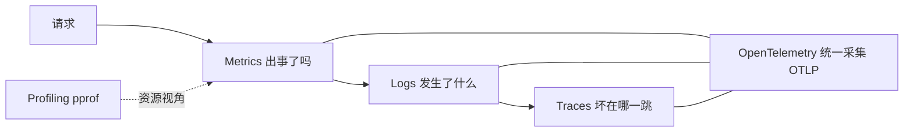

# 第 13 章 · metrics/observability：给服务装仪表盘

> 这章学完你能干什么：上线后回答"现在健康吗"。一条 `curl` 拿到全量指标，并看得懂其中的 RED 记分牌、路由模板和 label 基数。
> 读者：做完 P8（httpkv），想知道服务在线上过得好不好。前置：P8。后续：P15 从 13.8 的路线图起步，P17 把同一套方法搬进 DNS 代理。
>
> 动手方式：开一个空目录，`go mod init demo`，`go get github.com/prometheus/client_golang`，每个例子存成 `main.go`，用 `go run main.go` 运行。片段省略了 `package main` 和 `import`。端口用 19113 起，避开别的服务。

## 13.0 体系背景：指标是内存里的几个数

先把"指标"祛魅。Counter、Gauge、Histogram 在进程里就是几个原子数。看一个例子：

```go
c := prometheus.NewCounter(prometheus.CounterOpts{Name: "c_total"})
g := prometheus.NewGauge(prometheus.GaugeOpts{Name: "g"})
h := prometheus.NewHistogram(prometheus.HistogramOpts{Name: "h", Buckets: []float64{0.01, 0.1}})
c.Inc()
c.Add(2)
g.Set(7)
g.Dec()
h.Observe(0.005)
h.Observe(0.05)
h.Observe(0.5)
```

```sh
$ go run main.go
counter  : 3
gauge    : 6
hist count/sum: 3 0.555
  le=0.01 cumulative=1
  le=0.1 cumulative=2
```

Counter 只增，Gauge 可增可减，Histogram 是一排累计桶加总数和总和。就这些。

问题是怎么让外面看到它们。Prometheus 的答案是拉取：你的服务在 HTTP 上暴露一个文本页面，服务器定期来抓。这个页面一般叫 `/metrics`：

```go
hits = promauto.NewCounter(prometheus.CounterOpts{Name: "demo_hits_total", Help: "Total hits."})
// ... 另有一个 Gauge 和一个 Histogram
mux.Handle("GET /metrics", promhttp.Handler())
```

```sh
$ curl -s localhost:19113/metrics | grep demo_
# HELP demo_hits_total Total hits.
# TYPE demo_hits_total counter
demo_hits_total 0
# HELP demo_in_flight Requests being handled.
# TYPE demo_in_flight gauge
demo_in_flight 0
# HELP demo_latency_seconds Handler latency.
# TYPE demo_latency_seconds histogram
demo_latency_seconds_bucket{le="0.01"} 0
demo_latency_seconds_bucket{le="0.05"} 0
demo_latency_seconds_bucket{le="0.1"} 0
demo_latency_seconds_bucket{le="+Inf"} 0
demo_latency_seconds_sum 0
demo_latency_seconds_count 0
```

这是一份纯文本，每个指标一行，`# TYPE` 说明类型。再请求 `/hit` 三次，同一页面变成：

```sh
$ for i in 1 2 3; do curl -s localhost:19113/hit; done
$ curl -s localhost:19113/metrics | grep '^demo_'
demo_hits_total 3
demo_in_flight 0
demo_latency_seconds_bucket{le="0.01"} 0
demo_latency_seconds_bucket{le="0.05"} 3
demo_latency_seconds_bucket{le="0.1"} 3
demo_latency_seconds_bucket{le="+Inf"} 3
demo_latency_seconds_sum 0.061377958999999996
demo_latency_seconds_count 3
```

每次抓取拿到的是"此刻的快照"。服务器把一次次快照连起来，就成了时间序列。

Java 读者对此应该眼熟：Micrometer 加 Spring Boot Actuator 暴露的 `/actuator/prometheus` 就是同一份文本。Node 里 `prom-client` 的 `register.metrics()` 也一样。Go 的好处是 `/metrics` 只要一行 `promhttp.Handler()`。

## 13.1 RED：先摆哪几个指标

场景：下午三点，用户群说"服务有点慢"。手里没有指标时，你只能登机器看进程、翻日志数行数，每查一次都是体力活。

"现在健康吗"可以拆成三个小问题：多少流量、多少错误、多慢。业界有现成的答案，叫 RED（Tom Wilkie, Weaveworks, 2015）。

| RED | 含义 | httpkv 对应 |
|---|---|---|
| Rate | 每秒请求数 | `httpkv_requests_total` 求 `rate()` |
| Errors | 错误率 | 同一条序列里 `status` 为 5xx 的占比 |
| Duration | 耗时分布 | `httpkv_request_duration_seconds` |

RED 的本意是"每个服务都长同一张记分牌"，这样 on-call 值任何服务的班都不用重学仪表盘。

先看 httpkv 的真实输出。起服务，PUT 一次，再 GET 一个不存在的 key：

```sh
$ go run ./exercises/p8fast/httpkv
$ curl -s -X PUT localhost:8090/kv/foo -d '{"value":"1"}'
$ curl -s -o /dev/null localhost:8090/kv/ghost
$ curl -s localhost:8090/metrics | grep ^httpkv_ | grep -v _bucket
httpkv_in_flight_requests 0
httpkv_keys 1
httpkv_request_duration_seconds_sum{method="GET",path="GET /kv/{key}"} 0.000258542
httpkv_request_duration_seconds_count{method="GET",path="GET /kv/{key}"} 1
httpkv_request_duration_seconds_sum{method="PUT",path="PUT /kv/{key}"} 0.000231708
httpkv_request_duration_seconds_count{method="PUT",path="PUT /kv/{key}"} 1
httpkv_requests_total{method="GET",path="GET /kv/{key}",status="404"} 1
httpkv_requests_total{method="PUT",path="PUT /kv/{key}",status="201"} 1
```

这里用 `grep -v _bucket` 滤掉了桶明细。序列正好是 RED：请求数带 `status` 是 R 和 E，耗时直方图是 D。

`httpkv_in_flight_requests` 是饱和度的代理，顶满说明处理能力到头了。P8 写 httpkv 时没人提 RED，手上这套就是它，只是之前没人点破。

资源视角另有 USE（Brendan Gregg）：查 CPU、内存、磁盘时用利用率、饱和度、错误三件套。服务用 RED，资源用 USE，两边互补。RED 只对请求驱动型服务成立，批处理任务要另摆一套。

## 13.2 指标类型与命名

client_golang 有四种指标类型，本章只用前三种：

- Counter：只增不减，例如 `httpkv_requests_total`。
- Gauge：可增可减，例如 `httpkv_in_flight_requests`、`httpkv_keys`。
- Histogram：观测值落桶，例如 `httpkv_request_duration_seconds`。
- Summary：直接算分位数，本章不用。

Summary 和 Histogram 的取舍一句话说清：单机上 Summary 的 p99 算得准，但三个副本的 p99 加不出全局 p99。Histogram 存桶，`histogram_quantile()` 在服务端聚合桶再算分位数，所以生产基本用 Histogram。

定义即注册。`promauto` 挂默认 registry，重复注册会 panic，错误不会被悄悄吞掉：

```go
RequestsTotal = promauto.NewCounterVec(prometheus.CounterOpts{
	Name: "httpkv_requests_total",
	Help: "Total HTTP requests by method, path template and status code.",
}, []string{"method", "path", "status"})
```

命名有三条约定（[OneUptime 实践文](https://oneuptime.com/blog/post/2026-01-30-go-prometheus-client/view)）：

- 带单位后缀，例如 `_seconds`、`_bytes`。
- Counter 带 `_total`。
- `Help` 必填。

名字是 API。改指标名等于废弃所有历史面板。

`*Vec` 是带维度的指标族，`WithLabelValues(...)` 取出（或隐式创建）一条具体的时间序列。Vec 本身不记数，子序列才记。

## 13.3 Instrument：一个中间件管三件事

RED 要的数据，都能在一个中间件里收齐。`Instrument` 做三件事：在飞请求数加一减一（Gauge）、截状态码（Counter 的维度）、计时进 Histogram：

```go
func Instrument(pattern string, next http.Handler) http.Handler {
	return http.HandlerFunc(func(w http.ResponseWriter, r *http.Request) {
		InFlight.Inc()
		defer InFlight.Dec()

		start := time.Now()
		sw := &statusWriter{ResponseWriter: w, status: http.StatusOK}
		next.ServeHTTP(sw, r)

		RequestsTotal.WithLabelValues(r.Method, pattern, strconv.Itoa(sw.status)).Inc()
		Duration.WithLabelValues(r.Method, pattern).Observe(time.Since(start).Seconds())
	})
}
```

注意 `pattern` 是参数，不是从请求里读的。为什么，下一节说。

`statusWriter` 是 Go 的惯用技巧：嵌入 `http.ResponseWriter`，转发没覆盖的方法，只覆写 `WriteHeader` 记下状态码。handler 不显式调用 `WriteHeader` 时默认 200，所以结构体初始化为 200。练习里的 `TestMetricsGuarded` 守着这条行为。

中间件没有魔法，就是函数包装。Java 里是 `Filter`，Express 里是 `app.use((req, res, next) => ...)`，Rust 的 tower-http 里是 `TraceLayer`。

## 13.4 r.Pattern：中间件读不到路由模板

`path` 这个 label 填什么？填原始 URL（`/kv/user123`）会埋下基数地雷（13.7 展开）。填路由模板（`PUT /kv/{key}`）才是有限集合。

问题来了：中间件包在所有路由外面，它怎么知道请求匹配了哪个模板？Go 1.22 起，`ServeMux` 匹配后会把模板写进 `r.Pattern`。踩坑的版本是在 mux 外层、转发给 mux 之前读它：

```go
path := r.Pattern          // 先读，再交给 mux
if path == "" {
	path = "UNMATCHED"
}
next.ServeHTTP(s, r)
```

```sh
$ for i in 1 2 3; do curl -s -X PUT localhost:19116/kv/k$i -o /dev/null; done
$ curl -s localhost:19116/metrics | grep ^demo_requests
demo_requests_total{method="PUT",path="UNMATCHED",status="201"} 3
```

所有请求都记成了 `UNMATCHED`。这是第一版 httpkv 冒烟时撞上的现象，`metrics.go` 的注释里也记了一笔。

最小复现更直观：同一个 handler，外层读一次，里层读一次。

```go
mux.HandleFunc("GET /kv/{key}", func(w http.ResponseWriter, r *http.Request) {
	fmt.Fprintln(w, "inner  r.Pattern =", r.Pattern)
})
outer := http.HandlerFunc(func(w http.ResponseWriter, r *http.Request) {
	fmt.Fprintf(w, "outer  r.Pattern = %q\n", r.Pattern)
	mux.ServeHTTP(w, r)
})
```

```sh
$ curl -s localhost:19114/kv/user123
outer  r.Pattern = ""
inner  r.Pattern = GET /kv/{key}
```

原理：`r.Pattern` 是 `ServeMux` 匹配之后写进请求的。在转发给 mux 之前，外层看到的是匹配前的请求，所以是空的。

有一个细节值得讲清楚。把读取挪到 `next.ServeHTTP` 之后，本机（Go 1.26.4）上反而能读到：

```sh
$ curl -s localhost:19115/metrics | grep ^demo_requests
demo_requests_total{method="PUT",path="PUT /kv/{key}",status="201"} 3
```

mux 把模板写在同一个请求对象上，外层转发返回后再读，就看得到。但这依赖"请求对象没被换掉"，写起来很脆。所以 httpkv 的做法是不读 `r.Pattern`，把模板作为参数显式传进去，逐路由包在 mux 内层：

```go
mux.Handle("GET /kv/{key}", Instrument("GET /kv/{key}", getHandler))
srv := &http.Server{Handler: mux}   // 外层不再包
```

修好后冒烟的输出就是 13.1 里那份：`path="PUT /kv/{key}"`，`status="201"` 和 `status="404"` 都落在模板维度上。

## 13.5 中间件能看见什么，由位置决定

这条坑的推广比坑本身更值得记住：中间件能拿到的上下文，由它在洋葱里的位置决定。包在路由器外层，转发前只能看到原始信息（方法、URL、header）。要看路由模板这类"匹配之后"的信息，必须在路由器内层。

同一规律在别的栈里一样成立。Express 的应用级中间件里，`req.route` 要等路由匹配之后才有值。Spring MVC 的 Micrometer 指标记录的是 URI 模板（`/kv/{key}`），也是在匹配之后才拿到。gRPC 的 interceptor、tower 的 `map_request` 层同理。

迁移时别问"这个框架的中间件能不能拿到 X"，先问"它在洋葱的哪一层"。

逐路由包装还有一个小边界：未注册的路径不经过任何 `Instrument`。

```sh
$ curl -s -o /dev/null -w '%{http_code}\n' localhost:8090/nope
404
$ curl -s localhost:8090/metrics | grep ^httpkv_requests_total
httpkv_requests_total{method="GET",path="GET /kv/{key}",status="404"} 1
httpkv_requests_total{method="PUT",path="PUT /kv/{key}",status="201"} 1
```

`/nope` 返回了 404，`requests_total` 里却没有这条请求。全站级的 404 监控要在外层再包一层只记总数的 Counter，两层各干各的。

## 13.6 白送的 runtime 指标

`promhttp.Handler()` 用默认 registry，Go runtime 的指标随之白送：

```sh
$ curl -s localhost:8090/metrics | grep -E '^(go_goroutines|process_cpu_seconds_total)'
go_goroutines 11
process_cpu_seconds_total 0.015339
```

上一轮实测是 `go_goroutines 10`、`process_cpu_seconds_total 0.023`。goroutine 数随启动时机浮动，CPU 秒数随进程增长，指标名和出现的行为才是稳定的。

同一份输出里还有 `go_gc_duration_seconds`、`go_memstats_alloc_bytes` 等。Rust 侧这些要 `metrics-process` 之类的 crate 手动挂，Go 的 runtime 自己就是被观测对象。

Prometheus 是拉取模型，有两个推论。第一，指标是当前状态的快照，Counter 重启会归零，`rate()` 能处理。第二，短生命周期的任务（cron job）抓不到，要走 pushgateway 或 OTel。细节在章末参考。

## 13.7 label 基数

13.4 修完后，label 是路由模板。"基数有限"这四个字为什么生死攸关？看同一指标的两种 label 填法：

```go
byTemplate.WithLabelValues("GET /kv/{key}").Inc()
byRaw.WithLabelValues(fmt.Sprintf("/kv/user%d", i)).Inc()   // i 取 0 到 999
```

```sh
$ go run main.go
模板作 label: 1 条序列
原始 URL 作 label: 1000 条序列
暴露文本大小: 35043 字节
```

基数就是一个指标的时间序列总数。每个新 label 值都创建一条新序列，永不回收。1000 个不同的 key 就是 1000 条，换成真实流量，Prometheus 的内存涨、查询变慢、抓取超时。最常见的生产事故形态，就是有人把 user id 或原始 URL 塞进了 label。

三条纪律：

1. label 值必须来自有限集合，例如路由模板、状态码、方法。
2. user id、原始 path、trace id 一律不进 label，要查细节去日志或 trace。trace id 进指标有专门机制，叫 Exemplar（13.8）。
3. 不确定的先算"一天最多多少种取值"，超过几百就得收。

这条在 Micrometer、`prom-client` 里完全一样，label 就是序列维度，同样会炸。P15 会把这条纪律用到 `req_id` 上：每请求一个 id，只能进日志，不进指标。

## 13.8 路线图：从 metrics 往 logs 和 traces 走

本章只做了 metrics 这根柱。可观测性有三根柱，各答一个问题：

| 信号 | 回答的问题 | Go 侧 | Rust 侧 |
|---|---|---|---|
| Metrics | 出事了吗（数值趋势） | Prometheus client（本章） | `metrics` crate |
| Logs | 发生了什么（离散事件） | `log/slog`（1.21 起标准库） | `tracing` 事件 |
| Traces | 慢在哪一跳（请求跨服务的旅程） | OpenTelemetry-go | `tracing` 加 OTel |

Elastic 还提出第四根柱 profiling，答"资源花在哪"。Go 的 `net/http/pprof` 就是这个，P8 已经把它挂在 `:6060`。

往上走的标准路径有四步，每步都有 Go 的标准件：

1. **结构化日志**：`log/slog` 的 JSON handler，每条日志带 `request_id`，日志和指标就对上了号（[Dash0 slog 指南](https://www.dash0.com/guides/logging-in-go-with-slog)）。P15 和 P16 已落地：`req_id` 由中间件生成进 ctx，自定义 handler 自动注入。
2. **trace 关联**：OpenTelemetry-go 把 `trace_id` 注入 slog 的 context（`slog.InfoContext(ctx, ...)`），中间件里起 span（[关联实操文](https://openobserve.ai/blog/logs-traces-metrics-correlation)）。
3. **Exemplar**：Histogram 的桶上挂 `trace_id`，"p99 那 1% 的请求长这样"，点面板直接跳 trace。这是 metrics 和 traces 的官方接口，也是 13.7 第二条纪律的出口。
4. **OTel Collector**：生产环境的统一采集层，拉 Prometheus 端点、收 OTLP，路由到任意后端。

13.4、13.7 和 13.8 这三个小节号被别处引用，P15、P16、P17 和 dnsproxi-go 的注释都写着"P13 的 13.7"或"13.8"，所以本章改版保号不动。

## 小结

1. 三根柱各答一个问题：metrics 出事了吗，logs 发生了什么，traces 坏在哪一跳。pprof 是第四根柱。服务用 RED 摆记分牌，资源用 USE。
2. 指标在进程里就是几个原子数，`/metrics` 是它们的文本快照，Prometheus 定期来抓。
3. 四种类型只用三种：Summary 的分位数不可跨实例聚合，生产用 Histogram。命名是 API，改名等于废弃历史面板。
4. 中间件能看见什么，由洋葱位置决定。`r.Pattern` 在转发给 mux 之前是空的，要模板就逐路由包，把 pattern 显式传参。
5. label 值必须来自有限集合。user id、原始 path、trace id 不进 label，细节去日志或 trace。
6. 路线图是 slog 结构化日志（P15、P16 已落地），再到 OTel trace 关联、Exemplar、Collector。当下务实解是指标用 Prometheus 原生，traces 走 OTel。

## 练习：验收与冒烟

本章没有独立的练习包，练习骨架是 `exercises/p8fast/httpkv` 里的 `metrics.go` 和 `main.go`。先跑单测：

```sh
$ go test -race ./exercises/p8fast/...
ok  	golearn/exercises/p8fast	1.249s
ok  	golearn/exercises/p8fast/httpkv	1.304s
```

**预测**，跑之前写答案：

1. 13.1 的输出里，哪条是 R，哪条是 E，哪条是 D？
2. 把 `Instrument` 改成包在 mux 外层、转发前读 `r.Pattern`，指标会变成什么样？
3. `curl localhost:8090/nope` 之后，`httpkv_requests_total` 会多出一条 404 序列吗？

**观察**：

```sh
curl -s -o /dev/null localhost:8090/nope      # 未注册路径
curl -s localhost:8090/metrics | grep ^httpkv_requests_total
```

预期是 404 有响应，但 `requests_total` 不增，这是逐路由包装的可见边界。

另外几个动手点：

- 冒烟看四类输出：`requests_total`、`in_flight`、`keys`、`duration_count`。
- 用 RED 审计 httpkv：说出 R、E、D 各对应哪条序列，缺饱和度吗。
- 算 p99：`histogram_quantile(0.99, sum(rate(httpkv_request_duration_seconds_bucket[5m])) by (le))`。本机没有 Prometheus 服务器，这条查询没有实跑，只核对了函数用法。
- 加业务指标：`httpkv_puts_total`（Counter），在 put 处理里加一。

**改造**：给 dnsproxi-go 加同款 `Instrument`，RED 照搬，`qtype` 和 `rcode` 做 label。这是毕业项目生产化的一步，P17 是它的完成形态。

## 章末参考

### Rust 对照

| Rust | Go | 差异 |
|---|---|---|
| `metrics` + `metrics-exporter-prometheus` | `client_golang` + `promhttp` | 概念一一对应，Go 的默认值更高 |
| `counter!` / `gauge!` / `histogram!` | `promauto.NewCounter` 等 | Go 定义即注册，重复注册 panic |
| `metrics-process` 手动挂 | runtime 指标默认白送 | 见 13.6 |
| tower-http `TraceLayer` | `Instrument` 中间件 | 都是函数包装，中间件没有魔法 |
| `tracing` 的 span 与 layer | slog 加 OTel | Go 胜在标准库自带，Rust 胜在表达力 |

### Java/Kotlin 与 TS/JS 类比

| 概念 | Java / Kotlin | TS / JS |
|---|---|---|
| 指标库 | Micrometer | `prom-client` |
| 暴露端点 | Actuator 的 `/actuator/prometheus` | `register.metrics()` |
| 请求中间件 | `Filter` | Express `app.use` |
| 路由模板 | Spring MVC 的 URI 模板 tag | `req.route.path`，匹配后才有 |
| 基数事故 | 同样会炸 | 同样会炸 |

### 监控 vs 可观测

两个词的分界（IBM、Elastic、Cribl 的说法一致）：

- **Monitoring**（监控）：预定义的问题发生了就报警，例如"CPU 超 80%"。
- **Observability**（可观测）：能回答没预设过的新问题，例如"为什么只有用 IPv6 的用户慢"。

这章装的是 monitoring 的标准件。但 RED 记分牌摆好后，一部分新问题（"为什么只有 PUT 慢"）也能靠直方图桶和 label 组合回答。完全的可观测性要三柱合流，见 13.8。

### 方法论溯源

| 方法 | 作者 | 对象 | 内容 |
|---|---|---|---|
| RED | Tom Wilkie（Weaveworks, 2015） | 每个请求驱动型服务 | Rate、Errors、Duration |
| USE | Brendan Gregg | 每个资源（CPU、内存、磁盘） | Utilization、Saturation、Errors |
| Four Golden Signals | Google SRE | 服务（RED 的上游） | 流量、错误、延迟、饱和度 |

脉络是 Google 的 Four Golden Signals 在前，Wilkie 面向微服务简化出 RED。Gregg 的 USE 更早，面向基础设施。两者互补（ClickHouse 工程博客的总结）：只有 USE，你找到忙的 CPU 却说不出用户疼不疼。只有 RED，告警了却查不到原因。所以服务用 RED，资源用 USE，两边都摆。

### pull 模型的盲区与 2025 年的争论

pull 模型的两个推论在 13.6 已列。短生命周期任务抓不到是它著名的盲区，选型时要知道。

2025 年 Prometheus 核心维护者 Julius Volz 认为，指标应该继续用原生客户端（[PromLabs 文](https://promlabs.com/blog/2025/07/17/why-i-recommend-native-prometheus-instrumentation-over-opentelemetry)）。OTel 的指标模型转成 Prometheus 格式会丢特性，对齐标签还要额外处理。但 OTel 是 trace 和 log 的事实标准（13.8）。

务实的结论：指标走原生，traces 走 OTel，别被"all in OTel"的宣传带跑。

### 三支柱与采集链路


