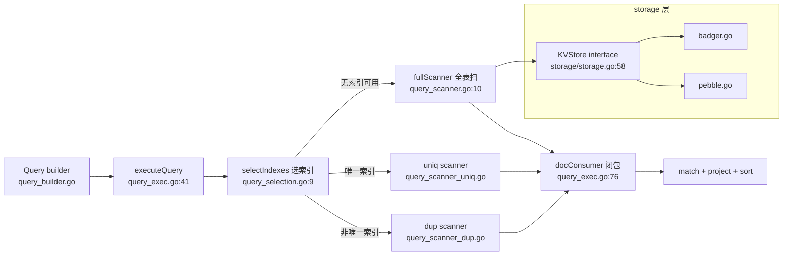

# P4 · 项目精读 A：ejdb，读别人的 Go 存储引擎从哪下手？

> 载体：`/Users/akka/oss/github.com/clarkqaq/ejdb`，~3200 行。
> 它是 C 版 EJDB2 的 Go 移植：C 参考源码登记在项目的 `c-code/` 目录
> （AGENTS.md 和 .gitignore 里都登记了，本机 clone 没带下来），Go 代码
> 注释里到处是 `Ported from jbi_*.c`，正好练"从 Rust 视角读 Go 存储
> 引擎代码"。读者：读过 P2（接口与错误）、P3（锁与原子操作），写过
> 自己的 Rust KV（D4/D5 的 LRU 淘汰序是手工模拟的，没有现成有序容器）。读法沿用你的
> _rust_learning 五步法：理论→定位真实代码→推导→动手→验证。
> 后续：P5 用同一套方法读服务型项目。

## 这章学完你能干什么

拿到一个没读过的 Go 存储引擎仓库，你能在半小时内画出它的查询执行
路径、说出接口抽象省了什么丢了什么、并预言键编码的排序行为（包括
负数会怎么被排错）。练习在 `exercises/p4ejdb/`（4 个测试，`go test`
全绿），终点证据是 `TestKeyEncoding` 的字节序断言，以及你不翻源码
回答"为什么 BigEndian 而不是 LittleEndian"。四个问题依次是：

1. 读别人的 Go 存储引擎，从哪下手？
2. interface 在真实代码里怎么用，抽象的代价在哪？
3. 键编码/序列化为什么是手工工程？
4. 一条查询怎么流过三段流水线？

## 问题 1：读别人的 Go 存储引擎，从哪下手？

先画图再读码。ejdb 的查询执行路径一张图：



然后看包布局，五个包各管一层：

```
ejdb/          package ejdb      : DB/Collection/Index/Query
storage/       package storage   : KVStore 接口 + badger/pebble 双实现
jsondoc/       package jsondoc   : path 解析 + 索引键序列化
types/         package types     : 共享枚举（IndexMode/Op）
examples/                        : 三个 main 包（Go 的 examples 惯例）
```

对照 deepsearch（P5 读）：`internal/` 强制私有 + `pkg/` 对外。
ejdb 全是顶级包，因为它是**库**：库不定义 internal 也能用包名小写保护。

## 问题 2：interface 在真实代码里怎么用，抽象的代价在哪？

`storage/storage.go:58` 的 `KVStore`：10 个方法，badger/pebble 各实现
一份（加上 `Cursor`、`Txn` 两个小接口，storage 层三个接口撑起全部抽象）。
**接口定义在使用方视角**（P2 讲过）：接口按"ejdb 需要什么"切，
不按"badger 能给什么"切，所以才能无痛换 pebble。

注意两个 Go 细节：

1. `Txn` 事务接口用 **回调**，不是返回句柄：
   `View(fn func(txn Txn) error) error`（storage.go:72）。
   Rust 心智：这是借用作用域的语言化，txn 活不过回调，编译器强制。
   Java 心智：template method。
2. `Val{Data []byte, Compound int64}`（storage.go:30）：复合键把 docID
   拼进 Val 而不是新分配一个 slice，**省一次拷贝**，你 Rust 学的
   "避免无谓 allocation" 在 Go 里长这样。

代价在 `Collection.Put` 现场可见（collection.go:39-74）：

```go
c.mu.Lock(); defer c.mu.Unlock()          // 集合级写锁
id = atomic.AddInt64(&c.idSeq, 1)          // ID 分配
store.Put(doc)                             // 先写主文档
removeIndexRecords(old)                    // 删旧索引
if err := addIndexRecords(new); err != nil {
    store.Del(doc)                         // ⚠️ 手工回滚
}
```

读点：

- **没有跨 DBID 事务**：文档和索引是两个 KV namespace，坏了就手工
  回滚（collection.go:66）。badger 单库其实支持事务，但 KVStore 接口
  把 Update 收窄成回调，ejdb 选择了不用。**接口抽象是有代价的**，
  这是又一个"抽象省了什么、丢了什么"的活教材。
- 读旧文档在写锁内（getRaw → RLock 级别操作），**锁策略**：
  写全程 Lock，读 RLock（db.go 的 colls map 另有 RWMutex）。
  对照你 L3 的决策树：这是"复合临界区→Mutex"档。
- `atomic.AddInt64(&c.idSeq, 1)`：**ID 分配不进锁**：单计数用原子，
  跟你 L3 决策树完全一致（P3 练习 TestCounters 同款）。

## 问题 3：键编码/序列化为什么是手工工程？

KV 存储按字节序比较 key，所以"整数怎么变成字节"决定一切。主键编码
（db.go:279）：

```go
func docIDToKey(id int64) []byte {
    buf := make([]byte, 8)
    binary.BigEndian.PutUint64(buf, uint64(id))
    return buf
}
```

大端序 = 整数序 = 字节序，cursor 顺序遍历直接得到 docID 升序。
**注意坑**：这里没有翻转符号位，负数 ID 会排在所有正数后面
（补码最高位为 1）：ejdb 的 ID 从 1 自增所以没事，但这个假设
**没有写在类型里**，读代码要自己发现。[INFERENCE：C 原版 EJDB2 的文档
主键走 iowow 的 VNUM64 变长数字键（ejdb2.c:165 IWDB_VNUM64_KEYS，天然
有序），Go 移植改成定长 8 字节大端直排，负数坑由此引入；Go 版的 I64
索引用符号位翻转补回（见下）]

索引键序列化（jsondoc/value.go 的 SerializeKey）把有序性做成手工工程：

| 类型 | 编码 | 为什么 |
|---|---|---|
| I64 | big-endian + **符号位翻转** | 让 -1 排在 0 前面：`uint64(v) ^ (1 << 63)`（value.go:93） |
| F64 | `strconv.FormatFloat(f,'g',-1,64)` 字符串 | 同位数时字典序≈数值序，省 8 字节；**跨量级会漏**（实测 Gt(90) 走索引只回 99.5 和 9.9e5，漏掉 100、123.4、1e6："1e+06" 按字典序排在 "99.5" 前面）。作者注释自称 lexicographic ordering，这是移植引入的真实缺陷 |
| Str | 原始字节 | 天然有序 |

**对照你的 Rust 学习线**：和 dnsproxi D3/D4 用 HashMap+稠密 slots 手工
近似 LRU 淘汰序是同一问题域：语言没有现成有序结构（Rust 有 BTreeMap
但你的 KV 载体没有），就到处手工算。ejdb 的答案是"把类型烧进编码"。

## 问题 4：一条查询怎么流过三段流水线？

```
executeQuery = selectIndexes(选索引) → scanner(取候选) → consumer(过滤/投影/排序)
```

**selectIndexes 的启发式**（query_selection.go:9-112，从 jbi_selection.c 移植）：

- RE（正则）条件不进索引（:49）
- IN 数组 > 500 直接放弃（:58）；10~500 之间看 `集合大小 / 数组长度`
  比率（:61-64），**索引 vs 全表扫的成本模型**就藏在这几个魔数里，
  作者自己注释 "empiric heuristic from EJDB2"
- 候选按成本排序：EQ > IN > GT > Prefix > LT 的操作符权重（精确数字
  在章末参考）
- 没有谓词候选时，退而求其次用 ORDER BY 字段的索引（:74-93），
  且 `ctx.sorting = false`：**索引天然有序，排序被 elide**

**consumer 是闭包不是接口**（docConsumer 类型在 query_exec.go:38，
plainConsumer 在 :76）：

```go
type docConsumer func(id int64, doc []byte) bool   // 返回 false = 停止
```

plainConsumer 内部：limit 短路（:91）→ count-only 快路径（:96）→
JSON 只 parse 一次给 match 和 projection 共用（:102-106）→
skip/limit 状态存在闭包变量里（:79-80）。
**Rust 对照**：这就是 `Iterator::take_while().skip().take()` 手写展开版；
Go 闭包+可变捕获 ≈ 你 Rust 里 `&mut` 捕获，但**没有借用检查**，
并发用要自己想（这里单线程执行没问题）。

**scanner 按索引命中方式分三套**：

- `query_scanner_uniq.go`：EQ 直接 `Get`（O(1) 点查）
- `query_scanner_dup.go`：非唯一索引键 = 值编码 + docID 后缀，
  扫描从 `CursorGE(值)` 开始，**break on 前缀失配**：范围扫描 + 提前终止
- fullScanner 里 `lastID` 去重（query_scanner.go:30-33）：因为非唯一
  索引扫描同一文档会出现多次（多值字段），去重靠**线性探测前一个 ID**
  （键有序 → 同文档相邻）。[INFERENCE] 这个去重只防相邻重复，
  非唯一索引上同一 docID 确实相邻，成立

## 动手：练习 p4ejdb（30-45 分钟）

```sh
cd /Users/akka/Dev/learning/go
go test ./exercises/p4ejdb/...        # 先跑一遍看全绿长什么样
go test -run TestKeyEncoding -v ./exercises/p4ejdb/   # 单跑某题
```

**预测题**（先写答案再跑）：

1. `docIDToKey(-1)` 和 `docIDToKey(1)`，哪个的字节大？ejdb 主键为什么
   没踩这个坑，I64 索引却躲不开？（§问题 3）
2. `takeFirstN(3, &sink)` 返回的 consumer 收到第 4 个文档时返回什么？
   scanner 拿到这个返回值会做什么？（§问题 4）
3. 把 `View` 回调里拿到的 `txn` 存进包级变量，回调结束后再用它 `Get`：
   能编译吗？安全吗？（§问题 2）

**观察验证**：

```sh
go test -run 'TestKeyEncodingNegative|TestI64IndexOrder' -v ./exercises/p4ejdb/
# TestKeyEncodingNegative 的注释给出结论：-1 的 key 排在 1 后面
cd /Users/akka/oss/github.com/clarkqaq/ejdb && go test -bench . -benchmem .
# 作者的基准：BenchmarkPut/Get/PutUpdate/Delete
```

配套练习地图（预测/改造时对照）：

| 练习 | 考什么 | 在哪 |
|---|---|---|
| TestKeyEncoding | 大端序让整数序 == 字节序（正数域） | p4ejdb |
| TestKeyEncodingNegative | 无符号字节序把 -1 排到 1 后面 | p4ejdb |
| TestI64IndexOrder | 符号位翻转救回负数顺序 | p4ejdb |
| TestConsumeClosure | consumer 返回 false = 停止扫描 | p4ejdb |

**改造题**：

1. 读 ejdb 仓库的 `bench_test.go`，找到作者的基准套路（同机基准方法论
   迁移：Go 版数字和你 Rust dnsproxi 的压测数字同台记录）。
2. 给 `exercises/p4ejdb/` 加 `skipFirstN(k, n, sink)`：先跳过 k 个再收
   n 个，复刻 plainConsumer 的 skip/limit 闭包状态（query_exec.go:79-80）。
   验收：新增测试 + `go test ./exercises/p4ejdb/` 全绿。

**检验你真读懂了**：不翻源码，回答"ejdb 为什么用 BigEndian 而不是
LittleEndian？"答不出就回去重读问题 3。

## Take-away

1. 库的 interface 按**使用方需求**切；回调式 Txn 是作用域的语言化。
2. 键编码决定一切：BigEndian 让整数序=字节序，符号位翻转让负数有序。
3. 查询引擎 = 选索引 + 扫描器 + 闭包流水线；排序 elide 靠索引天然有序。
4. 事务被接口收窄丢弃 → 手工回滚。抽象的代价在这里肉眼可见。

---

## 章末参考

### KVStore 接口全貌（storage/storage.go:58）

10 个方法：OpenDB / CloseDB / Put / Get / Del / NewCursor / View / Update /
Close / Sync。多库靠 DBID namespace：每个集合/索引分一个 uint32 DBID，
key 前缀 4 字节大端 DBID，用 badger 的前缀迭代模拟多个库
（DBID 1 = 元数据，见项目 AGENTS.md）。

### 选索引的精确权重与魔数（query_selection.go）

| 规则 | 值 | 位置 |
|---|---|---|
| IN 数组直接放弃 | > 500（maxINOpArraySize） | :58 |
| IN 看比率 | 10~500 之间：集合大小 < 数组长度×200（maxINOpArrayRatio）→ 放弃 | :61-64 |
| 操作符权重 | EQ 10 / IN 9 / 支持 ORDER BY 8 / GT,GTE 7 / Prefix 6 / LT,LTE 5 | operatorWeight |
| 平局裁决 | 有范围端（expr2）> 索引 Count 小 > path 短 | compareCandidates |

### 三种 scanner 的分派细节

- uniqScanner（query_scanner_uniq.go）：EQ 一次 `Get` 点查；IN 逐键
  点查；范围走 cursor 扫描。
- dupScanner（query_scanner_dup.go）：EQ/IN/范围三分派；扫描从
  `CursorGE` 定位（:51、:105），`keyPrefixMatch` 前缀失配即停（:202）。
- fullScanner（query_scanner.go:10）：顺序 Next，`lastID` 去重防多值
  字段重复交付（:30-33）。
